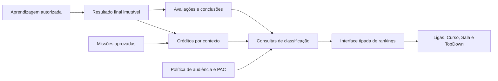

# Ligas, rankings e PAC: diagnóstico e proposta modular

**Status:** proposta para discussão; distingue implementação atual de mudanças sugeridas. Não é uma decisão aprovada.  
**Base inspecionada:** `sprint04`, commit `2c3d19dd6b92a44967c950d5bc03b5cb19f42e02`, em 29/10/2026.  
**Escopo desta entrega:** somente este documento; sem mudança de código, migração, instalação de dependência ou commit. A [proposta de missões](proposta-sistema-de-missoes.md) foi preservada.

## 1. Objetivo e recomendação

Consolidar o funcionamento de ligas, rankings e PAC nos contextos global, de curso e de sala. A funcionalidade completa precisa combinar regras compreensíveis, resultados consistentes, acesso autorizado e classificação que funcione para todos os participantes, inclusive quem está fora do primeiro lote da consulta.

**Recomendação:** manter inicialmente as ligas como faixas de progressão por XP, corrigir o cálculo e a exposição das métricas e criar um módulo compartilhado de classificação com autoridade no Postgres/Supabase. Separar três conceitos: pontuação acumulada por contexto, desempenho acadêmico por PAC e posição relativa entre participantes. Temporadas com promoção/rebaixamento devem ser uma evolução explícita, caso o produto queira competição periódica.

O módulo deve oferecer consultas específicas por contexto e uma interface uniforme de apresentação, sem obrigar todos os rankings a usar a mesma métrica. O PAC de cursos diferentes não deve ser agregado em uma classificação global de domínio acadêmico sem uma política de comparabilidade.

## 2. O que existe na versão atual

### 2.1 Mapa de persistência e consultas

| Estrutura | Uso atual | Limite |
| --- | --- | --- |
| `profiles.xp_global` e `level` | XP acumulado e nível global | Saldo atual, sem livro de lançamentos nem período competitivo |
| View `global_ranking` | Contas ativas ordenadas por XP decrescente e criação do perfil crescente | Não separa ligas no banco; não contém temporada |
| `friends_course_pac(course_id)` | PAC e divisão do usuário e dos amigos aceitos no curso informado | Não é ranking de todos os matriculados; inclui amigos sem tentativa, com PAC zero |
| `attempts` | Contadores de acertos, respostas avaliadas e XP por tentativa; referências a curso e sala | Resultados podem ser recalculados em nova chamada de finalização |
| `answers` | Resposta submetida, correção e XP por questão | Escritas precisam de proteção adicional contra manipulação e alterações após finalizar |
| `room_members` | `xp_internal`, `pac_internal` e `progress` por usuário/sala | Leitura de colegas expõe os três campos; visibilidade do PAC não é aplicada por coluna |
| `rooms.pac_visibility` | Opções `members`, `educator_only`, `public` | A aplicação não implementa integralmente essas três promessas de acesso |
| `enrollments.progress` | Percentual de aulas concluídas no curso | Não é PAC nem pontuação competitiva |
| `completions` | Uma conclusão por usuário/aula/contexto textual `course` ou `room` | Não identifica separadamente cada sala na chave |

Fontes: [perfis](../../codigo-base/supabase/migrations/0002_profiles.sql), [aprendizagem](../../codigo-base/supabase/migrations/0004_enrollments_attempts_answers_completions.sql), [salas](../../codigo-base/supabase/migrations/0005_rooms_members_announcements_missions.sql), [rankings SQL](../../codigo-base/supabase/migrations/0015_rankings.sql) e [repositórios do cliente](../../codigo-base/src/data/repositories.ts).

### 2.2 Ligas globais: faixas de nível

A rota implementada é `/ligas`, em [Hub.tsx](../../codigo-base/src/Hub.tsx). A página [Ligas.tsx](../../codigo-base/src/pages/Ligas.tsx) carrega até mil linhas do ranking global, agrupa no navegador pelo nível e monta Top 5, listagem e resumo pessoal.

| Liga visual | Nível | XP global de entrada |
| --- | --- | --- |
| Bronze | 1 | 0 |
| Prata | 2 | 100 |
| Ouro | 3 | 250 |
| Platina | 4 | 500 |
| Diamante | 5 | 1.000 |
| Mestre | 6 | 2.000 |
| Lendário | 7 ou mais | 4.000 |

O nível continua aumentando a cada 2.000 XP depois do nível 6, mas a liga visual fica em Lendário. As faixas de nível vêm de `level_for_xp`, na [migração 0010](../../codigo-base/supabase/migrations/0010_domain_functions.sql); nomes de liga e mapeamento para emblemas ficam no React. A página duplica os limiares de XP para calcular a barra rumo à próxima liga.

Não há tabela de ligas, turmas competitivas, histórico de mudança de liga, período semanal, fechamento, promoção relativa ou rebaixamento. Subir de liga significa atingir um novo limiar de XP, independentemente da posição dos outros usuários. O componente [RankingPodium](../../codigo-base/src/components/ranking/RankingPodium.tsx) fornece apresentação, não regras competitivas.

O ranking global considera toda conta com `account_status = 'active'`, sem exigir XP positivo nem filtrar papel estudante/educador. Na view, a posição usa `rank()` sobre XP e data de criação. Portanto, mesmo XP não implica necessariamente empate: a data faz parte do critério. A página de ligas ignora essa posição global e renumera o subconjunto de cada liga pelo índice do array.

### 2.3 PAC de curso e comparação entre amigos

A fórmula atual é:

```text
PAC = 100 × soma dos acertos / soma das respostas avaliadas
PAC = 0 quando não há respostas avaliadas
```

`friends_course_pac` soma `correct_count` e `total_count` de **todas as tentativas finalizadas** do curso, com `room_id IS NULL`, para o usuário autenticado e amizades aceitas. Ordena por PAC decrescente e nome de exibição crescente. Não exige matrícula, atividade no curso ou conta ativa de cada amigo no filtro final.

Exemplo: tentativas com 2/4 e 8/10 resultam em `10/14 = 71,43%`, e não na média simples dos percentuais, que seria 65%. O denominador atual é o total de respostas armazenadas e avaliadas nas tentativas, não o total de questões disponíveis no curso. Uma tentativa parcial finalizada também pode entrar nesse agregado.

O [TopDown](../../codigo-base/src/components/sidebar/top-down-dados.ts) consulta esse resultado para o curso ativo; [SidebarRight](../../codigo-base/src/components/sidebar/SidebarRight.tsx) apresenta percentual arredondado e posições por índice. Sem outro amigo retornado, esconde a lista e oferece adicionar amigos. A divisão calculada no SQL não é exibida nessa lista. Não há uma tela de classificação geral de todos os participantes de um curso.

### 2.4 PAC, progresso e ranking de sala

`recompute_room_metrics(room_id, user_id)` calcula:

- **PAC interno:** soma dos acertos / soma das respostas avaliadas nas tentativas finalizadas daquela sala.
- **Progresso interno:** aulas distintas com alguma tentativa finalizada na sala / total de aulas do curso associado; limitado a 100%. Isso não exige que a tentativa tenha respondido todas as questões da aula.
- **XP interno:** incrementado separadamente por `finalize_attempt`; o recálculo de métricas não reconstrói esse saldo.

Em [Salas.tsx](../../codigo-base/src/pages/Salas.tsx), membros ativos são classificados por **XP interno**, e os cinco primeiros aparecem no pódio. O PAC é um indicador complementar e define o emblema. Ter maior PAC não coloca automaticamente alguém em primeiro lugar se seu XP for menor.

A tela mostra PAC pessoal, progresso e pontuação, recarregando os dados após uma aula. Para esconder o PAC dos colegas em `educator_only`, remove o percentual textual, mas continua escolhendo o emblema pelo PAC. A leitura de membros também continua trazendo `pac_internal` do banco. `public` e `members` produzem o mesmo comportamento nessa tela; não há acesso geral à sala concedido apenas por selecionar `public`.

### 2.5 Divisões de PAC não são as ligas de XP

`division_for_pac` usa comparações numéricas na ordem abaixo:

| Divisão SQL | Intervalo efetivo no domínio válido de PAC |
| --- | --- |
| Bronze | Menor que 60 |
| Prata | De 60 até 74, inclusive |
| Gold | Maior que 74 até 84, inclusive |
| Platina | Maior que 84 até 94, inclusive |
| Diamante | Maior que 94 até 100 |

O retorno usa `Gold`, enquanto a liga global se chama Ouro. Não existem Mestre/Lendário como divisões de PAC. Os comentários resumem faixas inteiras, mas a função recebe decimais: 74,4 já é `Gold`. A sala arredonda antes de chamar `tierPorPac`, transformando 74,4 em 74 e exibindo Prata. Há uma divergência real entre classificação no SQL e no React para valores próximos dos limites.

### 2.6 XP e efeito das repetições

A [versão atual de `finalize_attempt`, 0018](../../codigo-base/supabase/migrations/0018_no_xp_for_already_correct.sql), corrige respostas no servidor. Na primeira finalização, curso acessível pode creditar XP global e atualizar nível; contexto de sala credita apenas o saldo interno da sala.

Questão já acertada em outra tentativa finalizada pelo mesmo usuário passa a valer zero XP. A busca desse acerto **não filtra curso nem sala**. Assim, acertar primeiro no curso pode impedir XP posterior na sala, e acertar primeiro em uma sala pode impedir XP no curso ou em outra sala. Os saldos são separados, mas a elegibilidade do crédito não é independente por contexto.

O bloqueio de novo XP não impede que a repetição altere o PAC: tentativas repetidas continuam somando acertos e respostas. Por exemplo, após 1/2, repetir a questão acertada nove vezes pode elevar o agregado para 10/11, sem demonstrar melhora na questão errada.

### 2.7 Verificações e limitações desta inspeção

As conclusões acima vêm da leitura do código, tipos, consultas, políticas e migrações numeradas. O [roteiro da sprint](../roteiro-demo-sprint04.md) confirma a separação entre XP global, PAC por curso e métricas da sala. Não foi consultado um banco remoto nem comprovada a aplicação das migrações em produção.

A busca em [tests](../../codigo-base/tests/) encontrou um E2E do TopDown que verifica o parâmetro de curso enviado a `friends_course_pac`; não encontrou cobertura específica de ligas, fórmulas, limites de divisão, privacidade ou concorrência. Nesta entrega documental não foram executados novos testes de aplicação. Há referências desatualizadas a `src/pages/Ranking.tsx` na documentação de arquitetura; no checkout inspecionado, a implementação acessível é `Ligas.tsx`.

## 3. Problemas prioritários a resolver

| Prioridade | Evidência e impacto | Direção proposta |
| --- | --- | --- |
| Alta | `profiles_update_own` restringe a linha, mas não XP/nível; o trigger protege `role`, não pontuação. Políticas de tentativas e respostas também permitem escritas amplas do proprietário | Conferir privilégios reais e restringir colunas/escritas; cálculos oficiais exclusivamente por funções autorizadas |
| Alta | `educator_only` esconde texto, mas devolve `pac_internal` e revela faixa pelo emblema | Redigir dados no servidor e neutralizar atributos derivados |
| Alta | Duas tentativas diferentes bloqueiam linhas diferentes; o teste de acerto prévio não tem unicidade própria | Garantir crédito único por usuário/questão/contexto com restrição transacional |
| Alta | Refinalizar regrava correção e XP da tentativa, embora não reaplique o saldo | Tornar o resultado final imutável; consultas históricas e saldos devem permanecer reconciliáveis |
| Alta | Repetições e tentativas parciais podem distorcer PAC; progresso da sala conta qualquer tentativa finalizada | Definir amostra avaliável e conclusão canônicas antes de classificar |
| Alta | Consulta limitada a mil globais antes de filtrar liga pode eliminar uma liga inteira e o próprio usuário | Filtrar e paginar no servidor; resumo pessoal independente do Top N |
| Média | Limiares e posições calculados em múltiplos lugares | Centralizar regras e devolver posição/faixa prontas |
| Média | Ausência de desempate estável em sala e entre nomes/PAC iguais | Critério explícito, identificador final estável e mesma política no pódio/lista |
| Média | Amigos sem atividade/inativos podem ocupar classificação de curso; não existe classificação geral do curso | Separar audiência, elegibilidade e estado “sem avaliação” |
| Média | `completions` não diferencia duas salas da mesma aula | Chave de contexto concreto e conclusão por sala |

Fontes de autorização: [políticas 0011](../../codigo-base/supabase/migrations/0011_rls_policies.sql), [triggers 0012](../../codigo-base/supabase/migrations/0012_triggers.sql) e [políticas revisadas 0020](../../codigo-base/supabase/migrations/0020_fix_room_members_rls_recursion.sql). Os riscos de escrita direta dependem também dos `GRANT`s reais; a inspeção não equivale a uma exploração no ambiente remoto.

Outro ponto de revisão: o teste de propriedade em `finalize_attempt` só rejeita usuário diferente quando `auth.uid()` não é nulo. A função precisa de rejeição explícita de sessão ausente e privilégios de execução mínimos. Conferir também vínculo questão/aula/curso/sala, participação ativa e imutabilidade dos parâmetros da tentativa: correção no servidor, isoladamente, não comprova legitimidade da origem.

## 4. Regras recomendadas por contexto

### 4.1 Separar progresso, qualidade e competição

| Medida | Pergunta que responde | Uso sugerido |
| --- | --- | --- |
| Progresso | Quantas aulas previstas foram concluídas? | Acompanhamento da trilha; aulas sem questões podem contar |
| PAC | Qual proporção de respostas da amostra definida está correta? | Indicador acadêmico com acertos, total e política visíveis |
| Cobertura | Quanto do conteúdo avaliável foi efetivamente avaliado? | Evitar equiparar 1/1 a 100/100 sem contexto |
| XP | Quanto crédito de aprendizagem/engajamento foi concedido? | Progressão e ranking, com origem e contexto controlados |
| Liga | Qual faixa de progressão ou categoria competitiva o usuário ocupa? | Rótulo associado a uma regra explícita |
| Posição | Como o usuário se compara à audiência elegível? | Resultado de ordenação, não um saldo editável |

Não apresentar PAC como progresso. Com 100% de acerto em uma única questão, o usuário pode ter cobertura mínima do curso. Não tirar a média simples do PAC de cursos ou salas com amostras e dificuldades diferentes.

### 4.2 Política inicial proposta para PAC

Recomendar um **PAC de avaliação inicial** para comparação e manter, separadamente, o histórico de prática. Usar a primeira tentativa completa válida por aula e contexto concreto, sobre uma versão identificada do conteúdo. Tentativas incompletas ficam como prática/abandono, sem entrar no PAC comparativo. Depois de publicada, a amostra e seu resultado ficam imutáveis.

O denominador é o conjunto de questões da versão daquela aula no início da avaliação. Finalizar uma avaliação exige resposta válida para todas; se o produto quiser permitir omissão, ela deve valer erro, e não desaparecer do denominador. Escolher entre essas políticas antes da implementação.

```text
PAC comparativo = 100 × acertos das avaliações iniciais válidas
                       / questões dessas avaliações
Cobertura = questões distintas avaliadas / questões elegíveis da versão do contexto
```

Esse PAC mede desempenho inicial, não domínio atual. Se o produto quiser mostrar melhora, oferecer um indicador separado de revisão/última avaliação, com regra própria. Misturar primeira, melhor e última tentativa sob o mesmo rótulo prejudica a interpretação. A melhor tentativa tende a favorecer repetição; a última permite oscilações. A escolha de primeira avaliação é uma recomendação a aprovar, não uma regra já existente.

Sem amostra, retornar `pac = null` e estado **Sem avaliação**, sem divisão Bronze automática. Aulas sem questões contam para progresso, mas não adicionam acertos nem denominador. Exibir quantidade avaliada e cobertura ao lado do percentual. Para competição por PAC, definir um mínimo de cobertura e amostra; os valores numéricos ficam pendentes de decisão de produto.

Usar o PAC não arredondado para regras. Recomendar intervalos contínuos `[0,60)`, `[60,75)`, `[75,85)`, `[85,95)`, `[95,100]`, com identificadores estáveis e rótulos traduzidos, incluindo Ouro. Essa mudança corrige as lacunas decimais dos limites atuais e deve ser versionada. Arredondar somente para exibir.

### 4.3 Rankings global, de curso e de sala

| Contexto | Classificação recomendada no MVP | PAC | Quem entra |
| --- | --- | --- | --- |
| Global | XP global acumulado; filtro de liga por faixa de XP | Não usar PAC global para ordenar cursos heterogêneos | Contas ativas elegíveis segundo regra de papel e participação |
| Curso | XP de aprendizagem daquele curso; visão adicional de amigos | PAC e cobertura do mesmo curso/versão como indicadores; ranking por PAC opcional com mínimo amostral | Matriculados elegíveis; definir tratamento de concluídos e abandonados |
| Sala | XP interno daquela sala | PAC daquela sala, exposto conforme permissão | Membros ativos; educador acompanha sem necessariamente competir |

Manter **XP de aprendizagem** separado de bônus de missão para permitir uma competição comparável. Sugestão: bônus globais/de curso podem elevar a progressão global, mas a classificação acadêmica do curso usa somente créditos de aprendizagem; bônus de sala podem aparecer no total interno e ter filtro por origem. Explicar qual saldo cada lista usa. Isso precisa ser alinhado à [proposta de missões](proposta-sistema-de-missoes.md), ainda não implementada.

O XP de curso precisa de origem explícita para não incluir outra matrícula ou atividade de sala. O global pode agregar créditos de curso e bônus globais aprovados; o XP de sala permanece fora dele. Acesso a uma sala vinculada a um curso não deve inserir silenciosamente o membro no ranking individual desse curso.

Para um ranking por PAC, usar avaliações comparáveis e mínimo de cobertura. Não usar XP ou tempo como se corrigissem automaticamente diferenças de dificuldade. Caso seja necessária competição acadêmica rigorosa, definir um conjunto comum de avaliações antes de ordenar usuários pelo percentual.

### 4.4 Repetição, crédito e identidade do contexto

Sugestão: crédito de aprendizagem único por usuário/questão/versionamento e contexto concreto. O contexto de curso identifica o curso; o contexto de sala identifica a sala. A mesma questão pode gerar um crédito no curso e um em cada sala autorizada, sem repetição dentro de cada contexto. É uma mudança em relação ao anti-regrind atual, que atravessa todos os contextos, e requer aprovação.

Se a equipe preferir um crédito único em toda a plataforma, manter essa política explicitamente e explicar por que uma sala pode render zero XP para quem já estudou o conteúdo. Em qualquer opção, a restrição única deve representar a política escolhida; bloquear apenas a tentativa não evita duas primeiras tentativas concorrentes.

Criar uma conclusão por usuário/aula/versão/contexto concreto. Progresso de sala deve contar conclusões válidas do conteúdo daquela sala, não qualquer tentativa finalizada. A mesma aula em duas salas não deve fazer uma conclusão substituir a outra.

Mudanças no curso associado à sala, exclusão de questões e acréscimos de módulos exigem versão do conteúdo ou regra explícita de atualização de denominadores. Preservar avaliações históricas; indicar a versão/cobertura vigente em vez de reclassificar silenciosamente avaliações antigas.

### 4.5 Empates e paginação

Recomendação inicial: pontuações iguais compartilham posição (`rank` por métrica principal); um identificador estável ordena a apresentação entre empatados. Exemplo: 100, 100 e 90 XP produzem posições 1, 1 e 3. Se for preferida posição ordinal única, documentar o desempate e usar `row_number` de forma uniforme.

O identificador de ordenação não deve entrar no `rank()` se a intenção for preservar empate por pontuação. Ver [funções de janela do PostgreSQL](https://www.postgresql.org/docs/current/functions-window.html). O pódio precisa conseguir apresentar empate; altura visual não pode inventar uma posição distinta da retornada pelo servidor.

Aplicar elegibilidade e escopo antes de calcular a posição. Para “minha posição na liga”, filtrar a liga antes da janela; para “minha posição global”, calcular no conjunto global. Filtrar somente meu ID antes da janela retornaria posição 1 incorretamente.

Paginar no servidor com ordenação total estável e devolver resumo pessoal por consulta independente. Um usuário fora da página atual ainda recebe XP, liga, posição e total correto. Se a pontuação mudar entre páginas, revalidar e sinalizar o instante da leitura; para exportação/temporada fechada, usar snapshot estável.

## 5. Arquitetura modular proposta

### 5.1 Organização e responsabilidades



Propor `codigo-base/src/features/classificacao/` como entrada única do React para leituras, tipos, hooks e apresentação. As regras ficam em funções e relações SQL versionadas; páginas deixam de filtrar mil globais para descobrir liga ou recalcular divisões de PAC. A pasta é proposta, não foi criada.

Responsabilidades internas: métricas acadêmicas; lançamentos de XP; política de ligas; elegibilidade e privacidade; consultas de posição/paginação. O módulo de aprendizagem confirma fatos, o de missões concede bônus, e o de classificação consulta resultados. Ranking não deve corrigir resposta nem executar missão.

Aplicar alta coesão, responsabilidade única e uma interface pequena que esconda agregação, permissão e desempate. A skill [codebase-design](../../.agents/skills/codebase-design/SKILL.md), já usada nesta sessão, orienta esse módulo profundo. O adapter Supabase implementa a interface; não é necessário criar outro backend ou abstrações para persistências hipotéticas.

### 5.2 Esquema conceitual

| Entidade proposta | Responsabilidade | Restrições essenciais |
| --- | --- | --- |
| `learning_results` | Resultado final imutável, usuário, tentativa, aula/versão, contexto, questões previstas e acertos | Uma finalização oficial por tentativa; curso/sala coerentes e origem autorizada |
| `evaluation_baselines` | Primeira avaliação completa por usuário/aula/versão/contexto concreto | Chave única da amostra comparativa; política versionada |
| `xp_credits` | Lançamento de aprendizagem, bônus ou ajuste; origem, usuário, contexto, valor e instante do servidor | Unicidade semântica; ajustes referenciam origem e motivo; escrita interna |
| `context_completions` | Conclusão válida por usuário/aula/versão/contexto concreto | Distinção de salas; aula sem questões tratada explicitamente |
| `context_metrics` | Projeção opcional de acertos, denominador, cobertura, progresso e XP | Única por usuário/contexto/versão; reconstruível das fontes |
| `league_rules` | Faixas de XP, identificadores de emblema e versão da política | Faixas sem sobreposição/lacuna; uma versão vigente |

Reutilizar as tabelas existentes onde forem compatíveis: os nomes acima expressam responsabilidades e não obrigam a criar uma tabela para cada linha. Decidir o DDL após validar consultas e volume. Evitar manter dois conjuntos independentes de verdade para os mesmos resultados.

XP, conclusão, inserção da amostra acadêmica e projeções necessárias devem ocorrer na transação da finalização. Repetir a chamada devolve o resultado persistido. Duas tentativas concorrentes disputam as mesmas chaves semânticas; apenas uma concede cada crédito ou estabelece a primeira avaliação. Bloqueios seguem ordem estável para reduzir deadlocks.

O livro de créditos deve ser compartilhado com as concessões de missão, sem criar duas autoridades de bônus. Cada concessão de missão tem exatamente um vínculo para seu crédito. O saldo global/interno existente pode continuar como projeção, mas precisa ser reconciliável; não deve ser reconstruído cegamente pela soma de `attempts.xp_earned`, pois a versão atual pode modificar esses campos depois da concessão.

### 5.3 Interface de leitura

```ts
type ContextoClassificacao =
  | { tipo: 'global' }
  | { tipo: 'curso'; cursoId: string }
  | { tipo: 'sala'; salaId: string };

listarClassificacao({ contexto, audiencia, metrica, liga?, cursor?, limite? })
obterMeuResumo({ contexto, audiencia, metrica })
obterRegrasDeClassificacao({ contexto })
```

O contrato devolve posição oficial, identidade pública, pontuação identificada por unidade/origem, faixa de XP, PAC permitido ou nulo, amostra, cobertura, total de elegíveis, cursor, versão de regra e instante de referência. `audiencia` separa participantes do contexto e amigos; `metrica` aceita somente combinações permitidas.

Obter o usuário pela sessão. Validar curso/sala e autorização no servidor mesmo quando o contexto é um parâmetro tipado no React. A mesma combinação de contexto, audiência, métrica, elegibilidade e versão precisa alimentar lista, pódio e resumo pessoal.

PAC oculto deve retornar nulo com um motivo de visibilidade distinto de “sem avaliação”. Erro de consulta deve ser erro, e não PAC/XP zero. Um usuário sem avaliação ou fora da audiência aparece como não classificado, sem posição `0º` ou posição 1 fictícia.

### 5.4 Segurança e visibilidade efetiva

| Opção de sala | Leitura própria | Educador/admin autorizado | Colegas ativos | Externos |
| --- | --- | --- | --- | --- |
| `educator_only` | PAC próprio permitido | PAC dos participantes | Ranking por XP, PAC e derivados ocultos | Negada |
| `members` | Permitida | Permitida | PAC permitido | Negada |
| `public` | Permitida | Permitida | Permitida | Exposição limitada somente se houver decisão explícita de produto |

Propor que `public` signifique público **para contas autenticadas da plataforma**, com consulta agregada dedicada; acesso anônimo é outra decisão. Não tornar a tabela inteira de membros pública. Até essa modalidade existir, preferir desabilitar a opção na interface ou explicar seu alcance real, em uma alteração futura.

Para proteger PAC oculto, retirar leitura direta de `pac_internal` dos papéis que consultam colegas e expor apenas uma projeção/RPC autorizada. Restrições por linha não ocultam automaticamente colunas. Na política `educator_only`, não permitir ordenar colegas por PAC nem devolver divisão/emblema ou numerador/denominador que revelem o dado. Ver [segurança por coluna no Supabase](https://supabase.com/docs/guides/database/postgres/column-level-security).

Retirar privilégios amplos de atualização antes de conceder atualização somente às colunas editáveis do perfil; um `GRANT` restrito por coluna não cancela um privilégio amplo ainda existente. Separar campos de apresentação dos campos calculados. Educadores gerenciam membros por operações próprias, sem poder alterar diretamente XP/PAC arbitrário.

Funções privilegiadas validam sessão, propriedade, acesso ao curso, participação e vínculo entre questão, aula e contexto. Usar `search_path` seguro e referências qualificadas; revogar execução de funções internas de `PUBLIC`, `anon` e `authenticated` conforme a finalidade, e conceder somente as entradas necessárias. Conferir as orientações de [Database Functions do Supabase](https://supabase.com/docs/guides/database/functions).

Amizade aceita não deve permitir consultar estatísticas de curso privado sem uma política de compartilhamento autorizada. Excluir contas inativas e participantes inelegíveis das listas correntes; preservar registros internos necessários para auditoria sem expor histórico de terceiros. Acesso histórico após saída exige regra própria.

### 5.5 Atualização, escala e acesso ao conteúdo

Consultas devem buscar somente o contexto selecionado, em vez de carregar todos os membros, cursos e tentativas no navegador. Criar índices coerentes com as chaves e filtros, medir com planos de consulta e adotar projeções apenas quando necessário. O índice atual de XP global ajuda a ordenação, mas não resolve sozinho classificação por liga e resumo pessoal.

Revalidar após atividade/bônus, troca de contexto, reabertura com dados obsoletos e mudança de visibilidade. Tempo real é opcional; a correção não depende de uma assinatura. Autorizar também a leitura de conteúdo de curso privado vinculado à sala, para que o participante consiga realizar as atividades que geram suas métricas sem ampliar o acesso geral ao curso.

## 6. Ligas por nível ou temporadas competitivas?

| Opção | Comportamento | Custo e adequação |
| --- | --- | --- |
| Faixas por XP acumulado | Mantém o significado atual; sobe ao atingir limiar, sem rebaixamento | Menor migração; recomendada para completar o esquema existente |
| Temporadas competitivas | Pontos de um período, grupos e mudanças de categoria no fechamento | Exige novo modelo, regras de empate, entrada tardia, inatividade e processamento confiável |
| Separar progressão e competição | Nível vitalício permanece; liga competitiva tem temporada própria | Mais claro se o produto quiser ambos, mas aumenta escopo e decisões |

Se houver escolha por temporadas, propor `league_seasons`, `league_groups`, `league_memberships`, `league_scores` e `league_results`. Congelar grupo/regra de cada participante durante a temporada, usar pontos de lançamentos elegíveis em `[início, fim)`, e persistir resultados e movimentos para a próxima temporada. Não obter pontuação semanal pela diferença entre o saldo de hoje e um saldo antigo sem trilha de lançamentos.

O fechamento precisa ser autorizado, transacional/idempotente e recuperável após falha. Definir explicitamente fuso, calendário, período de tolerância, eventos atrasados, grupos pequenos, empate na linha de corte, abandono, inscrição tardia e inatividade. Promoção/rebaixamento não pode depender do primeiro navegador que abrir a página. Se um job for necessário, revisar a intenção histórica de “sem cron” registrada nas migrações e formalizar a mudança antes de implantar.

Recompensa de temporada usa chave única por resultado/beneficiário e o mesmo mecanismo de créditos; evitar que um bônus no fechamento realimente a pontuação da temporada que acabou. Inicialmente, sugerir temporadas apenas globais. Rankings de curso e sala podem permanecer acumulados; replicar a mecânica competitiva em todos os contextos não é requisito para sua funcionalidade completa.

## 7. Migração e implementação incremental

1. **Definir regras:** aprovar conceitos, PAC, amostra, elegibilidade, desempate, crédito por contexto e significado de liga. Registrar decisões aprovadas depois, sem transformar esta proposta em regra vigente.
2. **Inventariar e proteger:** verificar migrações e privilégios do ambiente em banco isolado, testar papéis reais e fechar escritas indevidas. Preservar edição legítima de perfil e gestão de sala.
3. **Estabilizar a origem:** finalização imutável, validação de contexto/conteúdo, crédito único e conclusão por sala. Permitir concluir aulas sem questões na sala com autorização adequada e zero XP, se a regra for aprovada.
4. **Normalizar métricas:** produzir PAC/cobertura/progresso consistentes; confrontar contadores e amostras. Separar estatísticas legadas de avaliações comparativas novas quando faltar evidência.
5. **Entregar global correto:** filtro de liga e paginação no servidor, resumo pessoal fora do Top N, critérios de empate e faixas centralizados. Preservar XP histórico sem zerar usuários.
6. **Entregar curso e sala:** classificação por contexto/audiência, PAC autorizado, projeções sem dados ocultos, cobertura, atualização e estados sem amostra.
7. **Integrar missões:** origem única dos créditos, orçamento de bônus e reconciliação. Usar o mesmo contrato em resumo, perfil e rankings.
8. **Considerar temporadas:** somente depois da estabilidade acumulada e da aprovação das regras competitivas.

Não reconstruir retroativamente créditos exatos apenas de resultados mutáveis. Para saldos legados, registrar uma abertura auditada por usuário/contexto na data de corte; créditos posteriores seguem o livro novo. Onde houver evidência confiável, reconciliar antes da abertura e registrar ajustes. A abertura não pode contar como XP de uma temporada futura nem como nova atividade de missão.

O histórico pode não guardar o estado original de questões ou a primeira correção antes de refinalizações. Nesses casos, rotular PAC legado, reconstruir somente o que for demonstrável ou iniciar uma política comparativa a partir da nova versão. Não prometer recuperação exata por uma soma de tentativas.

Criar migrações incrementais, plano de recuperação e comparação entre leituras antigas e novas. Regenerar [tipos do banco](../../codigo-base/src/types/database.ts) a partir do esquema real, sem edição manual. Após implementação aprovada, atualizar as referências responsáveis de banco, arquitetura, glossário e demonstração; nenhum desses arquivos é alterado nesta entrega.

## 8. Critérios de funcionalidade completa e testes

| Área | Critério verificável |
| --- | --- |
| Global | Usuário além do milésimo recebe resumo e posição corretos; ligas vazias ou numerosas não dependem de um Top N global |
| Curso | Métricas usam apenas atividades daquele curso em contexto individual; matrícula/audiência e conteúdo privado são respeitados |
| Sala | Sala A não altera classificação da sala B ou XP global; conclusão da mesma aula em duas salas permanece distinta |
| PAC | Numerador, denominador, política e versão explicam o valor; sem amostra é diferente de zero acertos |
| Privacidade | `educator_only` impede obter PAC/derivados de colegas pela rede e por ordenação, não apenas pelo texto da tela |
| Integridade | Reenvio, refinalização e concorrência não mudam resultado imutável nem duplicam crédito |
| Experiência | Mesmas regras no pódio, lista, resumo, curso e sala; erro não vira pontuação zero; contexto e métrica aparecem identificados |

Casos SQL indispensáveis em banco isolado:

- Limiares de XP: 0, 99, 100, 249, 250, 499, 500, 999, 1.000, 1.999, 2.000, 3.999 e 4.000; nível além de 7 permanece na faixa visual máxima.
- PAC sem amostra, zero acertos, 100%, amostra inválida e limites decimais em 60, 74/74,4/75, 84/84,4/85 e 94/94,4/95. Validar coerência entre valor bruto, divisão e exibição.
- Tentativa parcial, completa, repetida e revisada; aula sem questões; conteúdo acrescentado/removido/versionado. Avaliar política de primeira amostra e cobertura.
- Duas primeiras tentativas concorrentes na mesma questão/contexto; reenvio da mesma finalização; falha entre crédito e saldo; correção administrativa auditada.
- Escrita direta de XP, nível, `finished_at`, acertos e PAC negada aos papéis de cliente; contexto inventado, questão de outra aula, usuário sem sessão e membro removido rejeitados.
- Conta inativa, amigo sem matrícula/atividade, curso privado, educador participante ou não participante e acesso público limitado. Testar os dados retornados, não só o status da requisição.
- Mais de mil usuários, empate, paginação, ranking pessoal, total elegível e liga filtrada antes do cálculo de posição.

E2E deve exercitar dados preenchidos, posições empatadas, usuário fora da primeira página, troca de contexto, PAC oculto, erro/vazio/sem avaliação e atualização após aula ou bônus. Se houver temporadas, acrescentar virada, fechamento repetido, empate de corte, atraso de evento e recuperação de falha.

Seguir [Testes e validações](../testes.md) para o pipeline de aplicação. O runner SQL legado ali documentado não comprova essas regras; preparar um harness isolado que aplique o esquema atual e faça chamadas com papéis distintos. Aprovação de testes React com respostas simuladas não valida RLS ou transações.

## 9. Decisões pendentes para retorno

| Decisão | Recomendação inicial |
| --- | --- |
| “Liga” continua sendo faixa de nível ou passa a competição? | Completar primeiro as faixas atuais; temporadas em escopo separado |
| Quem compete no global? | Contas ativas; decidir se educadores/admins participam e se é exigida atividade mínima |
| PAC mede primeira, última ou melhor avaliação? | Primeira avaliação completa por contexto/versão; prática e evolução em indicadores separados |
| Quando uma amostra permite competir por PAC? | Definir mínimo de questões/cobertura e avaliações comparáveis |
| Repetir conteúdo em curso e sala gera XP independente? | Sim por contexto concreto, com limite único; aprovar mudança do anti-regrind atual |
| Empate compartilha posição? | Sim; ordenação de exibição estável e pódio compatível |
| O que significa PAC público? | Inicialmente público a autenticados, por leitura agregada específica; confirmar necessidade |
| Bônus de missão entra em quais listas? | Progressão global conforme orçamento; separar aprendizagem de bônus para análise e competição acadêmica |
| Concluídos/abandonados e ex-membros continuam nas listas? | Histórico separado; decidir a audiência atual e o acesso após saída |
| Mudança de conteúdo/sala altera métricas antigas? | Versionar avaliação e preservar histórico; indicar cobertura vigente |
| Haverá temporada, grupos e rebaixamento? | Só após definir calendário, grupos, pontuação, corte, inatividade e recuperação |

## 10. Apoio de skills e próximo passo

Reutilizar [codebase-design](../../.agents/skills/codebase-design/SKILL.md) para a interface modular; [domain-modeling](../../.agents/skills/domain-modeling/SKILL.md) para termos aprovados; [grilling](../../.agents/skills/grilling/SKILL.md) para resolver decisões; e [tdd](../../.agents/skills/tdd/SKILL.md) para invariantes e cenários SQL. Após retorno, [to-spec](../../.agents/skills/to-spec/SKILL.md) e [to-tickets](../../.agents/skills/to-tickets/SKILL.md) podem organizar a entrega pelo tracker local.

A skill oficial `supabase-postgres-best-practices`, identificada com `find-skills` na [proposta de missões](proposta-sistema-de-missoes.md#92-candidata-externa-prioritária), continua sendo candidata para revisão de SQL e índices. Nenhuma nova busca ou instalação foi necessária nesta entrega.

O próximo passo é avaliar a seção 9, escolher uma política de PAC e confirmar o significado desejado de liga. Até esse retorno, este arquivo permanece uma proposta, sem alterar a implementação atual ou registrar decisões como aprovadas.
