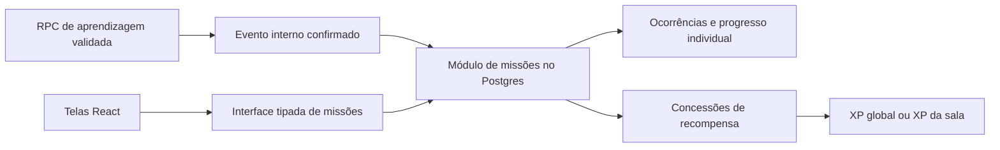

# Sistema de missões: diagnóstico e proposta modular

**Status:** proposta para discussão; não é uma decisão aprovada nem descreve funcionalidade já entregue.  
**Base inspecionada:** `sprint04`, commit `2c3d19dd6b92a44967c950d5bc03b5cb19f42e02`, em 29/10/2026.  
**Escopo desta entrega:** somente este documento. Nenhuma migração, instalação de skill, mudança de código ou commit foi realizado.

## 1. Objetivo e recomendação

Implementar um mecanismo compartilhado para missões globais diárias e semanais, missões diárias de curso e missões personalizadas de sala. Cada usuário deve ter progresso e recompensa próprios, mesmo quando a definição e a janela da missão forem compartilhadas.

**Recomendação:** criar um módulo de missões no monólito existente, com regras autoritativas em funções transacionais do Postgres/Supabase e uma interface pequena para o React. Separar definição versionada, ocorrência temporal, participação individual e concessão de recompensa. Usar eventos internos derivados de atividades confirmadas no servidor para atualizar todas as missões elegíveis.

O mecanismo é global no sentido de ser reutilizável pela plataforma; o **escopo global** é apenas uma de suas configurações. Recorrência, escopo, objetivo e destino da recompensa devem ser dimensões independentes, com combinações permitidas explicitamente.

## 2. O que existe hoje

### 2.1 Esquema persistido

Fonte: [migração 0005](../../codigo-base/supabase/migrations/0005_rooms_members_announcements_missions.sql).

| Estrutura | Campos e restrições relevantes | Consequência |
| --- | --- | --- |
| `missions` | `id`, `room_id`, `author_id`, `title`, `description`, `deadline`, `reward_xp`, `min_correct`, `status`, datas de criação/atualização | Toda missão atual pertence obrigatoriamente a uma sala; não há escopo global ou de curso |
| `missions.reward_xp` e `min_correct` | Inteiros não negativos; padrão zero | Valores armazenados, sem processamento automático |
| `missions.status` | `draft`, `published`, `archived`; padrão `published` | Estado editorial, sem modelo de recorrência |
| `mission_progress` | `id`, `mission_id`, `user_id`, `progress`, `completed`, `updated_at` | Um registro por missão/usuário |
| Restrições de progresso | `unique (mission_id, user_id)` e percentual entre 0 e 100 | Evitam duplicata individual e percentual fora do intervalo; não validam a conquista |
| Relacionamentos | Exclusão da missão remove seu progresso por cascata | O histórico não possui proteção própria para recompensas |

Há índices por sala, missão e usuário; a [migração 0012](../../codigo-base/supabase/migrations/0012_triggers.sql) atualiza `updated_at`. Não existem definição recorrente, período individual, critérios associados a aulas/questões, registro de eventos consumidos ou livro de recompensas de missão.

### 2.2 Acesso, apresentação e notificações

| Parte | Implementação presente | Limite |
| --- | --- | --- |
| Operações de missões | `missaoRepository`: listar por sala, listar ativas, obter, criar, editar, excluir e notificar | Criação e notificação são chamadas separadas; não há fluxo de edição na interface |
| Operações de progresso | `progressoMissaoRepository`: consultas, criação, atualização, exclusão e `upsert` | Métodos de escrita não são acionados pelo fluxo de aprendizagem |
| Dashboard/TopDown | Busca até três missões publicadas, sem prazo ou com prazo futuro, ordenadas pelo prazo; cruza com o progresso do usuário autenticado | A consulta depende de existir curso ativo, mas inclui missões de qualquer sala autorizada |
| Cartão | Título, recompensa anunciada, percentual, prazo e “Concluída” | Não mostra descrição, sala ou critério; não oferece abrir/executar a missão |
| Atualização | Carregamento na montagem ou alteração de curso | Reabrir o painel não refaz a consulta; não há assinatura em tempo real |
| Notificação | `notify_room_mission` valida o educador e notifica membros ativos | Precisa de chamada explícita; não valida publicação/prazo nem deduplica chamadas repetidas |
| Caixa de notificações | Tipo `missao`, ícone e leitura; clique abre `/salas` | Ignora a referência da missão na navegação |
| Gestão de salas | Não há editor de missão em `Salas.tsx` nem no console CRUD | A demonstração usa console técnico |

Fontes: [repositórios](../../codigo-base/src/data/repositories.ts), [carregamento do TopDown](../../codigo-base/src/components/sidebar/top-down-dados.ts), [cartões](../../codigo-base/src/components/sidebar/SidebarRight.tsx), [notificações SQL](../../codigo-base/supabase/migrations/0016_notifications_social_account.sql), [caixa de notificações](../../codigo-base/src/pages/Notificacoes.tsx), [Salas](../../codigo-base/src/pages/Salas.tsx) e [console CRUD](../../codigo-base/src/pages/CrudConsole.tsx).

### 2.3 Permissões e lacunas de integridade

- O educador da sala escreve suas missões. Educador e membros ativos podem lê-las, conforme as políticas de [0011](../../codigo-base/supabase/migrations/0011_rls_policies.sql) e a revisão de [0020](../../codigo-base/supabase/migrations/0020_fix_room_members_rls_recursion.sql).
- A leitura por membro não filtra `status`: o filtro de publicação existe na consulta do TopDown, mas rascunhos não estão protegidos por uma regra editorial equivalente no banco.
- `mission_progress_write_own` verifica somente `user_id = auth.uid()`. Pela política versionada, o usuário pode escrever o próprio percentual e `completed`, sem comprovar atividade, participação na sala ou prazo. A explorabilidade no ambiente depende também dos privilégios efetivamente concedidos às tabelas.
- Percentual e conclusão são independentes: o esquema aceita, por exemplo, `progress = 10` com `completed = true`; a tela mostrará 100% por causa do booleano.
- Missões concluídas continuam concorrendo pelas três posições enquanto publicadas e no prazo.

Não há cálculo para `min_correct`, atualização de progresso a partir de respostas ou concessão de `reward_xp`. O [roteiro de demonstração, seção 11.1](../roteiro-demo-sprint04.md#111-missões-e-progresso-preparado) declara essas limitações e prepara o progresso manualmente.

### 2.4 Pontos de integração já disponíveis

- [Finalização de tentativa, versão 0018](../../codigo-base/supabase/migrations/0018_no_xp_for_already_correct.sql): corrige respostas e aplica efeitos na primeira finalização; é um ponto adequado para integrar fatos de aprendizagem confirmados.
- [Conclusão de aula sem questões, 0022](../../codigo-base/supabase/migrations/0022_complete_empty_lesson.sql): conclui aula no contexto de curso sem XP; deve participar somente dos objetivos que aceitem esse tipo de aula.
- XP global e XP interno de sala já são separados. Atividades de sala não devem passar a gerar XP global indiretamente sem uma mudança explícita de produto.
- A [tabela `completions`](../../codigo-base/supabase/migrations/0004_enrollments_attempts_answers_completions.sql) identifica o contexto como `course` ou `room`, sem `room_id` próprio. Sua chave não diferencia duas salas com a mesma aula. Eventos novos devem carregar a sala diretamente da tentativa validada; usar somente essa tabela como fonte de progresso por sala seria insuficiente.

### 2.5 Alcance da verificação

O [E2E do dashboard](../../codigo-base/tests/e2e/dashboard.spec.ts) contém um caso do TopDown que verifica filtros de publicação/prazo/limite, usuário correto e apresentação de erro de progresso. O caso passou na inspeção anterior desta sessão, com respostas HTTP simuladas. Não cobre uma missão preenchida, transição para conclusão, recompensa, concorrência ou RLS real. O build executado por esse teste também concluiu, com aviso de tamanho de bundle.

Este diagnóstico foi feito sobre fontes versionadas. Não foi consultado nem modificado um banco remoto; a aplicação das migrações e os privilégios reais precisam de verificação em ambiente de teste.

## 3. Escopos pretendidos e regras iniciais propostas

Os exemplos abaixo são sugestões para discussão, não requisitos já aprovados.

| Escopo | Recorrência inicial | Exemplo | Elegibilidade | Destino sugerido da recompensa |
| --- | --- | --- | --- | --- |
| Global | Diária | Concluir duas aulas novas em cursos | Usuário autenticado com conteúdo elegível disponível | XP global |
| Global | Semanal | Estudar em três dias diferentes | Usuário autenticado; dias com atividade confirmada em curso | XP global |
| Curso | Diária | Acertar cinco questões distintas do curso | Matrícula ativa no curso específico | XP global |
| Sala | Avulsa, com início/fim; recorrência depois | Concluir três aulas selecionadas da sala | Participação ativa na sala específica | XP interno dessa sala |

Sugestão inicial: uma atividade de curso pode avançar simultaneamente uma missão global e outra do próprio curso; uma atividade de sala avança somente missões da sala correspondente. Isso preserva a separação atual de XP. Concluir a missão pode conceder bônus além do XP da atividade, com limites controlados por catálogo.

Na primeira versão, todos os usuários elegíveis recebem o mesmo catálogo por escopo/período, com progresso próprio. Sorteio individual e personalização adaptativa ficam como extensões: exigem atribuição persistida e regras de disponibilidade adicionais.

## 4. Alternativas de implementação

| Alternativa | Benefícios | Custos e limites | Avaliação |
| --- | --- | --- | --- |
| Ampliar `missions` e calcular nas telas | Pouca mudança inicial de estrutura | Regras duplicadas, cliente manipulável, recorrência e concorrência difíceis de controlar | Útil apenas para protótipo descartável |
| Módulo compartilhado com funções Postgres e acesso tipado no React | Reaproveita transações, Auth e banco atuais; concentra autorização e recompensa | Exige SQL bem organizado, testes de banco e cuidado com acoplamento às RPCs de aprendizagem | **Recomendado para esta base** |
| Novo backend de missões com fila e processamento assíncrono | Permite processamento separado e outras fontes de eventos | Novos deploys, credenciais, retentativas, consistência eventual e operação de fila | Considerar se volume ou integrações justificarem |

O mecanismo recomendado usa eventos internos síncronos, sem exigir broker ou arquitetura de event sourcing. Um registro de eventos serve para auditoria e deduplicação; não substitui as tabelas de aprendizagem como fonte de verdade.

## 5. Desenho do módulo recomendado

### 5.1 Responsabilidades e localização



Propor `codigo-base/src/features/missoes/` para consultas, tipos de apresentação, hooks e apresentação reutilizável. A pasta ainda não existe como parte desta proposta. O módulo deve expor uma entrada pública, por exemplo `index.ts`, e manter composição interna fora das páginas. As migrações continuam em `codigo-base/supabase/migrations/`, na sequência válida no momento da implementação.

Responsabilidades internas do módulo: resolver elegibilidade/períodos; publicar definições; avaliar objetivos permitidos; registrar progresso; conceder recompensas; produzir a leitura individual. A autoridade de todos esses cálculos fica no SQL. O React formata e apresenta resultados, sem repetir o avaliador de objetivos ou decidir XP.

Aplicação dos princípios: alta coesão das regras de missão; baixo acoplamento com Dashboard e Salas; responsabilidade única por cálculo; extensão por objetivos conhecidos; dependência de uma interface estável, em vez de chamadas diretas a muitas tabelas. Pela skill `codebase-design`, isso constitui um módulo profundo: uma interface pequena concentra período, elegibilidade, idempotência e recompensa. Um adapter Supabase atende essa interface; não é necessário criar abstrações para bancos hipotéticos.

### 5.2 Modelo de dados conceitual

Os nomes são propostos; não são um script de migração pronto.

| Entidade | Conteúdo | Invariantes principais |
| --- | --- | --- |
| `mission_definitions` | Identidade estável, versão, título, descrição, escopo, curso/sala, autor, estado editorial, recorrência, fuso, vigência, objetivo e recompensa | Versões publicadas são imutáveis; curso obrigatório somente no escopo de curso e sala somente no de sala |
| `mission_occurrences` | Definição/versionamento congelado, início/fim da janela, chave canônica do período, instante de publicação | Uma ocorrência por definição e período; intervalo `[início, fim)` |
| `mission_assignments` | Ocorrência, usuário, elegibilidade inicial, início efetivo, contagem, meta, conclusão e eventual cancelamento | `unique (occurrence_id, user_id)`; estado inicial consistente e contagem não negativa |
| `learning_events` | Origem confirmada, usuário, tipo, curso, sala, contexto, instante do servidor e fatos mínimos | Chave única da origem semântica; escrita exclusivamente interna |
| `mission_contributions` | Atribuição, evento e chave da entidade contabilizada | Evento aplicado uma vez; entidade distinta aplicada uma vez ao objetivo que exigir distinção |
| `mission_reward_grants` | Atribuição, beneficiário, destino, sala quando aplicável, valor congelado, instante | Uma concessão por atribuição; destino e valor não vêm do cliente |

Separar a identidade estável da versão permite que uma edição de título, meta ou recompensa não gere uma segunda missão no mesmo período. Mudanças aprovadas passam a valer na próxima ocorrência. No MVP, uma única meta por missão evita um motor genérico de expressões; objetivos compostos podem ser adicionados depois.

Usar colunas tipadas para escopo, referências, meta e destino de recompensa. Se filtros complementares usarem JSON, validar formato e chaves por tipo de objetivo. Não aceitar SQL, JavaScript, condições arbitrárias ou nomes livres de tabelas enviados pelo educador.

`mission_assignments` substitui o papel do percentual gravado em `mission_progress`: o percentual é calculado a partir de contagem/meta e limitado a 100. A conclusão resulta de atingir a meta, nunca de um booleano fornecido pelo cliente.

Para as chaves de unicidade, evitar depender de múltiplas colunas opcionais com `NULL`: usar identificadores obrigatórios de ocorrência/atribuição e uma chave de período normalizada. Validar a solução contra a versão real do Postgres do ambiente.

### 5.3 Recorrência, disponibilidade e elegibilidade

Sugestão para o MVP: fuso único `America/Sao_Paulo`, dia de calendário local e semana iniciando segunda-feira às 00h locais. Calcular limites no servidor e armazenar instantes como `timestamptz`; não somar sempre 24 horas nem usar o relógio do navegador. Mudança futura de fuso vale para períodos futuros.

Não zerar uma linha à meia-noite. Cada novo período produz uma nova ocorrência, preservando o histórico. Expiração pode ser derivada do horário da ocorrência, sem depender de um job para ser correta.

Materializar ocorrências e atribuições **sob demanda no servidor**: na leitura do painel e, obrigatoriamente, antes de processar uma atividade elegível. O usuário não precisa abrir o painel, visitar cada curso ou manter sessão ativa na virada do dia para obter progresso. A resolução considera os escopos elegíveis da atividade, e não apenas o curso selecionado na interface. Consultas e criação concorrentes usam chaves únicas e operações idempotentes.

Matrícula ou ingresso depois do início do período habilita uma atribuição com início efetivo igual ao ingresso/publicação aplicável. Não contabilizar atividades anteriores à elegibilidade. Sair de uma sala ou perder acesso impede novas contribuições; preservar histórico já concedido e não pagar bônus pendente sem elegibilidade. Reingresso no mesmo período reutiliza a atribuição, sem novo bônus. A política exata de saída/reingresso exige confirmação de produto.

Se um objetivo exigir conteúdo novo que o usuário já esgotou, o catálogo deve oferecer alternativa compatível ou informar indisponibilidade. Não atribuir metas impossíveis silenciosamente. A quantidade e seleção de missões precisam ser limitadas para não criar uma missão diária em todos os cursos do catálogo sem necessidade.

Cron pode ser acrescentado depois para pré-geração, limpeza e notificações; não deve ser requisito para reconhecer uma conquista. Se houver necessidade de histórico de missões não abertas e sem qualquer atividade, gerar esse histórico explicitamente por job, em vez de presumir que a materialização sob demanda o produz.

### 5.4 Objetivos, eventos e integração com aprendizagem

Catálogo inicial sugerido: `complete_lessons`, `answer_distinct_questions_correctly` e `study_distinct_days`. Cada objetivo declara tipos de evento aceitos, unidade, distinção, contexto permitido e filtros por curso/sala/aulas. Começar com um objetivo completo antes de generalizar os demais.

Um evento interno de aula deve conter usuário, aula, contexto, curso, sala quando aplicável, instante e origem confirmada. Derivar esses valores do banco; o navegador não informa que acertou, concluiu ou merece XP. Integrações previstas:

1. Na primeira finalização válida de `finalize_attempt`, produzir os fatos confirmados e chamar o módulo de missões na mesma transação. Refinalizar não emite uma nova atividade.
2. Em `complete_empty_lesson`, emitir conclusão somente quando houver nova conclusão efetiva. Não criar acertos ou XP de atividade para aula sem questões.
3. Em ambos os caminhos, garantir que a aprendizagem de origem já esteja autorizada. Auditar a origem antes de acoplar uma recompensa a ela, incluindo papéis, parâmetros e permissões de escrita direta.
4. Para sala, usar o `room_id` validado da tentativa. Não inferir sala a partir de `context = 'room'` de `completions`.

Além de deduplicar o identificador da tentativa, deduplicar a **entidade do objetivo**. Duas tentativas da mesma questão não equivalem a duas questões distintas. Sugestão inicial para “aulas novas”: primeira conclusão por usuário/aula/contexto concreto; para acertos, primeiro acerto confirmado por usuário/questão/contexto concreto. Guardar esse fato durável, pois o `completed_at` atual pode ser atualizado pela refinalização de outra tentativa.

Revisões de aulas já concluídas podem ser um objetivo futuro próprio. Não habilitar repetição ilimitada sob um objetivo chamado “aulas novas”. A regra de acertos distintos de missão também deve ser definida separadamente da regra atual de XP por questão, para não mudar incidentalmente o comportamento de [0018](../../codigo-base/supabase/migrations/0018_no_xp_for_already_correct.sql).

Uma atividade gera contribuições em todas as atribuições compatíveis com seu contexto e janela. Para “dias distintos”, a chave é a data local do evento no fuso da ocorrência. Nenhum evento anterior à publicação ou fora da janela deve avançar uma missão.

### 5.5 Transação, concorrência e recompensa

Processamento proposto para cada fato confirmado:

1. Resolver/materializar ocorrências e atribuições elegíveis para o instante do evento.
2. Inserir o evento com chave semântica única; repetição retorna o resultado persistido.
3. Bloquear atribuições afetadas em ordem estável e inserir contribuições com unicidade; incrementar somente pelas contribuições novas.
4. Ao atingir a meta, registrar a conclusão e tentar inserir a concessão única de recompensa.
5. Somente a transação que inserir a concessão aplica o incremento ao destino correto; conclusão, concessão e saldo são confirmados juntos ou revertidos juntos.

`SELECT ... FOR UPDATE`, restrições únicas e incremento atômico são mecanismos apropriados para essa coordenação; um teste “consultar se já recebeu, depois atualizar” isolado permite corrida. Ver [locks do PostgreSQL](https://www.postgresql.org/docs/current/explicit-locking.html).

No MVP, recomendar crédito automático, sem botão obrigatório de resgate. Se o produto escolher resgate manual, a interface recebe apenas a atribuição; o servidor valida conclusão e usa a mesma concessão única. Distinguir conclusão de crédito no contrato.

Missões de sala usam somente `room_members.xp_internal`; globais e de curso usam XP global e a atualização de nível apropriada. Uma concessão de bônus não produz outro evento de aprendizagem e não dispara missões recursivamente. Valores de sala são limitados por política da plataforma para proteger o ranking interno.

No desenho síncrono, falha do módulo de missões reverte também a atividade de origem: é um custo consciente da consistência transacional. Se isso se mostrar inaceitável, evoluir para uma outbox gravada junto da aprendizagem e processamento com retentativas; o usuário passa a ver progresso pendente. Essa mudança exige monitoramento e tratamento explícito de atraso.

### 5.6 Interface pública e autorização

Interface externa conceitual, sem exigir que as páginas conheçam as tabelas internas:

```ts
listarMinhasMissoes({ escopo?, cursoId?, salaId?, cursor? }): Promise<PaginaDeMissoes>
obterMinhaMissao(atribuicaoId): Promise<MissaoComProgresso>
publicarMissaoDaSala(entradaValidada): Promise<DefinicaoPublicada>
arquivarMissaoDaSala(definicaoId): Promise<void>
```

O método de publicação aceita rascunho ou entrada validada conforme o fluxo escolhido; deve tornar explícito quem pode editar e publicar. A leitura retorna escopo, contexto identificado, unidade, contagem/meta, percentual, estado, prazo, recompensa e instante do servidor. Aceita ausência de curso ativo para listar globais e usa paginação/filtros; o resumo de três cartões não limita o catálogo completo.

Uma interface **interna**, não executável pelos papéis de cliente, recebe apenas a referência da atividade validada para processar os fatos. Autoria e identidade são derivadas da sessão e da atividade, não de `userId` confiado ao navegador.

Regras propostas de acesso:

- Catálogos globais/de curso são administrados pela plataforma no MVP. Educadores publicam somente na própria sala e escolhem objetivos, conteúdo e recompensas dentro dos limites permitidos.
- Membros leem somente definições publicadas e suas atribuições; educadores podem ler o acompanhamento da própria sala. Especificar acesso histórico após saída, sem vazar conteúdo de salas privadas.
- Clientes não escrevem eventos, contribuições, contagem, conclusão ou concessões diretamente. A migração deve retirar a política permissiva antiga e os privilégios incompatíveis.
- Revisar em conjunto `GRANT`, RLS e privilégios das funções. Funções privilegiadas verificam sessão e permissão explicitamente, fixam `search_path` seguro e usam nomes de tabelas qualificados. Revogar execução de funções internas de `PUBLIC`, `anon` e `authenticated` conforme o papel; conceder somente as entradas necessárias.

RLS e privilégios de tabela são controles complementares, e o proprietário normalmente não sofre RLS: [documentação PostgreSQL](https://www.postgresql.org/docs/current/ddl-rowsecurity.html). Para configuração de funções e execução, consultar [Supabase Database Functions](https://supabase.com/docs/guides/database/functions). A autorização não pode depender apenas de esconder controles na tela.

### 5.7 Onde apresentar a mecânica

- **Área central de Missões:** globais diárias/semanais, histórico e filtros por contexto. Pode ser uma rota própria; confirmar o espaço de navegação antes de implementar.
- **Dashboard do curso:** seção das diárias do curso selecionado e resumo das globais. Ausência de curso não impede acesso às globais.
- **Salas:** aba de missões e editor para o educador; estudantes veem critério, conteúdo associado, prazo e progresso.
- **TopDown:** resumo com acesso à lista completa. Exibir nome da sala/curso e separar ativas de concluídas.
- **Notificações:** destino resolve a missão/atribuição específica, respeitando acesso; deduplicar por publicação/destinatário.

Compartilhar cartão, leitura e estados de carregamento/erro/vazio. Atualizar após confirmação de atividade e ao reabrir a área quando os dados estiverem obsoletos; tempo real é opcional. Expiração é decidida pelo servidor e refletida na revalidação, mesmo com a página aberta na virada do período.

## 6. Evolução do esquema atual

1. Inventariar dados e migrações realmente aplicadas em ambiente isolado. Estabelecer testes das permissões atuais e cópia de segurança antes da migração real.
2. Adicionar o esquema novo em migrações incrementais, sem reescrever as antigas. Proteger as escritas antigas na mesma etapa que transfere a autoridade de progresso.
3. Converter missões atuais de sala para definições avulsas, preservando IDs por mapeamento e referências de notificações. Missões sem início precisam de regra de importação; usar a criação como referência proposta e conferir casos reais.
4. Preservar progresso legado como histórico de origem manual, sem considerá-lo prova de conquista automática e **sem pagar retroativamente** `reward_xp`. Escolher entre encerrar as missões antigas ou mantê-las em modo legado até terminar; não misturar percentuais manuais com contagem nova silenciosamente.
5. Colocar a leitura nova atrás da interface de missões e migrar o TopDown. Desativar métodos antigos de escrita após conferir consumidores. Evitar manter dois mecanismos de progresso ativos para a mesma missão.
6. Integrar um objetivo de ponta a ponta, depois habilitar os demais escopos e editor. Notificações entram após estabilizar publicação e referências.
7. Regenerar [tipos do banco](../../codigo-base/src/types/database.ts) a partir do esquema-alvo, atualizar documentação responsável e roteiro de demo. Retirar compatibilidade antiga somente após validação e plano de recuperação.

Como `min_correct` não identifica conteúdo nem unidade de progresso, não há conversão automática inequívoca para um objetivo novo. Solicitar classificação das missões existentes ou mantê-las como legado. Recuperação deve preservar concessões já realizadas: voltar a versão da interface não autoriza apagar o livro de recompensas nem reaplicar bônus.

## 7. Plano de entrega e critérios de aceitação

| Etapa | Entrega | Critério para concluir |
| --- | --- | --- |
| 1. Regras de produto | Resolver decisões da seção 8 e exemplos de aceitação | Uma regra definida para cada escopo, período, objetivo e recompensa |
| 2. Núcleo seguro | Modelo, leitura individual, autorização, deduplicação e concessão | Testes SQL comprovam isolamento, concorrência e pagamento único |
| 3. Fatia global diária | Um objetivo, uma atividade real, progresso e bônus | Usuário conclui atividade sem abrir Missões e recebe a recompensa uma vez |
| 4. Recorrência e curso | Semanal e diária de curso; elegibilidade e viradas | Novo período independente e curso correto sem vazamento de contexto |
| 5. Sala | Editor restrito, participação e XP interno | Educador publica; somente membros elegíveis avançam; XP global permanece inalterado |
| 6. Experiência completa | Área central, TopDown, histórico e notificações | Critério e destino visíveis; navegação leva à missão correta |

Testes essenciais antes de liberar:

- Integração SQL em banco isolado: escrita de progresso/recompensa negada ao cliente; não membro negado; membro não lê rascunho; educador de outra sala negado.
- Mesma atividade reenviada; duas abas finalizando; duas atividades chegando juntas à meta; falha entre concessão e saldo. Nenhum caso duplica progresso ou recompensa, nem perde incremento válido.
- Aula em duas salas; aula de curso versus sala; mesma questão em duas tentativas; refinalização; aula sem questões. Contextos e critérios permanecem corretos.
- Virada diária/semanal, evento exatamente no limite, prazo vencido, mudança de versão, matrícula no meio do período, saída/reingresso e usuário sem curso ativo.
- Usuário que não abriu o painel recebe missões e progresso do período; missões de conteúdo esgotado não geram meta impossível.
- E2E com dados controlados: listagem preenchida, conclusão, ausência de dados, falha real de consulta, troca de contexto e atualização após atividade. Testes com mocks não substituem testes SQL.

Seguir o [pipeline do projeto](../testes.md) quando houver código. O runner SQL legado documentado ali não valida o esquema atual; preparar harness de banco isolado como parte da etapa 2.

## 8. Decisões que precisam de retorno

| Pergunta | Ponto de partida recomendado |
| --- | --- |
| Quantas missões por período e por curso? | Catálogo pequeno e limitado; determinar números e política de seleção antes de codificar |
| Mesmas missões para todos ou sorteio individual? | Mesmas definições por período, com progresso individual; personalização depois |
| Quais cursos recebem diárias? | Cursos com matrícula ativa e conteúdo elegível; definir limite e prioridade para muitas matrículas |
| Sala conta em missão global? | Inicialmente não, para preservar a separação atual; uma mudança exige revisar economia e abuso |
| Repetições contam? | Apenas conteúdo novo nos objetivos iniciais; revisão exige objetivo e limite próprios |
| Aula sem questões conta? | Sim para conclusão quando explicitamente aceita; nunca como acerto |
| Fuso e começo da semana? | Fuso único `America/Sao_Paulo`, segunda-feira; confirmar público e expectativas |
| Recompensa automática ou resgate? | Automática, com registro único por atribuição |
| O que educadores podem customizar? | Título, descrição, janela, conteúdo, objetivo permitido, meta e XP interno dentro de limites |
| Alterar/cancelar missão publicada? | Versões imutáveis; alteração futura, cancelamento auditado e política explícita para conquistas já obtidas |
| Como tratar usuários sem conteúdo novo, saída e reingresso? | Alternativa viável ou indisponibilidade explícita; preservar histórico, sem novo pagamento no reingresso |
| Quanto XP e quais limites? | Definir orçamento por dia/semana/contexto e impacto no nível/ranking antes de fixar valores |

## 9. Skills encontradas para apoiar o projeto

A skill `find-skills` foi usada para consultar o [leaderboard do diretório](https://skills.sh/) e verificar candidatas e seus repositórios. Também foi executado `npx --yes skills find supabase`: a primeira tentativa falhou por restrição de acesso ao npm; a repetição autorizada terminou com “No skills found”. A candidata externa abaixo foi localizada no diretório web e conferida diretamente no repositório oficial, apesar da ausência de resultado no CLI. Popularidade é um sinal auxiliar, não comprovação de adequação ou correção. As versões locais devem prevalecer no uso deste repositório, junto das regras de [fluxo de trabalho](../fluxo-de-trabalho-ia.md).

### 9.1 Reutilizar o que já está instalado

| Skill local | Aplicação sugerida |
| --- | --- |
| [codebase-design](../../.agents/skills/codebase-design/SKILL.md) | Usada nesta proposta para concentrar regras atrás de uma interface pequena e definir a localização do módulo |
| [domain-modeling](../../.agents/skills/domain-modeling/SKILL.md) | Após o retorno, fixar significado de definição, ocorrência, atribuição, objetivo e recompensa; registrar termos aprovados no glossário |
| [grilling](../../.agents/skills/grilling/SKILL.md) | Discutir as decisões da seção 8 com cenários concretos antes de transformar hipóteses em requisitos |
| [prototype](../../.agents/skills/prototype/SKILL.md) | Explorar em trabalho separado onde ficam lista, resumo e editor; validar interação antes de ligar ao banco |
| [tdd](../../.agents/skills/tdd/SKILL.md) | Implementar fatias com testes de comportamento, especialmente SQL, isolamento e idempotência |
| [to-spec](../../.agents/skills/to-spec/SKILL.md) e [to-tickets](../../.agents/skills/to-tickets/SKILL.md) | Converter decisões aprovadas em especificação e entregas pelo tracker local, em etapa posterior |

A versão pública de [codebase-design](https://www.skills.sh/mattpocock/skills/codebase-design) mostrava aproximadamente 877 mil instalações; o [repositório do autor](https://github.com/mattpocock/skills) mostrava aproximadamente 306 mil estrelas na consulta. O conteúdo local foi lido para elaborar a recomendação; não é necessário reinstalar a skill. As demais skills locais foram identificadas por seus manifestos, sem executar seus fluxos nesta entrega.

### 9.2 Candidata externa prioritária

**[supabase-postgres-best-practices](https://skills.sh/supabase/agent-skills/supabase-postgres-best-practices)**, mantida pela própria Supabase. Apoia revisão de esquema, índices, RLS, concorrência e consultas. A página consultada mostrava aproximadamente 466 mil instalações; o [repositório oficial](https://github.com/supabase/agent-skills) mostrava cerca de 2,9 mil estrelas. Métricas consultadas em 29/10/2026 e sujeitas a alteração.

Comando sugerido para uma instalação futura, após revisão e autorização:

```bash
npx skills add supabase/agent-skills --skill supabase-postgres-best-practices
```

A recomendação foi conferida na descrição da skill e no README do mantenedor; a skill não foi instalada nem tratada como garantia de segurança. Para este projeto, priorizar revisão de autorização e testes SQL antes de otimizações.

## 10. Próximo passo após avaliação

Responder às decisões de produto da seção 8 e escolher a primeira fatia de entrega. Depois, consolidar uma especificação revisável e somente então preparar migrações, código e testes. Este documento permanece como proposta; os guias atuais, o glossário, o código e o histórico Git foram preservados.
