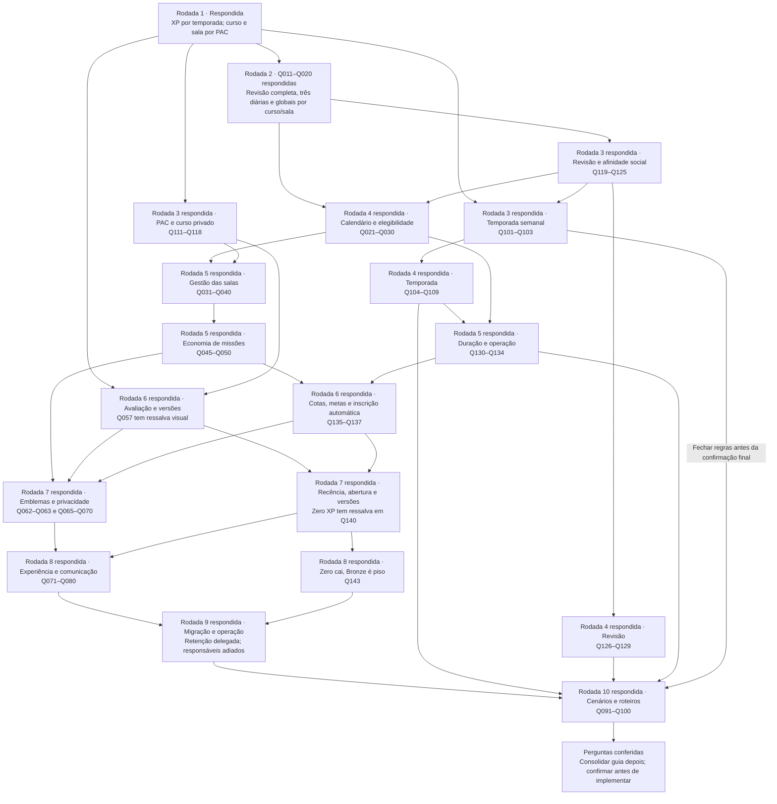

# Respostas — guia de missões, ligas e PAC

**Revisão após a rodada 10:** **132 respostas originais preservadas literalmente**, incluindo as 122 anteriores e as dez novas; os outros 11 IDs são registros derivados, sem fala de usuário inventada. Os 143 IDs foram conferidos e nenhum campo de resposta está pendente. **Este arquivo permanece a fonte ativa das decisões.** O [guia](guia-desenvolvimento-missoes-ligas-e-pac.md) continua congelado na rodada 6: a instrução mais recente limita esta revisão ao arquivo de respostas, apesar da sequência de consolidação aceita em Q100.

**Estado do questionário:** dez rodadas respondidas e cenários coerentes com o registro atual; **nenhuma nova rodada necessária nesta revisão**. Q099 delega os roteiros de teste, definidos abaixo. Próxima etapa documental: consolidar o guia quando solicitado e apresentar a versão final para confirmação antes de implementar. Responsáveis/contatos, atendimento e SLAs humanos continuam tarefas pré-implantação/liberação, conforme o adiamento registrado, sem aprovação fictícia.

**Como continuar:** usar este arquivo na consolidação única do guia, sem tratar o guia congelado como se já incorporasse as rodadas 7–10. Nesta revisão, atualizar somente as respostas. Definir roteiros não equivale a executá-los; nenhum teste funcional, código, migração ou commit foi realizado. O desenvolvimento depende da confirmação explícita da futura consolidação apresentada.

## Registro para consolidar o guia ao final

O guia fornece a base das rodadas 1–6 e as evidências do código; as respostas completas continuam abaixo. Este registro acumula as decisões posteriores ao congelamento, suas substituições e efeitos no plano. Não é necessário sincronizar os dois questionários enquanto o guia estiver congelado. Validar o conjunto significa conferir também respostas antigas afetadas, sem repetir decisões já encerradas.

### Rodada 7 — decisões recebidas e impactos

| Perguntas | Decisão e efeito no plano | Estado / transferência ao guia |
| --- | --- | --- |
| Q062, encerrando a ressalva Q057 | Emblemas Bronze–Lendário somente nas ligas; curso/sala exibem PAC, eficiência, cobertura e posição, sem segunda faixa visual de PAC. Não criar sete limiares acadêmicos | Decidida; sessões 03–04, 07–08 e diagramas. As antigas faixas acadêmicas são referência histórica, sem promessa visual no MVP |
| Q063 | Ranking de curso exige matrícula ativa/concluída, amostra individual e acesso autorizado, para usuário/amigos. Prévia/teste de autor/admin não concede XP base, bônus ou amostra oficial; papel educador/admin não exclui estudo legítimo de conteúdo alheio | Decidida; sessões 02–04 e 07. Responsável continua fora do ranking da própria sala |
| Q065–Q066 | Resumo com até cinco entradas, posições reais e indicação dos demais empatados; lista completa paginada. Liga acessível somente no próprio grupo/resumo/histórico, sem navegar em grupos alheios | Decidida; sessões 04, 07–08; cortes são calculados sobre o grupo inteiro |
| Q067–Q068 | educator_only também protege progresso dos colegas. Somente members/educator_only; retirar public e mapear legado para members com registro | Decidida; sessões 03 e 08. Curso público não torna sala pública; não expor indicadores fora da audiência |
| Q069 | Usar somente identidade padrão: foto de perfil, display name e banner. Sem pseudônimo, avatar alternativo ou opção de ocultação visual específica do ranking | Decidida; sessões 04 e 09. Retirar do plano a configuração condicional de pseudônimo; a ocultação de identidade por desativação de Q070 é um estado da conta, não preferência opcional do ranking |
| Q070, substituindo a exceção de Q132 | Desativação voluntária após inscrição preserva linha competitiva sem identidade exposta, pontos e movimento normal; reativação não reinicia categoria/grupo. Conta desativada na abertura não é inscrita | Decidida; sessões 04A–04 e 09–10. Exclusão definitiva/suspensão administrativa/retenção continuam em Q085; ex-membro não lê métricas novas dos antigos colegas |
| Q138–Q139 | Recência: conclusão oficial em curso/sala nos sete dias anteriores à virada, inclusive revisão ou primeira conclusão sem questões, mesmo sem XP competitivo. Entrada durante a semana pela primeira atividade oficial, sem exigir XP positivo | Decidida; sessão 04A. Sem login/visita/bônus como prova de estudo. Categoria persistida ou Bronze; vaga por afinidade/teto 30 ou grupo tardio, sem mover os já atribuídos |
| Q140 | Usuário aceita a recomendação e acrescenta que zero XP deve ser rebaixado | Ressalva resolvida por Q143 na rodada 8, com alcance e exceção do piso Bronze registrados abaixo |
| Q141 | Fotografia na virada; fechar anterior, persistir categorias e formar novo lote automaticamente. Atividade da nova janela confirmada durante espera e associada uma vez ao grupo definitivo, sem categoria provisória | Decidida; sessões 04A–04 e 09–10. Formação com alvo de cinco minutos e alerta em 30, retentativa idempotente; atraso não bloqueia estudo nem amplia janela |
| Q142 | Curso individual usa última versão publicada/autorizada; educador adota explicitamente nova versão do mesmo curso na sala. Missão ativa dependente do conteúdo impede adoção até terminar/cancelar. Tentativas mantêm snapshot; aula inalterada conserva amostra, modificada exige nova conclusão | Decidida; sessões 02–03, 05 e 07–08. Sem troca de curso/cópia, repagamento de questão inalterada ou acesso perpétuo a conteúdo revogado |

### Rodada 8 — decisões recebidas e impactos

As 11 recomendações foram aceitas, sem novas ressalvas. Q143 encerra a ambiguidade de Q140; não há necessidade de criar outra pergunta para confirmar a queda dos zeros.

| Perguntas | Decisão e efeito no plano | Transferência ao guia |
| --- | --- | --- |
| Q071–Q073 | /missoes com detalhe/histórico junto de Ligas na navegação; curso/sala integrados às páginas existentes, navegação móvel recolhível e adoção de versão na sala. TopDown com até três pendentes de contextos autorizados, rótulos, prazo mais próximo/ID estável e acesso à lista completa; globais sem curso ativo. Detalhe com meta, contexto/versão, prazo/fuso, prêmio e destino autorizado | Sessões 06–08; preservar execução em sala sem matrícula individual e progresso independente de visita ao painel |
| Q074/Q076 | Feedback discreto após confirmação, resumo de XP base/bônus/conquistas, sem resgate, som, confete ou modal adicional obrigatório. Recuperar resultado antes de repetir; distinguir rejeição, resultado desconhecido e retorno perdido, sem sucesso fictício ou falha convertida em zero | Sessões 02, 06–09; reenvio não repete prêmio nem celebração |
| Q075 | Revalidar após atividade própria, contexto, reabertura/foco; /ligas visível consulta a cada 60 segundos. Outras listas ao reabrir/focar, com referência/Atualizar. Meta de defasagem de até 60 segundos com serviço disponível; formação/apuração segue alvo de cinco minutos | Sessões 04 e 09; sem push obrigatório, falha indica dado desatualizado e não posição zero |
| Q077–Q078 | Caixa interna para publicação de sala, conquista e resultado final de temporada, deduplicada; sem alertas por inscrição/incremento/renovação ou canais externos. Entrega a cada cinco minutos por até 24 horas; publicação expira no menor entre 24 horas e fim/cancelamento, conquistas/resultados valem sete dias para recuperação operacional. Depois só histórico; falhas ficam para reconciliação | Sessão 09 e operação; entrega não desfaz aprendizagem/XP, links respeitam acesso atual e histórico próprio |
| Q079–Q080 | Critérios do guia de estilos, teclado/foco/leitor de tela/contraste/estados/redução de movimento; desktop Chrome/Edge/Firefox, móvel Chrome Android/Safari iOS, larguras 360/768/1440. Português brasileiro e identidade atual, sem redesenho geral. Foto/nome em linhas compactas, banner em cartões/pódio ou detalhe do ranking; emblemas só nas ligas | Sessões 04 e 06–10; evidências reais, sem alegar certificação formal por testes. Sem pseudônimo opcional ou e-mail no ranking |
| Q143, resolvendo Q140 | Todo inscrito válido com zero XP competitivo cai uma categoria, inclusive grupo totalmente zerado, grupo menor que dez, pessoa sozinha ou entrada tardia; Bronze é o piso. Sem compensação ou carência. Para XP positivo, mantêm-se cortes/proteções/empates anteriores; queda por critérios sobrepostos acontece uma única vez | Sessões 04A–04 e 10; substituir proteções antigas somente para zeros. Grupo zerado em Prata vai a Bronze; pessoa sozinha zerada em Mestre vai a Diamante; zero em Bronze permanece. Incidente não reconciliado mantém apuração, sem inventar zero |

**Coerência preservada:** liga usa somente XP novo elegível de aprendizagem individual; bônus/XP interno/revisão já creditada continuam excluídos. Estudo em sala ou revisão pode inscrever alguém com zero competitivo e resultar na queda aceita em Q143. Não criar pontos de compensação nem estornar XP vitalício por rebaixamento. Empate completo de XP positivo continua sem movimento; grupo pequeno com pontuação positiva conserva suas proteções. Cotas/metas Q135/Q136 e PAC binário permanecem aceitos.

### Rodada 9 — decisões recebidas e impactos

As dez respostas foram incorporadas. Q085 delega a escolha da política de retenção; a configuração inicial está abaixo, separada da resposta literal. Q087 solicita relação separada de testes manuais, incluída neste arquivo. Q088 adia a identificação dos responsáveis: isso será respeitado, sem repetir a cobrança nesta rodada nem inventar designações.

| Perguntas | Decisão e efeito no plano | Estado / transferência ao guia |
| --- | --- | --- |
| Q081–Q082 | Abertura única auditada preserva saldos/limiares sem atividade/XP competitivo. Missões manuais e avaliações antigas ficam como legado, sem bônus retroativo ou ordinais fabricados. Questão legada sem evidência suficiente não recebe novo XP base até revisão, mas permite estudo/missões. Eventuais salas sem curso são arquivadas, sem escolher curso/transferir participantes automaticamente | Decidida; sessões 02–03 e 10. Esforço novo começa no corte e é identificado; impedir repagamento quando houver evidência confiável |
| Q083–Q084 | Ensaio isolado e janela de até 30 minutos com restrição de escrita; reconciliação antes de retomar. Interromper por diferença inexplicada, duplicidade, violação de acesso/integridade ou estouro da janela; preservar concessões e reaplicar somente fatos confirmados | Decidida; sessões 01–02 e 10. Não voltar apenas frontend e deixar comandos antigos pagarem de novo |
| Q085 | Valores e tratamento escolhidos por delegação, na política abaixo | Escolha inicial delegada; sessões 02, 04A, 09–10. Não é comportamento já implementado |
| Q086 | Ensaio com 10.000 contas, 1.000 ativos/semana, 50 conclusões concorrentes, 50 cursos por usuário e salas de 200 no conjunto de teste; p95 de consulta de ranking até dois segundos e finalização até cinco no ambiente declarado | Metas aceitas; não são limites de produto nem desempenho já comprovado |
| Q087–Q088 | Observabilidade, pipeline, SQL real isolado, E2E e homologação aceitos; testes manuais listados separadamente. Identificação de responsáveis adiada pelo usuário | Designações não são prioridade agora; registrar antes de implantação/liberação. Horário de atendimento e prazos humanos de reconhecimento/reconciliação não foram fornecidos e continuam pendências operacionais, sem novos SLAs presumidos |
| Q089–Q090 | Fork de teste, branches por issue da sprint vigente, PRs revisáveis e posterior integração no upstream por PR. Sequência 00–10/04A, piloto isolado com pelo menos um educador e três alunos e liberação após validação integrada | Decidida para o planejamento; sprint/issues reais conferidas ao iniciar. Sem commits, push, migração ou implantação autorizados nesta etapa |

### Política inicial de dados escolhida por delegação de Q085

Parâmetros de produto configuráveis escolhidos pelo agente conforme a delegação literal. Aplicam-se aos dados desta implementação e à integração de sua exclusão; não são prazos já existentes no ambiente. O comportamento real do provedor e as dependências de autoria devem ser conferidos no ensaio, sem assumir que limpar o perfil apaga todos os dados.

| Classe/situação | Política escolhida | Efeito verificável |
| --- | --- | --- |
| Histórico, resultados, contribuições, créditos e movimentos de conta existente, sem pedido de exclusão | Manter enquanto a conta existir, com acesso por finalidade/contexto. Desativação temporária não zera histórico nem concede crédito de novo | Retomada autorizada conserva saldo, atribuição e categoria; nenhuma retenção cria leitura de colegas após sair da sala |
| Solicitação confirmada de exclusão definitiva | Retirar identidade das projeções e bloquear novas contribuições imediatamente; concluir eliminação de dados pessoais nos sistemas ativos sob controle da aplicação em até 30 dias, incluindo conteúdo livre e arquivos pessoais | Não tratar exclusão como pausa reversível. Inscrição da semana conserva linha técnica sem identidade para fechar uma vez; não restaurar perfil, respostas pessoais ou matrícula ao reprocessar |
| Auditoria técnica após exclusão | Até 12 meses somente se os registros puderem ser conservados sem identificar a pessoa; retirar identificadores diretos, vínculos reversíveis e conteúdo livre. Se isso não puder ser demonstrado, eliminar os dados pessoais no prazo de 30 dias, mantendo apenas os agregados não identificáveis necessários | ID aleatório sozinho não comprova anonimização. A expiração de dados não pode ser usada para repetir pagamentos; separar a política de eliminação de um estorno que exige trilha auditada |
| Logs operacionais da aplicação | 30 dias, acesso restrito, sem respostas de aluno, tokens ou dados pessoais desnecessários | Expurgo periódico comprovado, sem converter logs em histórico pedagógico paralelo |
| Cópias de ensaio e backups controlados pela equipe | Cópias de ensaio eliminadas até sete dias após seu uso e no máximo 30 dias após criação; backups rotativos com máximo de 30 dias | Restauração reaplica eliminações antes de devolver acesso. Retenção gerenciada pelo provedor deve ser conferida no plano/configuração reais; não prometer apagar individualmente uma linha em backup imutável |
| Suspensão administrativa | Administrador autorizado registra motivo/referência, bloqueia novas contribuições e oculta a identidade exposta; mantém fatos válidos e participação já registrada. Invalidação de crédito comprovadamente incorreto usa ajuste/reconciliação auditados de Q049 | Sem exclusão silenciosa de concessões, reinício de categoria ou alteração automática de movimentos já fechados; resultado fechado que precise de correção exige registro de retificação e revisão humana, preservando grupos em disputa |

**Integração com o que existe:** a tela [ConfigPage](../../codigo-base/src/pages/ConfigPage.tsx) chama `desativarConta`; o [repositório](../../codigo-base/src/data/repositories.ts) usa `deactivate_account`. A [migração 0016](../../codigo-base/supabase/migrations/0016_notifications_social_account.sql) limpa campos do perfil e remove vínculos ativos de sala, preservando IDs/histórico; não implementa sozinha a política acima nem elimina o usuário de Auth/objetos de Storage. Distinguir na interface e nos comandos desativação, suspensão e exclusão definitiva; nenhuma reativação de Q070 recupera dados eliminados por pedido definitivo. Não publicar curso privado, apagar conteúdo de terceiros ou transferir propriedade como efeito automático da limpeza.

A documentação informa que apagar o usuário de Auth não invalida retroativamente todo JWT já emitido e que objetos de Storage pertencentes ao usuário podem impedir sua exclusão. A implementação precisa verificar o estado/autorização no servidor e planejar a limpeza por operação privilegiada, sem segredo administrativo no cliente. [Supabase — gestão de usuários](https://supabase.com/docs/guides/auth/managing-user-data).

Backups do banco não contêm os arquivos de Storage; os dois recursos precisam de inventário/recuperação próprios. Disponibilidade e retenção dos backups dependem do plano real; os 30 dias acima são a escolha para cópias controladas pela equipe. [Supabase — backups](https://supabase.com/docs/guides/platform/backups).

### Validações manuais planejadas — pedido de Q087

**Nenhum teste desta lista foi executado nesta revisão documental.** Usar homologação isolada e registrar versão, ambiente, papel/conta, passos, resultado e evidência. As verificações abaixo complementam o pipeline e os testes SQL/E2E de [Testes](../testes.md); não substituem concorrência real no Postgres por cliques ou mocks.

| ID | Verificação manual | Resultado/evidência esperados |
| --- | --- | --- |
| M01 | Navegar em desktop/móvel e 360/768/1440 px; teclado, foco/retorno de modal, leitor de tela, contraste e redução de movimento | Conteúdo/ações utilizáveis nos navegadores de Q079, estados de erro/vazio/espera compreensíveis e capturas/registro de acessibilidade |
| M02 | Educador cria sala com privado próprio e com público de outro autor; aluno entra por código e estuda pela sala | Conteúdo acessível naquele contexto, sem matrícula individual, publicação indevida ou permissão de editar o curso alheio; curso da sala não pode ser trocado |
| M03 | Aluno estuda, erra/revisa, conclui aula sem questões, troca curso/sala e usa mais de uma aba | Resumos coerentes de base/bônus/PAC e histórico; identidade real e banner nos locais aceitos; ausência/erro não viram zero e resultado confirmado é recuperado sem duplicar prêmio |
| M04 | Educador usa rascunho/prévia/publicação, vigências/cotas, cancelamento e adoção de versão | Papéis e mensagens corretos, regra publicada preservada, cota não devolvida, nova versão bloqueada quando prejudicaria missão ativa; snapshot e histórico mantidos |
| M05 | Aluno/educador consultam members/educator_only, curso de amigos e próprio grupo da liga; inspecionar respostas de rede | Sem PAC/progresso/ordem indevidos, dados de outro grupo ou e-mail; responsável fora do ranking da sala, sem pseudônimo opcional; public legado tratado conforme Q068 |
| M06 | Acompanhar virada/apuração/formação e resultado em ensaio controlado, zero XP e desativação | Fotografia/posição e movimentos consistentes; estados de espera sem bloquear estudo, nenhuma saída de temporada; zero cai uma vez com Bronze como piso. Não usar relógio do navegador como prova do calendário oficial |
| M07 | Publicação/conquista/resultado geram notificação; ensaiar atraso/falha/expiração e clique com acesso perdido | Deduplicação e prazos Q078, histórico próprio acessível sem novo acesso à sala; falha de entrega não desfaz aprendizagem e não dispara novo prêmio |
| M08 | Ensaio de corte/retomada, conferência de Auth/RLS/jobs/Storage/backups e compatibilidade frontend/SQL | Ambiente e versões identificados, saldos reconciliados, comandos antigos sem pagamento paralelo, recuperação demonstrada e evidências de configuração real |
| M09 | Ensaiar desativação, exclusão/suspensão autorizadas, token anterior, expurgo e restauração de cópia | Identidade/acesso/participação seguem a política; sem recuperar dados eliminados, segredos no cliente ou perda de conteúdo alheio. Conferir dependências de autoria antes de remover Auth/Storage |

**Automação continua obrigatória:** fórmulas/limiares, crédito e concessão únicos, concorrência, permissões com papéis reais, limites de período, movimentos/empates/zeros, reaplicação/recuperação e expurgo devem ter testes apropriados. Desempenho é medido por ensaio reproduzível de Q086; percepção visual não comprova percentil 95. Identificar responsáveis, contatos, janela de atendimento e resposta operacional antes da implantação/liberação, conforme o adiamento aceito; não bloquear a próxima rodada de produto para repetir esses nomes.

### Rodada 10 — conferência dos cenários e encerramento das perguntas

As dez respostas confirmam os cenários ou delegam os roteiros. Não foi identificada nova contradição de produto que exija outra rodada agora. Os roteiros abaixo são escolhas do agente por delegação de Q099, separadas da resposta literal; não foram executados.

| Perguntas | Entendimento conferido | Efeito na consolidação final |
| --- | --- | --- |
| Q091–Q092 | Um crédito elegível por questão/contexto; base de sala interna e base individual elegível à temporada. Bônus separados e mesma questão contada uma vez por missão global de questões distintas. Exemplo controlado: 4 de base + 2 global + 1 de curso = 7 vitalícios e 4 competitivos | Sem matrícula pela sala, repagamento por reenvio ou ordenação acadêmica por XP |
| Q093–Q094 | Primeiro acerto após erro concede base 4/2 uma vez após execução integral; abandono não apaga ordinal. Confirmação na fronteira entra no novo período; retorno perdido mantém o instante original. Formação pendente não perde a atividade nova | Conferir aprendizagem, precisão, legado, calendário e associação competitiva idempotente |
| Q095–Q096 | Regra/janela publicada imutável; cancelamento mantém motivo/histórico, sem prêmio por 90% ou devolução de cota. educator_only protege indicadores, progresso, ordem e inferências dos colegas; sem emblema acadêmico ou ranking substituto de XP | Autorizar no servidor e conferir a resposta de rede, além da tela |
| Q097–Q098 | Resumo pessoal independente do Top N; conteúdo inviável tem variante/indisponibilidade sem penalidade da missão. Inscrito com zero cai conforme Q143 até Bronze, inclusive em revisão/sala/entrada tardia. Falha de rede/notificação não inventa zero nem duplica pagamento | Nenhuma fonte compensatória de XP foi criada; espera/erro e pontuação zero são estados distintos |
| Q099 | Roteiros escolhidos pelo agente conforme delegação literal | Cinco percursos abaixo, sem atribuir exemplos ao usuário nem apresentar testes como executados |
| Q100 + instrução atual | Sequência de consolidar/apresentar antes de implementar aceita; nesta solicitação o usuário restringe alterações às respostas | Guia e propostas intactos. Nenhum código, migração, commit, push ou implantação autorizado/executado nesta revisão |

### Roteiros escolhidos por delegação de Q099 — não executados

Cinco percursos agrupam contratos para reduzir repetição de preparação. Usar contas/fixtures controladas, com pré-condições registradas por roteiro; não reiniciar contadores de usuários reais. Os percursos orientam automação e as verificações humanas M01–M09 já separadas acima.

| Roteiro | Pré-condições, percurso e resultado esperado | Cobertura / evidência |
| --- | --- | --- |
| T01 — aluno em curso individual | Aluno novo elegível desde o início da semana, curso público alheio com pelo menos cinco questões; primeira aula com uma questão de base 4 e sem outras conquistas no evento. Matricular, concluir e conferir 7 vitalícios/4 competitivos e PAC provisório. Avaliar mais aulas para qualificar amostra, errar/revisar, reenviar e concluir aula sem questões. Base não se renova; PAC usa a última execução completa | Q091–Q094/Q098; M01/M03. Conferir UI contra resultado oficial/livro de créditos; unicidade e concorrência também no SQL |
| T02 — educador e alunos em sala | Educador com privado próprio publicado, público de outro autor, três alunos e duas salas do mesmo curso. Prévia não pontua; criar sala/rascunho/missão, publicar e entrar por código sem matrícula individual. Aluno só de sala fecha global com bônus vitalício, sem XP competitivo daquela atividade. Conferir members/educator_only, responsável fora do ranking e curso sem troca | Q063/Q067–Q068 e isolamento; M02/M04/M05. Inspecionar chamadas diretas/rede e cada contexto, sem depender de esconder campos |
| T03 — semana competitiva | Fixtures com categoria anterior persistida e estudo recente, grupos de 20, grupo pequeno, pessoa sozinha e Bronze. Abrir automaticamente, entrar tarde, pontuar por fonte elegível e fechar com positivos empatados, zeros mistos e grupo inteiro zerado. Zero cai uma vez até Bronze; positivos mantêm proteções/empates, sem prêmio, abandono ou troca por amizade | Q105/Q138–Q143, Q094/Q097; M06. Viradas controladas no ambiente isolado, resultado persistido e teste automatizado dos cortes do grupo inteiro |
| T04 — mudanças e falhas indesejadas | Aluno com missão a 90% e tentativa em andamento. Tentar mudar regra, cancelar, exceder cota, publicar/adotar versão; remover/reingressar aluno e interromper retorno de rede/notificação. Preservar snapshot/histórico e regra publicada, vedar leitura perdida e recuperar confirmação sem segunda concessão; aplicar prazos de entrega | Q095–Q096/Q098, Q135/Q142; M04/M05/M07. Separar reversão de retorno perdido; restabelecer vínculo não renova atribuição |
| T05 — legado, operação e ciclo de conta | Cópia isolada com saldos/progresso legados e item incerto. Ensaiar abertura/reaplicação, corte/recuperação, carga Q086, desativação/exclusão/suspensão, token anterior e expurgo/restauração. Preservar créditos válidos, sem repagar legado ou recuperar dados pessoais eliminados; conferir Auth/Storage/backups | Q081–Q090 e Q070/Q085; M08/M09. Testes SQL/permissões/carga automatizados e conferência manual de configuração; não preencher grupos reais com dados de ensaio |

**Casos indesejados escolhidos:** repagamento por reenvio/abandono ou edição cosmética; matrícula ao entrar em sala; PAC privado inferido pela rede/ordem; perda de atividade por formação atrasada; alteração de meta a 90%; reaparecimento de dados eliminados após restauração. São verificações de regras existentes, sem requisitos novos atribuídos ao usuário.

### Estado final desta revisão e próximos passos documentais

- **Perguntas:** 143 IDs, 132 respostas originais e 11 registros derivados; nenhum campo pendente ou nova rodada aberta nesta revisão.
- **Produto:** cenários coerentes com o registro; escolhas delegadas continuam identificadas como tais e não substituem as respostas literais.
- **Consolidação pendente:** atualizar o guia com rodadas 7–10, sessões/páginas/arquivos/branches planejados, exclusões, política de dados e roteiros automáticos/manuais. A instrução atual impede essa atualização nesta solicitação, restrita às respostas.
- **Antes de implantar/liberar:** designar responsáveis/contatos, atendimento e SLAs humanos; verificar ambiente/provedor e demonstrar recuperação, reconciliação, permissões e desempenho. Pendências adiadas não estão aprovadas nem representam testes realizados.
- **Desenvolvimento:** depende de confirmação explícita da futura consolidação apresentada. Nenhum código, teste funcional, migração, commit, push ou implantação foi realizado nesta revisão.

Novos fatos ou ressalvas podem reabrir sua decisão; não é necessária outra rodada apenas para repetir regras aceitas ou cobrar os responsáveis adiados.

## 10. Questionário de escopo, propósito e implementação

**Estado:** dez rodadas respondidas e conferidas: **132 respostas originais preservadas e 11 registros derivados em 143 IDs**. Nenhum campo de resposta pendente. Q099 delegou roteiros e Q100 aceitou a sequência documental, sem autorização de executar. Guia congelado por instrução atual; operação/designações adiadas permanecem explícitas. Não há nova rodada aberta.

### 10.1 Método e instruções de resposta

O modelo segue [grill-with-docs](../../.agents/skills/grill-with-docs/SKILL.md), que combina [grilling](../../.agents/skills/grilling/SKILL.md) e [domain-modeling](../../.agents/skills/domain-modeling/SKILL.md): árvore de decisões, perguntas numeradas, recomendação explícita e cenários. Termos/ADRs e guia serão consolidados ao final; por solicitação do usuário, o registro ativo fica somente neste arquivo durante as rodadas restantes.

Os blocos preservam o histórico das dez rodadas, agora respondidas. Não preencher novamente questões aceitas ou registros derivados. Recomendações antigas são contexto das respostas literais; o registro identifica substituições. A consolidação do guia continua pendente por instrução atual. Responsáveis/atendimento e SLAs humanos adiados serão tratados antes da implantação/liberação, sem valores presumidos. Contradição real reabre somente seu ramo com nova pergunta identificada.

- Responda pelo ID: `Q001: sim`, `Q002: ...`. **Sim aceita integralmente a recomendação daquela pergunta**, sem aceitar as demais por associação. Para discordar, informe a alternativa e, quando possível, um exemplo.
- Preencha os campos **Resposta** abaixo ou envie as respostas na conversa. Pode responder por rodada, sem repetir todo o documento.
- Quando houver valores a preencher, responda cada campo: concordar com o método não define números, responsáveis ou prazos. `A definir` permanece pendência; silêncio nunca é aprovação.
- Use `Não se aplica — motivo` somente quando uma escolha anterior realmente excluir aquele ramo. Uma pergunta condicional não respondida continua pendente até decidirmos se o ramo existe.
- As perguntas tratam de intenção e escolhas. Localizar arquivos, confirmar configuração real, medir desempenho e verificar o banco são tarefas do agente, não informações que você precisa descobrir para responder.
- Após cada rodada, atualizar este registro e a próxima fronteira. Sessões, diagramas e guia ficam para a consolidação final. Contradições e respostas compostas incompletas geram perguntas com cenários concretos, sem inventar aprovação.

### 10.2 Árvore de decisões e cobertura

A árvore indica pré-requisitos principais, não uma autorização de trabalho em paralelo. Perguntas com dependências ainda abertas são propostas de próxima rodada. Se uma resposta mudar o significado de liga, contexto, crédito ou avaliação, revisar os ramos afetados.

| Escopo a esclarecer | Perguntas | Sessões do plano impactadas |
| --- | --- | --- |
| Propósito, público e limites da entrega | Q001–Q010 | 00 e todo o plano |
| Objetivos, quantidade e seleção das missões | Q011–Q020 | 05–08 |
| Calendário, expiração, matrícula e viabilidade | Q021–Q030 | 02, 05–08 |
| Poderes do educador e ciclo editorial | Q031–Q040 | 03, 05, 08 |
| Economia, unicidade e separação de XP | Q041–Q050 | 02, 04–05, 07–09 |
| Amostra, PAC, cobertura e conteúdo versionado | Q051–Q060 | 02–04, 07–08 |
| Participantes, ligas, métricas, empate e privacidade | Q061–Q070 | 03–04, 07–08 |
| Telas, acessibilidade, atualização e notificações | Q071–Q080 | 06–09 |
| Legado, arquitetura, operação, testes e Git | Q081–Q090 | 00–03, 09–10 |
| Cenários de conflito e fechamento do entendimento | Q091–Q100 | Todas |
| Temporadas confirmadas em Q003/Q004 | Q101–Q110 | 04A–04, 09–10 |
| PAC e curso privado: novas decisões estruturantes | Q111–Q118 | 02–04, 07–08 |
| Revisão completa, bônus global e grupos sociais | Q119–Q125 | 02, 04A, 05–08 |
| Ordinais/decimais, revisão sem questões, tipo de acerto e XP competitivo | Q126–Q129 | 02–03, 04A, 05–08 |
| Limites de vigência, entrada tardia, inatividade, prêmio e SLA | Q130–Q134 | 04A–04, 05, 08–10 |
| Cotas de publicação, metas/alternativas e atividade durante apuração | Q135–Q137 | 04A–04, 05–08, 10 |
| Atividade recente, entrada posterior, zeros, abertura e adoção de versão | Q138–Q142 | 02–04A, 04, 05, 07–10 |
| Queda obrigatória de zero em grupo pequeno/zerado e piso Bronze | Q143 | 04A–04, 10 |

### 10.3 Rodada 1 — propósito, público e limites

**Estado:** respondida; manter os registros originais. As respostas substituem a intenção presumida onde houver discordância. Q010 não define responsáveis nem elimina limites funcionais de missão/XP.

❓ **Q001 — Propósito principal:** concorda que as missões devem incentivar constância e avanço real de aprendizagem, enquanto as ligas mostram progressão e os rankings oferecem comparação secundária, sem substituir avaliação acadêmica?

➡️ **Recomendação:** priorizar aprendizagem e constância; competição é incentivo complementar. Se outro objetivo for central, descreva-o e dê um exemplo de comportamento desejado.

**Resposta:** Sim.

❓ **Q002 — Público:** concorda em atender estudantes adultos e educadores da plataforma nesta primeira entrega, sem presumir requisitos específicos de público infantil ou instituições externas?

➡️ **Recomendação:** confirmar público e contexto educacional antes de fechar exposição de identidade e competição. Se incluir menores, organizações ou turmas institucionais, identifique-os para revisar os ramos afetados.

**Resposta:** Sim.

❓ **Q003 — Entrega obrigatória:** concorda que a primeira versão completa inclui missões globais diárias/semanais, diárias de curso, missões personalizadas de sala, ligas globais por XP, rankings por contexto e PAC autorizado?

➡️ **Recomendação:** manter esse conjunto como alvo final; entregar em sessões verificáveis, sem chamar uma fatia incompleta de funcionalidade total. Liste qualquer item que possa ficar para depois.

**Resposta:** Sim em relação as missões, em relação as ligas e pac, as ligas globais devem funcionar por XP, mas considerando temporadas, os rankings dependeram do contexto (curso ou sala).

❓ **Q004 — Significado de liga:** concorda que “liga” continuará sendo faixa de XP acumulado, sem temporadas, grupos competitivos ou rebaixamento nesta entrega?

➡️ **Recomendação:** sim. Se quiser competição periódica já agora, responder também Q101–Q110; isso exige revisar a arquitetura específica e o número de sessões antes de implementar.

**Resposta:** Não, o rankeamento das ligas globais deve ser pensado por temporadas de xp, enquanto o os ranks de cursos (que só leva em consideração o usuário e seus amigos) e salas (que levam em consideração apenas os alunos inscritos) devem levar em consideração o PAC (porcentagem de acerto calculada em relação ao curso).

❓ **Q005 — Separação dos contextos:** concorda que uma sala é um espaço independente de execução e pontuação, mesmo vinculada a um curso, e que participar da sala não equivale a matrícula individual naquele curso?

➡️ **Recomendação:** preservar essa distinção do glossário atual. Atividade de sala não avança missão global nem pontuação individual de curso por padrão.

**Resposta:** Sim.

❓ **Q006 — Tecnologia e reutilização:** concorda em manter React/Supabase/Postgres e reutilizar os mecanismos de missão e classificação entre páginas, sem novo backend, fila externa ou biblioteca de estado obrigatória?

➡️ **Recomendação:** monólito modular com regras oficiais no banco; reaproveitamento por contratos pequenos. Se existe alguma restrição tecnológica externa já definida pela equipe, informe qual.

**Resposta:** Sim.

❓ **Q007 — Falha na operação principal:** concorda com a opção transacional em que atividade, XP e conquista são confirmados juntos, e uma falha interna de missão impede confirmar a atividade até a repetição segura?

➡️ **Recomendação:** sim para consistência inicial, com mensagem clara e retentativa idempotente. Se a aula precisar concluir mesmo com missões indisponíveis, escolher processamento posterior com estado pendente e revisar o plano.

**Resposta:** Sim.

❓ **Q008 — Gestão de plataforma:** concorda que catálogo global/de curso, regras de XP e faixas de liga serão administrados pela plataforma, enquanto educadores gerenciam somente suas salas?

➡️ **Recomendação:** separar esses poderes. Definir se o catálogo inicial pode ser publicado por configuração/migração versionada; se uma interface administrativa for obrigatória, ela precisa entrar expressamente no escopo.

**Resposta:** Sim.

❓ **Q009 — Resultado de sucesso:** concorda que a entrega só estará pronta quando os três contextos funcionarem ponta a ponta, sem duplicar créditos e com permissões verificadas, além de telas demonstráveis?

➡️ **Recomendação:** adotar a matriz da seção 6 como mínimo técnico. Acrescente a meta de produto desejada: por exemplo, frequência de estudo, conclusão de aulas ou uso de salas; prazo e alvo numérico podem ser propostos por você.

**Resposta:** Sim.

❓ **Q010 — Limites práticos:** concorda em registrar prazo, prioridades, capacidade da equipe e custo operacional aceitável antes de fechar a sequência das sessões?

➡️ **Recomendação:** preencher `prazo desejado`, `itens inegociáveis`, `itens adiáveis`, `responsável de produto` e `restrição de custo`. Se não houver limite em algum campo, escrever isso explicitamente.

**Resposta:** Considere que nenhum campo terá limite atualmente.

### 10.4 Rodada 2 — definição das missões e atividades válidas

**Estado:** Q011–Q020 respondidas e preservadas literalmente. Q013 aceita revisão mediante nova aula completa; Q014 não exige questões quando a aula não as possui; Q016 delega quantidades; Q017 muda o alcance das globais e os grupos de temporada. A pergunta original de Q017 sobre definições compartilhadas não foi respondida diretamente e reaparece isolada em Q119. Os detalhes faltantes não serão preenchidos com a recomendação original rejeitada.

❓ **Q011 — Vocabulário de missão:** concorda em distinguir definição reutilizável, ocorrência de um período, atribuição ao usuário, contribuição de atividade e recompensa concedida?

➡️ **Recomendação:** usar esses conceitos para evitar que “missão” signifique simultaneamente o modelo e a conquista de uma pessoa. Os nomes técnicos podem mudar; os significados devem permanecer precisos.

**Resposta:** Sim.

❓ **Q012 — Objetivos iniciais:** concorda em começar com concluir aulas novas, acertar questões distintas e estudar em dias distintos, sem objetivos arbitrários programados pelo educador?

➡️ **Recomendação:** esses três tipos, com exemplos aprovados para cada escopo. Tempo de tela, sequência de acertos, tarefas externas e objetivos compostos exigem decisão adicional se forem obrigatórios.

**Resposta:** Sim.

❓ **Q013 — O que é novo:** concorda que aula nova ou primeiro acerto é um fato único por usuário, entidade, versão de conteúdo e contexto concreto, não uma novidade que reinicia a cada dia?

➡️ **Recomendação:** repetições ficam como prática; uma nova versão não deve ser criada apenas para gerar XP novamente. Se revisão diária precisar render progresso, especificar objetivo próprio e limite.

**Resposta:** Repetições são foco da plataforma, mas para contar progresso devem exigir que a aula completa seja concluída novamente.

❓ **Q014 — Conclusão e acerto:** concorda que concluir uma aula exige responder suas atividades, mas não exige necessariamente acertar todas, enquanto missão de acertos conta apenas respostas corretas confirmadas?

➡️ **Recomendação:** separar conclusão de desempenho. Se houver nota mínima para concluir ou avançar a trilha, informar a regra, pois isso amplia a mudança para aprendizagem e navegação.

**Resposta:** "Concluir uma aula" exige responder as atividades apenas se a aula em sí contiver questões.

❓ **Q015 — Aulas sem questões e dia de estudo:** concorda que a primeira conclusão válida de aula sem questões pode contar para missão de conclusão e dia de estudo, mas nunca para acertos ou XP base da atividade?

➡️ **Recomendação:** sim, identificando essa possibilidade na definição da missão; apenas abrir a aula, entrar no aplicativo ou receber bônus não caracteriza dia de estudo.

**Resposta:** Sim.

❓ **Q016 — Quantidade de missões:** concorda em fixar uma quantidade máxima por escopo em vez de gerar missões ilimitadas?

➡️ **Recomendação:** catálogo pequeno. Preencha os números obrigatórios: `globais/dia`, `globais/semana`, `diárias/curso`, `cursos com diárias por usuário` e `missões simultâneas/sala`. Não há números aprovados no guia atual.

**Resposta:** Defina o que achar mais adequado, use de base uma quantia de 3 missões diárias globais para definir o resto.

❓ **Q017 — Seleção individual:** concorda que pessoas elegíveis compartilhem as mesmas definições do período, com progresso próprio, sem sorteio individual ou recomendação adaptativa no início?

➡️ **Recomendação:** seleção determinística e persistida. Entre muitos cursos, o usuário escolhe quais receberão diárias até o limite aprovado; trocar a seleção durante o período não cria novas recompensas.

**Resposta:** As definições dos rankings em temporadas devem considerar uma pool de usuarios regional por liga proporcional a userbase total da plataforma (número de usuários cadastrados), ou seja, para cada liga, existiram multiplos grupos aleatórios regionais de usuários que competirão entre sí pela temporada. Qualquer curso ou sala deve contar para a finalização de missões globais (diárias e semanais), enquanto as missões diárias de cursos devem existir para cada curso. Missões de salas dependem do educador responsável.

❓ **Q018 — Metas viáveis:** concorda que o sistema verifique se existe conteúdo elegível antes de atribuir uma missão e use uma alternativa previamente aprovada quando a meta for impossível?

➡️ **Recomendação:** nunca exibir uma meta impossível como obrigação. Aprovar uma lista ordenada de alternativas; se nenhuma servir, mostrar indisponibilidade sem prejudicar sequência ou classificação.

**Resposta:** Sim.

❓ **Q019 — Atividade em mais de uma missão:** concorda que uma atividade individual de curso possa avançar todas as missões globais e daquele curso que sejam compatíveis, inclusive diária e semanal?

➡️ **Recomendação:** sim, cada missão pode conceder seu bônus uma vez. A mesma atividade em sala avança apenas missões da sala respectiva; não duplicar o crédito base porque várias missões receberam contribuição.

**Resposta:** Sim.

❓ **Q020 — Missão não exige visita:** concorda que atribuição e progresso existam a partir da elegibilidade, mesmo sem o usuário abrir o painel, sem aceitar manualmente cada missão?

➡️ **Recomendação:** adesão automática às missões disponíveis. Se houver necessidade de aceitar ou recusar, definir se a atividade anterior à aceitação conta e como isso altera o período.

**Resposta:** Sim, missões devem ser ativas automaticamente.

### 10.5 Rodada 3 — calendário, elegibilidade e mudanças de estado

**Estado:** Q021–Q030 respondidas e preservadas. Calendário, confirmação, expiração, elegibilidade e histórico estão na revisão 4. Q130 já confirmou duração de sala de 1 hora a 90 dias na rodada 5. Em Q025, a recomendação aceita inclui revisão viável em curso concluído; não impor regra oposta só pela formulação inicial da pergunta.

❓ **Q021 — Calendário comum:** concorda em usar `America/Sao_Paulo`, dia de calendário local e semana iniciada na segunda-feira às 00h para todos?

➡️ **Recomendação:** fuso único no MVP, com horário visível ao usuário. Se houver público internacional ou fuso por pessoa/sala, especificar precedência e impedir troca para obter outra recompensa no mesmo período.

**Resposta:** Sim.

❓ **Q022 — Qual instante conta:** concorda que vale o instante em que o servidor confirma a atividade dentro da janela, não o horário informado pelo navegador nem o início da aula?

➡️ **Recomendação:** início inclusivo e fim exclusivo. Aula iniciada antes do prazo e concluída depois conta na janela de conclusão, quando elegível, sem tolerância implícita.

**Resposta:** Sim.

❓ **Q023 — Expiração e histórico:** concorda que missão vencida encerra novas contribuições, preserva progresso histórico e não transfere contagem para o próximo período?

➡️ **Recomendação:** criar nova ocorrência, sem zerar a antiga. Missão concluída antes do fim preserva a conquista; a regra de crédito automático evita resgate perdido por expiração.

**Resposta:** Sim.

❓ **Q024 — Entrada no meio do período:** concorda que cadastro, matrícula, seleção de curso ou ingresso em sala habilitem missões somente para atividades posteriores à elegibilidade?

➡️ **Recomendação:** nenhum crédito retroativo por atividade anterior. Atribuir meta compatível com o conteúdo disponível; se o tempo restante inviabilizar o objetivo, usar a política de alternativa/indisponibilidade aprovada.

**Resposta:** Sim.

❓ **Q025 — Situação da matrícula:** concorda que matrículas abandonadas deixem de receber novas diárias, enquanto matrículas concluídas só continuem elegíveis se houver conteúdo novo aprovado?

➡️ **Recomendação:** revisar conteúdo já é parte do propósito aceito em Q013; curso sem aula inédita pode ter objetivo de revisão viável. Retomada no mesmo período reutiliza atribuição; a elegibilidade de curso concluído/abandonado e a contagem da revisão dependem de Q125 e Q121.

**Resposta:** Sim.

❓ **Q026 — Saída e reingresso na sala:** concorda que sair ou ser removido bloqueie novas contribuições e que reingressar reutilize a mesma atribuição, sem novo bônus?

➡️ **Recomendação:** preservar progresso e créditos já confirmados. Conquista ainda não confirmada exige participação válida na confirmação; o acesso ao histórico após saída será decidido com a privacidade.

**Resposta:** Sim.

❓ **Q027 — Publicação tardia e agendamento:** concorda que missão de sala tenha início/fim explícitos, possa ser agendada e nunca conte atividade anterior à publicação e ao início efetivo?

➡️ **Recomendação:** permitir agendamento validado pelo servidor. Uma missão publicada hoje para amanhã só recebe contribuição amanhã; prazo ausente deve significar uma política explícita, não disponibilidade infinita acidental.

**Resposta:** Sim.

❓ **Q028 — Prazo obrigatório na sala:** concorda em exigir fim definido para missões avulsas de sala na primeira versão?

➡️ **Recomendação:** sim para impedir metas eternas e simplificar histórico; definir duração mínima/máxima e antecedência aceitável. Preencha esses limites ou declare explicitamente que a plataforma não os imporá.

**Resposta:** Sim.

❓ **Q029 — Atividade offline ou atrasada:** concorda que esta entrega exija conexão para confirmação oficial e não prometa sincronizar conquistas offline retroativamente?

➡️ **Recomendação:** preservar resposta local quando viável, mas comunicar que a conquista depende de confirmação. Retentativa de algo já confirmado recupera o mesmo resultado; uma operação nunca confirmada usa o novo instante.

**Resposta:** Sim.

❓ **Q030 — Histórico sem atividade:** concorda que o histórico completo de atribuições represente períodos com elegibilidade materializada, sem fabricar missões perdidas em todos os dias nos quais o usuário não entrou nem estudou?

➡️ **Recomendação:** histórico de atribuições reais, com calendário sem atividade identificado separadamente. Se precisar listar todas as missões disponíveis mesmo sem visita/atividade, incluir geração programada e seu custo operacional.

**Resposta:** Sim.

### 10.6 Quinta rodada respondida — missões e administração das salas

**Estado:** Q031–Q040 respondidas e preservadas. Q038 proíbe trocar o curso após criar a sala, mesmo sem missão ativa; combinada com Q113, exige curso na criação de novas salas. Recorrência, coeducação, subgrupos e painel administrativo completo ficam fora da entrega. Recomendações originais abaixo são histórico da pergunta; prevalecem os esclarecimentos das respostas e a revisão 5.

❓ **Q031 — Poderes do educador:** concorda que só o responsável pela sala ou um administrador autorizado possa criar/publicar missões nela, sem coeducadores ou delegação nesta entrega?

➡️ **Recomendação:** preservar o responsável único atual. Se coeducação, transferência de propriedade ou moderadores forem necessários, definir poderes e incluir a modelagem correspondente.

**Resposta:** Sim.

❓ **Q032 — Personalização permitida:** concorda em permitir título, descrição, objetivo aprovado, conteúdo associado, meta, janela e XP interno dentro dos limites da plataforma?

➡️ **Recomendação:** não aceitar scripts, critérios livres executáveis, anexos ou aprovação manual de tarefas externas nesta versão. Caso precise desses recursos, descreva um exemplo concreto e como a entrega será comprovada.

**Resposta:** Sim.

❓ **Q033 — Destinatários:** concorda que uma publicação se destine aos membros ativos elegíveis da sala inteira, sem subgrupos ou atribuição individual no início?

➡️ **Recomendação:** sim; quem ingressar depois segue a regra de entrada tardia. Se quiser tarefas para alunos específicos, indicar se o restante da sala pode saber da existência, meta ou recompensa delas.

**Resposta:** Sim.

❓ **Q034 — Rascunho e publicação:** concorda que rascunhos sejam visíveis somente a quem pode editar e que publicar fixe uma versão de objetivo, meta e recompensa para as atribuições já criadas?

➡️ **Recomendação:** validação completa antes de publicar, com prévia do que o aluno verá. Rascunho não gera notificação, atribuição nem contribuição.

**Resposta:** Sim.

❓ **Q035 — Edição após publicação:** concorda em impedir alteração retroativa de meta/recompensa/conteúdo e permitir apenas correção textual sem mudar a regra já comunicada?

➡️ **Recomendação:** alterações de regra geram nova versão para ocorrência futura. Prorrogar prazo também é mudança de regra e deve ter política explícita; não alterar silenciosamente uma conquista em andamento.

**Resposta:** Sim.

❓ **Q036 — Cancelamento e arquivamento:** concorda que arquivar preserve histórico, enquanto cancelar interrompa contribuições futuras sem retirar recompensas já confirmadas automaticamente?

➡️ **Recomendação:** mostrar motivo e estado ao aluno. Se uma missão for cancelada por erro, eventual compensação ou estorno exige ajuste auditado, não exclusão de registros.

**Resposta:** Sim.

❓ **Q037 — Recorrência das salas:** concorda que missões customizadas de sala sejam avulsas nesta entrega e que recorrência diária/semanal de sala fique para uma extensão?

➡️ **Recomendação:** sim, preservando capacidade de extensão do modelo. Se recorrência de sala for obrigatória agora, definir calendário, renovação de conteúdo e limites por período antes de fechar o editor.

**Resposta:** Sim.

❓ **Q038 — Curso da sala muda:** concorda em impedir trocar o curso vinculado enquanto houver missão ativa dependente desse conteúdo ou avaliação comparativa em curso?

➡️ **Recomendação:** exigir encerramento explícito e preservar histórico da configuração anterior. Sala sem curso pode existir, mas não oferece missão de aula/questão sem fonte de conteúdo autorizada.

**Resposta:** Sim, uma sala criada não deve poder ter alteração de curos.

❓ **Q039 — Acompanhamento pelo educador:** concorda em mostrar progresso, conclusão, recompensa e avaliação da própria sala, sem revelar atividade individual de outros cursos/salas?

➡️ **Recomendação:** visão por aluno e missão, com paginação e acesso a pendentes/concluídos. Exportação CSV, relatórios externos ou detalhamento de cada resposta só entram se forem declarados necessários.

**Resposta:** Sim.

❓ **Q040 — Gestão do catálogo fora das salas:** concorda que o catálogo global/de curso seja mantido inicialmente por alterações versionadas revisadas, sem construir painel administrativo completo?

➡️ **Recomendação:** sim para reduzir o primeiro escopo. Se Q008 exigir editor administrativo, detalhar quem publica, fluxo de aprovação, prévia, agendamento, desativação e auditoria; acrescentar a sessão correspondente.

**Resposta:** Sim.

### 10.7 Economia de XP — quinta rodada respondida em Q045–Q050

**Estado:** Q045–Q050 respondidas. Valores delegados em Q045, diárias de curso automáticas e responsável fora do ranking foram incorporados. Q135/Q136 já confirmaram cotas/metas/variantes, sem cortar pagamento prometido; não são mais números em aberto. Q041–Q044 continuam derivadas, sem fabricar respostas. Nenhum bônus pontua a temporada.

❓ **Q041 — Crédito independente por contexto:** concorda em alterar o anti-regrind atual para que a mesma questão possa render um primeiro crédito no curso e um em cada sala autorizada, sem repetição dentro do mesmo contexto?

➡️ **Recomendação:** sim, conforme o plano. Se preferir crédito único em toda a plataforma, aceitar explicitamente que uma sala pode não render XP a quem já estudou fora dela e revisar exemplos e testes.

**Resposta:** _direção definida por Q112/Q122/Q126: crédito elegível único no contexto e proporcional; sem resposta literal nova_.

❓ **Q042 — XP de atividade e bônus:** concorda que XP base venha da aprendizagem confirmada e bônus venha somente de concessão de missão, com origens separadas no mesmo livro de créditos?

➡️ **Recomendação:** manter os valores atuais de atividade na primeira entrega, salvo ajuste aprovado, e não aumentar XP base porque a atividade participa de várias missões.

**Resposta:** _direção definida por Q112/Q120/Q122: aprendizagem e bônus separados; crédito não se multiplica por participar de missões; sem resposta literal nova_.

❓ **Q043 — Destino e uso dos bônus:** concorda que bônus global/de curso aumente saldo global, bônus de sala aumente somente o saldo da sala e ranking acadêmico do curso exclua os bônus?

➡️ **Recomendação:** conforme decisões posteriores, bônus global/de curso aumenta o saldo vitalício; bônus próprio de sala fica interno. Q102 exclui todo bônus da liga e Q004 define ranking acadêmico por PAC em curso/sala; nenhum saldo de XP ordena essas listas acadêmicas.

**Resposta:** _direção definida por Q102/Q120: base da sala interna, bônus global vitalício permitido e excluído da temporada; ranking acadêmico não usa XP; sem resposta literal nova_.

❓ **Q044 — Crédito automático:** concorda que atingir a meta conceda a recompensa automaticamente, sem botão obrigatório de resgate nem prazo adicional para reclamá-la?

➡️ **Recomendação:** sim; exibir confirmação e histórico. Se quiser resgate manual, definir prazo, acesso após saída e o que acontece com recompensa não resgatada no fim do período.

**Resposta:** _direção definida no contrato transacional de Q007 e concessão de Q120: crédito ao confirmar conquista, sem etapa de resgate prevista; confirmar entendimento consolidado antes de implementar, sem resposta literal nova_.

❓ **Q045 — Tabela de valores:** concorda em aprovar uma tabela explícita de XP por objetivo/escopo antes de publicar o catálogo?

➡️ **Recomendação:** preencher `bônus de cada diária global`, `bônus de cada semanal global`, `bônus de cada diária de curso`, `mínimo/máximo de bônus por missão de sala` e se o valor varia com a dificuldade. Um “sim” sem a tabela não encerra esses valores.

**Resposta:** Sim, defina a tabela como achar necessário inicialmente, considere que missões diárias de cursos serão geradas automaticamente pelo sistema e não dependem do criador do curso.

❓ **Q046 — Limites de ganho:** concorda em impor limites na quantidade e no valor das missões publicáveis, evitando bloquear uma recompensa já prometida a quem cumpriu a meta?

➡️ **Recomendação:** controlar o orçamento na atribuição/publicação. Preencher limites por usuário/dia/semana global e por sala, indicando se cada um limita oportunidade ou pagamento; não introduzir teto oculto no momento da conquista.

**Resposta:** Sim.

❓ **Q047 — Novos tipos de prêmio:** concorda que a primeira entrega conceda somente XP, sem moedas, itens, medalhas novas ou benefícios externos?

➡️ **Recomendação:** sim; preservar as medalhas existentes sem redesenhá-las. Qualquer novo prêmio precisa de regra de posse, duplicidade, revogação e apresentação própria.

**Resposta:** Sim.

❓ **Q048 — Autoria e abuso:** concorda em impedir que o usuário ganhe XP competitivo global avaliando conteúdo criado por ele mesmo e que o responsável pela sala não concorra com seus alunos por padrão?

➡️ **Recomendação:** separar modo de teste do conteúdo e atividade elegível para pontuação. Definir como tratar cópias de questões e versões artificiais, com moderação auditada, em vez de permitir XP ilimitado por reedição.

**Resposta:** Sim, além disso, o educador responsável por uma sala não deve ser incluído na ranking de participantes.

❓ **Q049 — Correções e estornos:** concorda que só administrador autorizado possa corrigir crédito por lançamento de ajuste com motivo e referência, sem apagar a concessão original?

➡️ **Recomendação:** evitar saldo negativo e informar ao usuário a correção relevante. Se ajuste reduzir nível/faixa de XP, mostrar a razão; isso é correção de saldo, não rebaixamento de temporada.

**Resposta:** Sim.

❓ **Q050 — Faixas e orçamento final:** concorda em manter as faixas atuais de XP/nível da seção 2 dos diagnósticos e conferir se o orçamento de missões não torna a progressão trivial?

➡️ **Recomendação:** manter esses limiares somente para nível/progressão vitalícia; simular ganho com a tabela aprovada. As ligas competitivas usam temporada, não esses limiares automaticamente; categorias dependem das respostas de temporada.

**Resposta:** Seguir a recomendação.

### 10.8 Rodada 6 respondida — avaliação, PAC, cobertura e versões

**Estado:** Q053–Q055, Q057 e Q059–Q060 respondidas e preservadas. Retomada, PAC binário, estados, snapshot e ausência de bloqueio por nota foram aceitos. A ressalva visual de Q057 está em Q062; adoção de versão em Q142. Q051/Q052/Q056/Q058 continuam derivadas, sem resposta literal inventada.

❓ **Q051 — Amostra acadêmica após delegação:** registro da substituição da primeira avaliação pela proposta de última execução completa por aula/versão/contexto, com histórico preservado.

➡️ **Recomendação:** não chamar o PAC proposto de “avaliação inicial”. Q111 preserva acertos/avaliadas; a escolha delegada em Q112 permite evolução por revisão completa, com eficiência histórica separada e sem somar toda repetição ao denominador.

**Resposta:** _direção definida no desenho delegado por Q111/Q112; última execução completa é proposta técnica, não resposta literal_.

❓ **Q052 — Primeira resposta e feedback:** confirma que o primeiro envio de cada questão seja preservado para ordinal/eficiência, mas uma nova execução integral possa atualizar a amostra corrente de PAC?

➡️ **Recomendação:** congelar primeiro envio antes do feedback em cada execução. Editar depois do feedback não o renova; execução posterior tem nova identidade e pode melhorar o PAC após conclusão, sem repagar crédito base já concedido.

**Resposta:** _direção definida pelo desenho Q111/Q112 e confirmação Q126: primeiro envio oficial preservado antes do feedback, ordinal persistente e nova execução completa para atualizar amostra; sem resposta literal nova_.

❓ **Q053 — Incompleta e retomada:** concorda que uma avaliação incompleta possa ser retomada na mesma versão, mantendo primeiras respostas já enviadas, e só entre no PAC quando o conjunto estiver completo?

➡️ **Recomendação:** retomar na mesma versão enquanto o acesso estiver autorizado, sem expiração automática da tentativa por tempo nesta entrega. Primeiros envios ficam preservados; incompleta não substitui a última amostra completa. Recomeçar em outra execução não apaga erros, ordinais ou histórico. Perda de acesso bloqueia novas contribuições; alteração de conteúdo segue Q059.

**Resposta:** Seguir recomendação.

❓ **Q054 — Denominador e pesos:** concorda em exigir resposta para todas as questões previstas e calcular PAC por acertos/questões com peso igual, independentemente do XP de cada tipo?

➡️ **Recomendação:** todas respondidas para execução completa; cada questão vale uma unidade binária de PAC: totalmente correta = 1, incorreta/parcial = 0, inclusive associação e soma de alternativas. Somar acertos/questões, sem média simples de percentuais ou peso de XP. Feedback de partes corretas não vira fração de acerto no PAC; alternativa com unidades parciais precisa ser especificada.

**Resposta:** Sim.

❓ **Q055 — Sem amostra e aula vazia:** concorda que ausência de avaliação seja apresentada como “Sem avaliação”, sem PAC numérico/divisão, e que aula sem questões conte apenas no progresso de aulas?

➡️ **Recomendação:** diferenciar `sem amostra`, `provisório por amostra insuficiente`, `PAC oculto`, `carregando` e `erro`. Zero numérico só quando há amostra válida com zero acertos; ausência/ocultação/falha não viram zero. Aula vazia contribui ao progresso conforme regras já decididas, sem inventar avaliação.

**Resposta:** Sim.

❓ **Q056 — Cobertura comparável:** registro do complemento definido por delegação em Q111: amostra/cobertura visíveis e mínimo de questões para classificação.

➡️ **Recomendação:** proposta inicial `T = min(Q, max(5, teto(0,20 × Q)))`; abaixo disso, provisório sem posição. PAC, eficiência e cobertura são distintos. O limiar é ajustável, não uma garantia de equivalência de dificuldade entre aulas.

**Resposta:** _direção definida por delegação em Q111; mínimo e cobertura explicitados na revisão 3_.

❓ **Q057 — Limiares e precisão:** concorda com divisões Bronze abaixo de 60, Prata de 60 a menos de 75, Ouro de 75 a menos de 85, Platina de 85 a menos de 95 e Diamante a partir de 95?

➡️ **Recomendação:** calcular com valor bruto; 74,6% ainda é Prata. Exibir até duas casas e explicitar a fronteira quando o arredondamento puder aparentar uma faixa superior, sem promover por apresentação. Identificadores de faixa são estáveis; textos são traduzidos.

**Resposta:** Siga a recomendação, mas considere a divisão de ligas para determinar as divisões, ter dois tipos diferentes de classificação pode ser confuso.

❓ **Q058 — Prática e evolução:** registro reconciliado: revisão completa pode atualizar o PAC corrente, preservando todas as avaliações históricas, sem novo crédito base da questão já remunerada.

➡️ **Recomendação:** aplicar Q111/Q112/Q121/Q122/Q126/Q129: última execução completa atualiza a amostra; eficiência conserva o primeiro acerto; bônus de missão permanece separado e fora da temporada. A antiga recomendação de congelar a primeira avaliação foi substituída, sem criar obrigação de painel avançado de evolução.

**Resposta:** _direção definida no desenho delegado e nas confirmações de revisão: prática atualiza amostra corrente sem apagar histórico nem renovar XP base; sem resposta literal nova_.

❓ **Q059 — Conteúdo versionado:** concorda em congelar o conjunto avaliável ao iniciar a avaliação e manter o resultado histórico quando questões forem editadas, removidas ou acrescentadas?

➡️ **Recomendação:** nova versão identifica conteúdo novo sem reemitir créditos para toda questão inalterada. Preservar identidade semântica de itens reaproveitados; alteração textual não deve renovar recompensa.

**Resposta:** Sim.

❓ **Q060 — Reprovação e acesso:** concorda que PAC e divisão sejam informativos e não bloqueiem automaticamente curso, sala, aula seguinte ou missão já elegível?

➡️ **Recomendação:** não acrescentar requisito de nota mínima ou nivelamento nesta entrega. Se quiser bloqueio pedagógico, informar nota, tentativas, recuperação, exceções do educador e impacto na trilha.

**Resposta:** Sim.

### 10.9 Rodada 7 — ligas, rankings e privacidade

**Estado:** rodada 7 respondida. Emblemas somente na liga, matrícula/modo de teste, resumo, audiência e privacidade foram escolhidos. Q069 rejeita pseudônimo e pede foto/display name/banner padrão; Q070 mantém participação/movimento após desativação voluntária. O registro inicial contém as regras vigentes; recomendações abaixo preservam o contexto das respostas.

❓ **Q061 — Métrica de cada ranking:** registro consolidado de Q003/Q004: global por XP da temporada, curso somente usuário/amigos por PAC, sala somente alunos participantes por PAC.

➡️ **Recomendação:** manter as métricas já decididas, com fonte/janela do XP e PAC binário definidos. Q057 pede esclarecer emblemas, não trocar a métrica acadêmica por XP. Parâmetros de audiência e da inscrição automática seguem nas perguntas da rodada 7.

**Resposta:** _direção definida por Q003/Q004; parâmetros ainda pendentes, sem nova resposta necessária aqui_.

❓ **Q062 — Uma apresentação clara após Q057:** concorda em usar emblemas Bronze–Lendário somente nas ligas globais e mostrar nos cursos/salas PAC, eficiência, cobertura e posição, sem uma segunda faixa visual de PAC nesta entrega?

➡️ **Recomendação:** essa opção mantém uma única família de emblemas e preserva ranking acadêmico por PAC. Categoria global aparece como resultado da liga, sem servir de selo de domínio de um curso. Alternativa: reutilizar os sete nomes/ícones também no PAC, mantendo significados distintos; se preferir isso, indicar expressamente, e definiremos os sete limiares na rodada seguinte. Q057 não escolheu essa tabela, e os cinco cortes anteriores não se convertem automaticamente em sete. “Sim” aceita somente a opção recomendada, sem faixa visual acadêmica; nenhum dado oculto pode ser inferido por emblema.

**Resposta:** Sim.

❓ **Q063 — Matrícula e modo de teste:** concorda que o ranking do curso exija matrícula ativa ou concluída, acesso autorizado e amostra individual válida do próprio usuário/amigos, e que prévia/teste de autor ou administrador não seja atividade oficial remunerada?

➡️ **Recomendação:** exigir esses vínculos no ranking do curso; abandonado e estudo somente em sala ficam fora daquela comparação. Na liga, Q137 inclui usuários recentes sem exigir XP positivo: não excluir educador/admin apenas pelo papel se estuda legitimamente conteúdo alheio autorizado. Prévia de autor/admin não concede XP base, bônus ou amostra oficial; conteúdo próprio permanece fora do XP competitivo conforme Q048. O responsável da sala nunca concorre com seus participantes. Se autoria própria precisar permitir algum estudo oficial ou prêmio, definir essa exceção explicitamente.

**Resposta:** Sim.

❓ **Q064 — Amizade e curso privado:** concorda que o ranking de amigos seja uma audiência do curso e só exponha métricas quando houver acesso e compartilhamento autorizado naquele contexto?

➡️ **Recomendação:** aplicar Q117: amizade não concede acesso ao curso privado nem mistura estudo em sala com amostra individual. Vínculo de matrícula é decidido em Q063; exposição de identidade e audiência adicional continuam nas perguntas específicas.

**Resposta:** _direção definida por Q117: amizade aceita, atividade individual elegível e acesso autorizado; sala não cria matrícula nem estatística individual; sem resposta literal nova_.

❓ **Q065 — Empate e limite do resumo:** concorda com posições acadêmicas compartilhadas ao empatar PAC/eficiência/cobertura e com resumo de até cinco entradas, indicando empates e oferecendo acesso à lista completa paginada?

➡️ **Recomendação:** limite de cinco é apresentação, sem inventar posições ou vencedores distintos. Se houver mais pessoas empatadas na última posição mostrada, informar a quantidade adicional e acesso à lista autorizada completa; ID só estabiliza a apresentação. Pódio usa posições reais. Esse resumo não limita o cálculo dos cortes da liga, e no modo educator_only aluno não recebe contagem de empates ou ordem dos colegas. Se preferir ampliar o resumo para incluir todos os empatados, indicar essa alternativa.

**Resposta:** Sim.

❓ **Q066 — Audiência das ligas:** concorda que, nesta entrega, cada inscrito consulte seu grupo, resumo pessoal e histórico autorizado, sem navegar pela lista de competidores de outros grupos ou ligas?

➡️ **Recomendação:** somente o próprio grupo, com regras/categorias explicadas e posição independente do Top N; sem ranking vitalício. Inscrito com zero tem saldo real; sem grupo ainda publicado mostra estado de formação/apuração, não posição inventada. Ver outras categorias como regras/objetivo de promoção não concede acesso aos seus competidores. Se quiser acompanhar grupos de amigos, definir esse novo alcance antes de implementar.

**Resposta:** Sim.

❓ **Q067 — Progresso de conclusão no modo restrito:** concorda que, em `educator_only`, também o progresso de aulas dos colegas fique restrito ao educador, enquanto cada aluno consulta somente seus próprios indicadores?

➡️ **Recomendação:** Q116 já protege PAC/eficiência/cobertura/ordem; estender a leitura individual ao progresso de conclusão evita uma segunda regra de exposição nesse modo. Nome/avatar autorizado da lista de membros não traz indicadores de desempenho dos colegas. No modo members, indicadores seguem a audiência dos membros. Esta pergunta não reabre a autorização de mostrar o PAC privado nem troca a ordem por XP.

**Resposta:** Sim.

❓ **Q068 — Métricas públicas de sala:** concorda em limitar a entrega aos modos members e educator_only, retirando a promessa de métricas públicas fora da sala?

➡️ **Recomendação:** não expor métricas a anônimos ou autenticados sem vínculo autorizado. Remover public da criação/edição e mapear public legado para members com registro da mudança, sem ampliar audiência. Um curso ser público não torna pública a sala que o usa; conhecer o convite não equivale a participação ativa. Se a exposição externa for necessária, informar quem acessa e quais campos para abrir esse ramo com regras próprias.

**Resposta:** Sim.

❓ **Q069 — Identidade sem abandono da liga:** concorda em usar nome público/avatar na audiência autorizada, sem e-mail, e permitir nas ligas ocultar somente a identidade visual, mantendo inscrição, XP, posição e movimentos?

➡️ **Recomendação:** padrão de nome público/avatar; opção de pseudônimo estável naquela temporada e avatar neutro para os colegas do grupo. A projeção do ranking não retorna a identidade real quando oculta; não se promete anonimato absoluto diante de relações sociais. O próprio usuário continua identificando sua linha. A opção não remove participante nem muda cortes, não cria abandono e não oculta aluno do responsável por sua sala. Curso/sala mantêm sua audiência autorizada. Se preferir somente nome público sem opção visual adicional, indicar isso; nenhuma alternativa permite retirar a inscrição automática de Q137.

**Resposta:** Apenas a identidade padrão do usuário deve ser visível pelo ranking, foto de perfil, display name e banner.

❓ **Q070 — Desativação sem saída competitiva:** concorda que desativar voluntariamente a conta depois da inscrição oculte sua identidade corrente, mas preserve a participação e o movimento normal da temporada, com reativação sem reiniciar categoria/grupo?

➡️ **Recomendação:** tratar desativação voluntária após inscrição como ocultação, mantendo a linha competitiva sem identidade exposta e os pontos/cortes normais; reativar recupera a mesma atribuição ou a categoria já fechada. Isto substituiria a exceção anterior de Q132, que não aplicava movimento ao desativado; a escolha evita usar desativação como abandono de temporada. Conta já desativada na fotografia de abertura não é inscrita. Exclusão definitiva, suspensão administrativa e retenção permanecem em Q085/ajustes auditados, sem regra presumida. Ex-membro de sala perde leituras correntes dos colegas, preservando somente histórico próprio e acompanhamento autorizado conforme retenção a definir. Se preferir manter a exceção de Q132, registrar que desativação antes do corte pode evitar o movimento; atraso operacional do fechamento não muda o instante de corte.

**Resposta:** Seguir recomendações.

### 10.10 Rodada 8 — telas, atualização e comunicação

**Estado:** Q071–Q080 respondidas e preservadas. Parâmetros de navegação, resumo, atualização, notificações e apresentação foram aceitos; o registro da rodada 8 contém os efeitos no plano. Não reapresentar seus números como lacunas operacionais.

❓ **Q071 — Navegação:** concorda em criar `/missoes` com detalhe e histórico, manter `/ligas` e integrar curso/sala nas páginas existentes em vez de criar um portal novo para cada contexto?

➡️ **Recomendação:** adicionar Missões junto de Ligas na navegação existente, preservando a ordem dos outros itens; lista/detalhe/histórico em /missoes e liga em /ligas. Curso/sala usam suas páginas, com acesso direto ao conteúdo/contexto correto e controle de adoção de versão na sala. Em móvel, navegação recolhível acessível, sem novos portais ou painel administrativo completo. Se preferir outra ordem ou organização, indicar.

**Resposta:** Sim, seguir recomendações.

❓ **Q072 — Resumo versus lista completa:** concorda que o TopDown continue como resumo, com pendentes priorizadas e link para todas, enquanto concluídas e vencidas ficam em áreas próprias?

➡️ **Recomendação:** até três cartões pendentes no TopDown, misturando globais/curso/sala autorizadas com rótulo explícito de contexto; ordenar por prazo mais próximo e ID estável. Não confundir três cartões com a quantidade total de missões. Link para lista completa com filtros; concluídas/vencidas em áreas próprias. Globais aparecem sem curso selecionado; nenhuma missão oculta por resumo perde progresso ou prêmio.

**Resposta:** Sim.

❓ **Q073 — Próxima ação útil:** concorda que o detalhe da missão mostre critério, meta, conteúdo elegível, progresso, prazo com fuso e recompensa, com ação para abrir o conteúdo correto?

➡️ **Recomendação:** esses dados, identificação de contexto/versão e ação autorizada para a aula ou seleção de conteúdo elegível. Indisponibilidade explica o motivo; missão de sala abre execução de sala sem matrícula individual. Atualização de versão respeita Q142 e não muda a regra publicada. Não exigir a visita ao detalhe para contar progresso.

**Resposta:** Sim.

❓ **Q074 — Confirmação da conquista:** concorda em usar feedback discreto após confirmação do servidor, sem bloquear o estudo com animação/modal obrigatório a cada missão?

➡️ **Recomendação:** resumo da aula reúne XP base, bônus e conquistas confirmados; aviso discreto acessível, sem resgate manual, som, confete ou modal adicional obrigatório. Respeitar redução de movimento; retentativa não repete celebração/concessão. Se quiser outra celebração, indicar antes das telas.

**Resposta:** Sim.

❓ **Q075 — Atualização visível:** concorda que a própria atividade atualize saldos/missões ao retornar e que rankings de terceiros sejam revalidados ao reabrir a área, sem tempo real obrigatório?

➡️ **Recomendação:** revalidar saldos/missões/ranking após atividade própria, troca de contexto, reabertura e retorno de foco. Enquanto /ligas estiver visível, revalidar a cada 60 segundos; demais listas ao reabrir/focar, com instante de referência e ação Atualizar. Meta de defasagem de até 60 segundos no grupo aberto quando o serviço estiver disponível, sem push obrigatório. Falha mantém aviso de dado desatualizado; apuração/formação respeitam os cinco minutos de Q141, não são posição zero. Se precisar de atualização mais rápida ou outro intervalo, informar.

**Resposta:** Sim.

❓ **Q076 — Erros e tentativas:** concorda em apresentar erro recuperável com opção de tentar novamente, preservando a resposta submetida quando possível, sem simular sucesso ou substituir falha por zero?

➡️ **Recomendação:** distinguir operação rejeitada, operação não confirmada e operação já confirmada cuja resposta foi perdida; recuperar resultado por identidade antes de repetir concessões.

**Resposta:** Sim.

❓ **Q077 — Notificações necessárias:** concorda em notificar publicação de missão de sala, conclusão de missão e resultado fechado da temporada, sem aviso para cada incremento ou atualização de ranking?

➡️ **Recomendação:** caixa interna deduplicada, resultado da liga somente após apuração definitiva, com posição/categoria/movimento do próprio participante, inclusive se terminou com zero. Sem aviso por inscrição automática semanal, incremento, renovação diária ou atualização de colocação. Lembretes/resumos adicionais dependem de escolha explícita; e-mail, push e SMS ficam fora da entrega, salvo requisito informado aqui.

**Resposta:** Sim.

❓ **Q078 — Retentativa de notificação:** concorda que falha de entrega não cancele aprendizagem/XP e que notificações atrasadas sejam omitidas quando já não forem úteis?

➡️ **Recomendação:** intenção durável e retentativa idempotente a cada cinco minutos por até 24 horas; após isso, registrar falha para reconciliação pela operação. Aviso de publicação vale até o menor entre 24 horas e fim/cancelamento da missão, com participação autorizada. Avisos de conquista/resultado de temporada valem sete dias para eventual recuperação operacional; depois, resultado permanece no histórico sem novo alerta. Clique respeita acesso atual e pode abrir histórico próprio, sem conteúdo/colegas cujo acesso foi perdido. Entrega indisponível nunca desfaz XP/aprendizagem. Se quiser outros prazos, preencher.

**Resposta:** Sim.

❓ **Q079 — Dispositivos e acessibilidade:** concorda em exigir uso por teclado, rótulos de progresso, contraste, leitor de tela e layout móvel, além da apresentação desktop existente?

➡️ **Recomendação:** critérios do guia de estilos: teclado/foco, rótulos e anúncios legíveis por leitor de tela, contraste, estados e redução de movimento. Cobrir desktop Chrome/Edge/Firefox e móvel Chrome Android/Safari iOS, verificando larguras de 360, 768 e 1440 px, com navegadores estáveis no momento da homologação. Registrar evidências reais e limitações, sem declarar certificação formal por executar testes. Se exigir outro dispositivo ou padrão formal adicional, indicar.

**Resposta:** Sim.

❓ **Q080 — Escopo visual e idiomas:** concorda em manter o estilo atual e português brasileiro, alterando o necessário para os fluxos novos sem redesenhar páginas inteiras ou introduzir múltiplos idiomas?

➡️ **Recomendação:** preservar tokens/componentes e português brasileiro. Identidade de Q069: foto/display name nas linhas compactas e banner nos cartões de apresentação/pódio ou detalhe acessível pelo ranking; sem pseudônimo opcional ou e-mail. Emblemas só nas ligas; cursos/salas mostram indicadores acadêmicos autorizados. Não colocar detalhes internos de banco nos fluxos. Se banner precisar aparecer em toda linha ou houver outra referência obrigatória, indicar.

**Resposta:** Sim.

### 10.11 Rodada 9 — legado, arquitetura, operação e entrega

**Estado:** rodada 9 respondida. Legado, corte/recuperação, metas de ensaio, fluxo de branches/PRs e piloto foram aceitos. Q085 delegou a política, registrada no início. Q087 pediu testes manuais separados; Q088 adiou responsáveis. Não solicitar novamente nomes agora nem presumir horário/SLA humano: constam como pendências operacionais pré-liberação. Os dados reais do ambiente continuam tarefa do agente, sem credenciais neste arquivo.

❓ **Q081 — Saldo legado:** concorda em preservar XP existente por abertura auditada na data de corte, sem tentar reconstruir créditos exatos de um histórico que possa ter sido regravado?

➡️ **Recomendação:** abertura única por usuário/contexto/data de corte, preservando saldo global, saldos de sala e limiares de nível. Conferir totais antes/depois; divergência explicada exige ajuste auditado, sem regravar concessão original. Abertura não emite atividade, bônus ou XP de temporada; reexecutar a migração não duplica saldo. Não fabricar origens exatas a partir de tentativas antigas mutáveis.

**Resposta:** Sim.

❓ **Q082 — Missões, PAC e salas antigos:** concorda em identificar progresso manual como legado sem pagamento retroativo, não declarar avaliações antigas como amostras confiáveis sem evidência e definir tratamento para eventuais salas legadas sem curso?

➡️ **Recomendação:** arquivar missões manuais em leitura, sem pagamento retroativo ou mistura com contagens novas. Manter avaliações antigas identificadas como legado, sem inventar primeiras respostas/ordinais; nova medição de esforço começa no corte e é identificada como tal. Usar evidência confiável para impedir novo crédito base de questão já remunerada; item legado sem evidência suficiente fica sem novo XP base até revisão auditada, permitindo estudo e missões elegíveis, sem fingir que seu esforço passado foi conhecido. Se forem encontradas salas sem curso, arquivá-las com histórico; eventual substituição exige criação explícita de sala vinculada, sem escolher curso ou transferir participantes automaticamente. Não trocar curso de sala já vinculada. Existência e confiabilidade dos dados são verificadas pelo agente; se preferir regularização excepcional ou outra política para itens incertos, indicar.

**Resposta:** Seguir recomendação.

❓ **Q083 — Estratégia de corte:** concorda em ensaiar migração em cópia isolada e fazer um corte coordenado com breve restrição de escrita, em vez de permitir dois mecanismos concedendo XP simultaneamente?

➡️ **Recomendação:** ensaio isolado e janela planejada de até 30 minutos com restrição de escrita, mantendo leitura quando tecnicamente segura. Retomar somente após reconciliação; ultrapassar janela ou falhar um critério aciona recuperação de Q084, sem liberar dois mecanismos concedendo XP. Informar se prefere outro prazo ou nenhuma interrupção; isso exige rever a estratégia. Trata-se de requisito para planejar o corte, sem aplicar migração agora.

**Resposta:** Sim.

❓ **Q084 — Recuperação:** concorda que o plano de recuperação preserve créditos já concedidos e use restauração/ajustes reconciliados, em vez de simplesmente voltar o frontend e repetir o processamento antigo?

➡️ **Recomendação:** responsável pela implantação, identificado em Q087, interrompe se houver diferença inexplicada de saldo/conclusão, crédito duplicado, violação de acesso, falha de integridade ou estouro da janela. Manter escrita suspensa, preservar concessões e evidências, restaurar/reconciliar em ambiente controlado e reaplicar somente fatos confirmados por suas identidades únicas. Ensaiar falha parcial e recuperação; não resolver voltando apenas o frontend enquanto comandos antigos ainda podem pagar de novo. Retomar exige reconciliação sem diferenças inexplicadas e revisão humana definida em Q088.

**Resposta:** Sim.

❓ **Q085 — Retenção, exclusão e suspensão administrativa:** concorda em definir prazos para histórico de missões, resultados, créditos e registros operacionais, além dos efeitos de exclusão de conta e suspensão administrativa sobre participações já registradas?

➡️ **Recomendação:** definir uma política explícita por classe de dado, mantendo o necessário à experiência e auditoria. Preencher `histórico/resultados/créditos de conta ativa = prazo ou enquanto a conta existir`; `após exclusão = prazo e destino da identidade/histórico/participação corrente`; `logs operacionais = prazo`; `cópias e backups controlados pela equipe = prazo`; `suspensão administrativa = quem decide e o que oculta/invalida`. Desativação voluntária segue Q070; exclusão/suspensão não apagam fatos para refazer pagamento e qualquer invalidação deve ser auditada. Pode delegar expressamente os valores para receber uma proposta posterior. Um “sim” aceita o método, mas não preenche esses campos. Sem novo painel de moderação obrigatório.

**Resposta:** Determine a opção recomendada e siga com ela.

❓ **Q086 — Escala e desempenho:** concorda em dimensionar consultas paginadas e testes para o volume esperado, sem exigir otimizações ou processamento externo antes de medir?

➡️ **Recomendação:** carga inicial de referência para homologação: 10.000 contas, 1.000 usuários ativos por semana, 50 conclusões concorrentes, até 50 cursos por usuário no conjunto de ensaio e salas de 200 membros; percentil 95 de até dois segundos para consulta de ranking e cinco segundos para finalizar atividade no ambiente declarado. Esses números são metas de ensaio, sem limitar quantos cursos recebem diária ou impedir salas maiores. Medir e registrar infraestrutura/dados; não prometer desempenho antes de validar. Se precisar de outro volume/prazo, informar os valores e ajustar o plano antes de implementar.

**Resposta:** Sim.

❓ **Q087 — Observabilidade e responsabilidade:** concorda em acompanhar erros de finalização, saldo divergente, missão sem processamento e notificação pendente, com responsável e procedimento de correção definidos?

➡️ **Recomendação:** acompanhar finalização, saldo divergente, missão sem processamento, formação/fechamento e entrega pendente, com correlação e logs sem respostas/dados pessoais desnecessários. Manter os alertas de 30 minutos já aceitos; inconsistência de integridade mantém resultado em apuração até reconciliação. Preencher `responsável de operação = pessoa/função designada`; `responsável pela implantação e decisão de interromper = pessoa/função`; `horário de atendimento = dias/horas/fuso`; `reconhecimento do alerta = prazo`; `tratamento/reconciliação = prazo-alvo`. Não inferir os nomes pelo autor do repositório e não atribuir plantão ao agente. Pode usar uma mesma função para os dois papéis se declarar isso; um “sim” não faz essa designação. Alertas/consultas existentes bastam, sem painel novo obrigatório.

**Resposta:** Sim, liste separadamente depois o que precisará ser testado manualmente.

❓ **Q088 — Validação obrigatória:** concorda que cada sessão funcional tenha testes de comportamento relevantes e que permissões, concorrência e migração sejam testadas no Postgres isolado, além de E2E e pipeline do projeto?

➡️ **Recomendação:** pipeline do projeto, Postgres isolado com RLS/papéis/concorrência/reaplicação/recuperação, E2E dos fluxos e evidências de acessibilidade/dispositivos aceitos em Q079. Casos incluem legado, contexto privado, zero/empates e formação automática, sem apresentar mock como validação SQL. Preencher `homologação de produto = pessoa/função designada` e `revisão de banco = pessoa/função designada`, com revisão humana independente do autor nos PRs conforme as convenções. Um “sim” aceita as verificações, mas não identifica os responsáveis.

**Resposta:** Sim, identificação dos responsáveis não é prioridade no momento.

❓ **Q089 — Repositório, sprint e revisões:** concorda em implementar primeiro no fork de teste, com branches por issue a partir da sprint vigente, PRs revisáveis e registro efetivo de arquivos/branches por sessão?

➡️ **Recomendação:** desenvolver em embertoni/Athen-Teste, com branches de issue saindo da sprint vigente e PRs para essa sprint, revisão humana e registro por sessão. Preparar integração posterior em VitorSoaresGoncalves/Athen por PR revisável, preservando commits/migrações; se o destino preferido for reprodução manual, indicar expressamente. Conferir sprint, issues e atribuições reais no início, sem inventar IDs. Esta escolha define o destino do trabalho futuro, sem autorizar commits/push agora.

**Resposta:** Sim.

❓ **Q090 — Ordem e liberação:** concorda com as sessões 00–10 e com a correção da origem/segurança antes de divulgar missões remuneradas, homologando a experiência integrada antes da liberação geral?

➡️ **Recomendação:** seguir a sequência 00–10, incluindo 04A, e testar SQL desde cada sessão. Primeiro piloto em homologação isolada com pelo menos um educador e três alunos, cursos público/privado e contextos independentes; ensaiar viradas diária/semanal, revisão/zero, saída/retorno, versão, falha e legado. Liberação geral só após matriz final consolidada do questionário aprovada, reconciliação sem diferenças inexplicadas, permissões verificadas, responsáveis e recuperação definidos. Mesmo mecanismo de créditos no piloto e na versão final; dados artificiais de ensaio não preenchem grupos reais. Se quiser piloto em produção ou outra ordem/público, definir a alternativa. Nenhuma implantação é executada por responder.

**Resposta:** Sim.

### 10.12 Rodada 10 — cenários de conflito e confirmação conjunta

**Estado:** Q091–Q100 respondidas e preservadas. Cenários aceitos, roteiros escolhidos por delegação de Q099 e sequência documental aceita em Q100. A instrução mais recente mantém o guia congelado por enquanto. Nenhuma nova rodada necessária nesta conferência; nenhum teste funcional ou desenvolvimento autorizado/executado por estas respostas.

❓ **Q091 — Curso e sala com a mesma questão:** concorda com este resultado: atividade individual e de sala podem ambas avançar globais, sem criar matrícula pela sala, enquanto créditos base por contexto e por repetição seguem as decisões próprias de XP?

➡️ **Recomendação:** fora do legado e com primeiro acerto elegível de base 4 em cada contexto, curso credita 4 XP globais e sala 4 internos; bônus de missões são lançamentos distintos e só os 4 de aprendizagem individual pontuam a temporada. A mesma questão pode ter crédito único por contexto, mas não vira duas questões distintas na mesma missão global de acertos. Execuções integrais reais podem avançar objetivos de execução/revisão; reenvio não conta de novo. Sala nunca cria matrícula individual.

**Resposta:** Seguir recomendação.

❓ **Q092 — Duas missões, um acerto:** concorda que uma atividade que fecha diária global e diária de curso gere um único crédito base e duas concessões distintas, sem que os bônus alterem a ordem do ranking por PAC do curso?

➡️ **Recomendação:** em execução completa com um primeiro crédito de base 4 e somente as duas conquistas citadas, lançar 4 de aprendizagem, 2 da diária global e 1 da diária de curso: 7 XP vitalícios, apenas 4 competitivos. Retentativa recupera o mesmo resultado sem repetir os três lançamentos; PAC é independente desses bônus. Outras conquistas compatíveis, quando existirem, têm lançamentos próprios únicos.

**Resposta:** Seguir recomendações.

❓ **Q093 — Resposta incorreta e revisão:** concorda que Bruno erre primeiro e acerte numa nova execução completa, atualizando o PAC corrente e recebendo o primeiro crédito proporcional, sem novo crédito base em acertos posteriores?

➡️ **Recomendação:** fora do legado, para base 4, erro no primeiro envio oficial e primeiro acerto na segunda execução integral concedem 2 XP uma vez; na amostra daquela questão, acerto corrente é binário e eficiência conserva o ordinal 2. Novo acerto posterior pode contribuir à missão conforme Q128/Q136, sem novo XP base/competitivo; a mesma execução não contribui duas vezes por reenvio. Erro submetido antes de abandono continua no contador. Item legado incerto segue Q082, sem inventar ordinal passado.

**Resposta:** Seguir recomendação.

❓ **Q094 — Meta no limite do dia:** concorda que uma atividade confirmada exatamente às 00h pertença ao novo dia e não complete a diária anterior, mesmo que tenha sido iniciada antes?

➡️ **Recomendação:** usar confirmação oficial e janela com início incluso/fim excluído; exatamente às 00h pertence ao novo dia e, na segunda, à nova semana. Resultado já confirmado antes com retorno perdido preserva o período original. Formação ainda em apuração não bloqueia registro de atividade nova: aplicar Q139/Q141 uma vez, sem categoria provisória, tolerância retroativa ou uso do relógio do navegador.

**Resposta:** Seguir recomendações.

❓ **Q095 — Educador altera uma missão quase concluída:** concorda que Carla em 90% mantenha a regra publicada e que o educador não possa dobrar a meta ou reduzir o prêmio daquela atribuição?

➡️ **Recomendação:** meta, prêmio, conteúdo e janela publicados permanecem; somente texto sem mudança de regra pode ser corrigido. Nova regra exige publicação futura e usa cota. Cancelamento explícito preserva o histórico dos 90%, informa motivo e interrompe contribuição, sem retirar créditos confirmados, conceder prêmio automaticamente por progresso parcial ou devolver cota. Não substituir isso por edição retroativa silenciosa.

**Resposta:** Sim.

❓ **Q096 — PAC privado no pódio:** concorda que a regra escolhida em Q116 determine se os colegas podem receber a posição de Diego por PAC, além dos números e emblemas, sem substituir por XP o ranking acadêmico confirmado?

➡️ **Recomendação:** em educator_only, educador recebe a lista ordenada e Diego seus próprios indicadores; colega não recebe PAC, eficiência, cobertura, progresso, posição ou contagem de empate que revelem desempenho. Bloqueio vale em rede/RLS e outras telas, sem ranking substituto por XP. Emblemas acadêmicos foram excluídos por Q062; não reintroduzi-los para sugerir a faixa oculta.

**Resposta:** Seguir recomendações.

❓ **Q097 — Usuário sem conteúdo novo ou fora do Top N:** concorda que Eva veja seu resumo/posição real mesmo fora da primeira página e que ausência de conteúdo elegível resulte em alternativa ou indisponibilidade, sem missão impossível nem penalidade?

➡️ **Recomendação:** fora da primeira página, Eva mantém posição real; sem conteúdo viável, missão usa variante aceita ou indisponibilidade sem penalidade própria. Na liga, inscrito que termina com zero cai conforme Q143, com Bronze como piso, mesmo que só tenha estudado em sala, revisado conteúdo já creditado ou entrado tarde. Não criar XP de compensação. Globais aparecem sem curso selecionado; formação/apuração ainda não publicadas são estados próprios, não posição zero inventada.

**Resposta:** Sim.

❓ **Q098 — Falha após clicar concluir:** concorda que uma resposta de rede perdida seja resolvida consultando o resultado persistido e que a mensagem de sucesso só apareça após confirmação, sem conceder novamente ao tentar outra vez?

➡️ **Recomendação:** sim; separar operação realmente revertida de operação concluída cujo retorno não chegou. Notificação indisponível não impede confirmar uma conquista já registrada.

**Resposta:** Sim.

❓ **Q099 — Exemplos próprios e lacunas:** concorda em acrescentar pelo menos um percurso real de aluno, um de educador e um caso que você considera injusto ou indesejado, para testar o escopo além dos exemplos do agente?

➡️ **Recomendação:** preencher `aluno: situação inicial, ação e resultado`; `educador: situação inicial, ação e resultado`; `caso injusto/indesejado: situação e resultado desejado`. Também pode responder explicitamente que os cenários documentados representam o uso e não há casos adicionais. Um “sim” sozinho não fornece esses exemplos nem essa declaração. Nova exigência reabre seu ramo antes da consolidação final.

**Resposta:** Sim, determine rotas optimas para teste e siga como preferir.

❓ **Q100 — Confirmação do entendimento e consolidação:** concorda que, após estas respostas e eventuais ressalvas, atualizaremos o arquivo de respostas e o guia, apresentaremos o entendimento consolidado e aguardaremos sua confirmação explícita desse resultado antes de implementar?

➡️ **Recomendação:** consolidar o guia ao terminar o questionário, com páginas/arquivos/branches planejados, critérios automáticos e lista manual separada. Manter responsáveis, contatos/atendimento e SLAs humanos adiados como tarefas antes da implantação/liberação, conforme Q087/Q088; não fingir designação nem reabrir essa prioridade agora. Conferir também a política delegada de Q085 e os cenários antes de declarar o produto especificado. “Sim” aceita essa sequência documental; não autoriza código, migração, commit, push ou implantação. Se houver ressalva de produto, resolvê-la e apresentar nova consolidação antes de iniciar.

**Resposta:** Sim.

### 10.13 Temporadas competitivas — ramo incluído e regras consolidadas

**Q101–Q109 respondidas:** semana São Paulo/corte por confirmação, categorias/movimentos por delegação e empates em bloco. Q123 substitui região por proximidade social. A inscrição automática de recentes de Q137 substitui o gatilho de crédito de Q131 e a exclusão dos zeros de Q132. Sem prêmio e tempos de Q133/Q134 permanecem; recência/zeros/abertura em Q138–Q141, desativação em Q070. Q110 registra replanejamento.

❓ **Q101 — Propósito competitivo:** concorda que a temporada já solicitada seja global e separada do nível vitalício, sem temporadas próprias para os rankings por PAC de curso/sala?

➡️ **Recomendação:** sim; nível/XP acumulado não é zerado. Liga competitiva deve ter nome e explicação distintos da faixa de progressão, evitando duas categorias diferentes com o mesmo rótulo.

**Resposta:** Sim, o XP total usado no cálculo do nível deve ser mantido, enquanto o XP da temporada (utilizado) para o ranking deve ser temporário e variável. Não existirá um ranking global de nível, e portanto não exigirá uma nomenclatura a parte. Um sistema de "ranking" existirá apenas dentro de cursos e salas como já foi discutido, enquanto as ligas serão globais e divididas em temporadas.

❓ **Q102 — Pontuação da temporada:** concorda em contar somente créditos novos de aprendizagem elegíveis dentro da janela, excluindo abertura de saldo, ajustes históricos, XP de sala e bônus de missão?

➡️ **Recomendação:** sim para reduzir vantagem por bônus e preservar contexto. Se outra composição for escolhida, registrar origem permitida, limites e efeito das recompensas do próprio fechamento.

**Resposta:** Sim.

❓ **Q103 — Duração da temporada:** concorda em adotar uma semana de calendário como duração da temporada, deixando dia/hora de virada e fuso para a definição conjunta do calendário em Q021?

➡️ **Recomendação:** duração semanal como ponto de partida, ainda não aprovada; se preferir outro período, informar qual. Esta resposta não aceita implicitamente segunda-feira, meia-noite, fuso, tolerância ou prêmio. Depois de escolher o calendário, definir resultado definitivo e correção posterior. Missão semanal e temporada mantêm estados separados.

**Resposta:** Sim, seguiremos inicialmente com duração semanal.

❓ **Q104 — Grupos e entrada tardia:** concorda em atribuir grupo/categoria no primeiro ingresso elegível do período e congelá-los até encerrar, sem permitir trocar para grupo mais fácil?

➡️ **Recomendação:** congelar grupo durante a temporada; alvo 20, mínimo proposto 10 e teto 30, com exceção de base menor que 10, conforme desenho social delegado. Decidir entrada tardia: vaga sem mover competidores, grupo tardio ou espera. Não exigir região física.

**Resposta:** Sim.

❓ **Q105 — Promoção, manutenção e rebaixamento:** concorda em definir quantidades ou percentuais exatos por grupo antes de exibir zonas competitivas?

➡️ **Recomendação:** registrar tabela, categoria inicial para novos participantes e regras de grupo pequeno. Começar todos na categoria inicial é uma opção; nível vitalício não determina categoria automaticamente. Se não houver movimentos nesta versão, declarar isso; temporada não pressupõe promoção/rebaixamento.

**Resposta:** Sim, defina os limites como determinar apropriado para o MVP.

❓ **Q106 — Empate na linha de corte:** concorda que um empate relevante não seja decidido silenciosamente por ID ou nome e que a política de promoção/rebaixamento seja comunicada previamente?

➡️ **Recomendação:** tratar empatados de modo igual na zona de corte, mesmo que o número final de movimentos varie; se precisar de vagas fixas, definir desempate competitivo auditável e aceito.

**Resposta:** Sim.

❓ **Q107 — Inatividade e desistência:** concorda que não entrar na plataforma, abandonar a temporada e desativar a conta tenham políticas explícitas, sem rebaixamento acidental por falha técnica?

➡️ **Recomendação:** definir elegibilidade e participação mínima, tratamento de zero pontos, reingresso e eventual pausa. Diferenciar ausência voluntária de incidente que impediu a plataforma de registrar atividades.

**Resposta:** Sim.

❓ **Q108 — Recompensa competitiva:** concorda em começar sem prêmio financeiro ou benefício externo e, se houver bônus de XP, concedê-lo uma vez sem retroalimentar a temporada encerrada?

➡️ **Recomendação:** resultado e prêmio com referências únicas; preencher tabela por colocação/categoria e destino do XP. Definir se o bônus afeta progressão vitalícia e temporadas futuras.

**Resposta:** Sim.

❓ **Q109 — Fechamento e incidentes:** concorda em acrescentar processamento de fechamento autorizado e monitorado, com retentativa idempotente e recuperação, em vez de depender de alguém abrir a página?

➡️ **Recomendação:** sim; aprovar a operação programada necessária e definir responsável, atraso aceitável, congelamento de resultado e política para evento confirmado antes do fim mas processado depois.

**Resposta:** Sim.

❓ **Q110 — Replanejamento de temporadas:** concorda que incluir este ramo exija atualizar sessões, arquivos previstos, testes, diagramas, orçamento e prazo antes de considerar o entendimento fechado?

➡️ **Recomendação:** replanejamento incorporado em sessões, dependências, testes e diagramas. Q137 substitui o ingresso por primeiro crédito; Q105 e Q133/Q134 mantêm categorias e ausência de prêmio/tempos de fechamento. Recência/zeros/abertura, audiência e operação têm perguntas próprias, sem autorização para implementar.

**Resposta:** _direção definida: replanejamento já incorporado ao guia; não constitui resposta literal nem autorização para implementar_.

### 10.14 Terceira rodada respondida — PAC e curso privado

**Estado:** Q111–Q118 respondidas. Fórmula A, vínculo sem cópia, privado próprio pronto/publicado, público de outro autor, privacidade e calendário acadêmico independente confirmados. Q111/Q112 delegaram o complemento quantitativo da revisão 3. A primeira amostra não foi aceita automaticamente.

❓ **Q111 — Denominador do PAC que ordena:** confirma a opção A: acertos divididos pelas questões efetivamente avaliadas no contexto, exibindo cobertura separada, em vez da opção B: acertos divididos por todas as questões previstas no curso?

➡️ **Recomendação:** A preserva o significado de precisão e precisa de regra de cobertura para comparar amostras. Exemplo: aluno acerta 1 de 1 questão respondida em um curso de 10 questões; A dá 100% de PAC e 10% de cobertura, B dá 10% no indicador principal. Escolher A, B ou outra fórmula explícita; “em relação ao curso” não distingue esses resultados.

**Resposta:** Será mantido a opção A. Determine a melhor forma de complementar a opção para aprimorar o sistema de rankeamento.

❓ **Q112 — Que respostas representam o desempenho:** confirma usar a primeira avaliação completa válida por aula/contexto como amostra comparativa, em vez da última, da melhor ou da soma de todas as tentativas?

➡️ **Recomendação:** primeira amostra completa, mantendo prática separada, é uma opção de precisão inicial, ainda não aprovada. Se o propósito for mostrar domínio atual, escolher última avaliação ou outro mecanismo. Exemplo a decidir: errou primeiro e acertou após estudar; esse novo acerto deve melhorar sua posição? A decisão define o método a detalhar em Q051–Q059.

**Resposta:** Acertar uma questão fornece 100% do XP da questão, enquanto tentativas seguintes que resolvam questões erradas fornecem um valor proporcional ao número da tentativa. Determine o melhor modo de calcular a porcentagem de acerto considerando um método similar se possível.

❓ **Q113 — Significado de transformar curso em sala:** confirma vincular o curso original à sala com versões identificadas do conteúdo, sem converter/remover o curso e sem criar uma cópia independente de tudo?

➡️ **Recomendação:** vínculo e versionamento reaproveitam o curso privado próprio e permitem várias salas com métricas independentes. Se quiser uma cópia que o educador possa editar livremente por turma, ou um snapshot imutável por sala, escolher explicitamente: isso muda autoria, atualizações e migração. No código atual existe somente vínculo por `course_id`.

**Resposta:** Sim, uma sala deve estar vinculada a um curso.

❓ **Q114 — Curso privado pronto ou rascunho:** confirma que um curso privado próprio precisa ter conteúdo publicado/pronto para ser usado pelos alunos em sala, mantendo rascunhos apenas para preparação do educador?

➡️ **Recomendação:** permitir privado e publicado — publicação do conteúdo não é o mesmo que visibilidade pública. Se rascunho tiver de funcionar como material vivo durante a turma, especificar que conteúdo os alunos podem ver e como evitar mudanças de avaliação enquanto respondem.

**Resposta:** Sim.

❓ **Q115 — Fontes permitidas para criar a sala:** confirma que o caso principal é curso privado do próprio educador, mas também deve ser possível vincular curso público publicado, inclusive criado por outra pessoa, preservando autoria e sem conceder permissão de editar o original?

➡️ **Recomendação:** sim, com validação da origem no servidor. Curso privado de outro autor não pode ser escolhido só porque seu ID é conhecido. Se “curso público” significar somente público próprio, informe essa restrição; o seletor atual é mais amplo.

**Resposta:** Sim.

❓ **Q116 — Ranking por PAC versus PAC privado:** confirma que, numa sala configurada como `educator_only`, apenas o educador veja a lista ordenada por PAC e cada aluno veja apenas seu desempenho, sem ordem/posição relativa dos colegas?

➡️ **Recomendação:** esse comportamento preserva a privacidade prometida. Alternativa: permitir que alunos vejam a ordem por PAC mas ocultar números, aceitando explicitamente que o desempenho relativo será revelado. Não é possível prometer esconder toda comparação de PAC e simultaneamente mostrar a lista ordenada por ele. Não adotar XP como substituição sem sua escolha.

**Resposta:** Sim.

❓ **Q117 — Amigo sem matrícula no curso:** confirma que o ranking do curso exija, além de amizade aceita, atividade individual elegível e acesso autorizado naquele curso, sem usar a participação em sala como matrícula?

➡️ **Recomendação:** incluir o próprio usuário e amigos com amostra válida no contexto individual; quem não tem amostra fica fora da ordenação ou identificado sem avaliação, conforme regra futura. Decidir se uma matrícula ativa/concluída é também obrigatória ou se atividade autorizada já basta. Aluno que só estudou o curso dentro da sala continua exclusivamente no contexto da sala.

**Resposta:** Sim.

❓ **Q118 — PAC acadêmico tem temporada?:** confirma que temporadas são do ranking global por XP e que PAC de curso/sala permanece relativo ao contexto/conteúdo, sem zerar automaticamente quando a temporada global mudar?

➡️ **Recomendação:** sim, preservando avaliações e histórico de turma. Se uma sala precisar de bimestres, semestres, avaliações com datas de corte ou reinício de PAC, descrever esse calendário próprio; isso não decorre automaticamente de temporadas globais.

**Resposta:** Sim.

### 10.15 Terceira rodada respondida — revisão, alcance global e proximidade social

**Estado:** Q119–Q125 respondidas e preservadas. Q123 rejeitou região física e delegou afinidade por amizades. Q121/Q122 aceitam revisão e crédito único, mas deixam escolhas secundárias que Q127–Q128 isolam. A quarta rodada está indicada no início do questionário.

❓ **Q119 — Catálogo de missões igual ou sorteado:** confirma que as definições globais do período sejam iguais para todos os usuários elegíveis, e que a aleatoriedade regional por liga se aplique aos competidores da temporada, não às missões atribuídas?

➡️ **Recomendação:** mesmas definições globais por período, adaptando somente conteúdo/metas inviáveis pela política aprovada. A resposta de Q017 definiu sorteio de grupos de pessoas, mas não respondeu ao sorteio de missões. Se quiser missões individuais sorteadas, explicar a equidade de metas e bônus.

**Resposta:** Sim.

❓ **Q120 — Bônus global por estudo em sala:** confirma que concluir uma missão global estudando em sala conceda o bônus global dessa missão, mantendo apenas o XP base da atividade no saldo interno da sala?

➡️ **Recomendação:** sim, distinguindo origens: base da atividade permanece na sala; bônus de missão global vai ao saldo global; missão própria da sala concede bônus interno. Isso é uma exceção explícita à regra antiga de que atividade de sala nunca afeta o global. Entrada em sala continua sem matrícula individual. Incluir esse bônus na temporada depende de Q102.

**Resposta:** Sim.

❓ **Q121 — Como contar a aula repetida:** confirma que cada nova execução integral validada da aula conte uma contribuição para objetivo de concluir/revisar aulas, inclusive duas execuções da mesma aula para uma meta de duas conclusões?

➡️ **Recomendação:** contar execuções completas, não reenvios da mesma tentativa. Objetivos que exigirem aulas distintas devem dizer isso no texto. Para aula sem questões, recomendar que a primeira conclusão conte, mas a repetição dependa de regra específica de revisão, pois clicar novamente não comprova releitura; escolha se deseja permitir esse clique como conclusão remunerável.

**Resposta:** Sim.

❓ **Q122 — Repetir gera qual recompensa e qual acerto?:** confirma que uma revisão integral possa avançar missões e render seus bônus, enquanto XP base só seja concedido pelo primeiro acerto elegível na questão/contexto, sem XP base infinito por repetição?

➡️ **Recomendação:** sim como ponto de partida de economia; decidir também se missão de “acertos” aceita acertos repetidos em novas execuções completas ou somente questões distintas/primeiros acertos. Missão de revisão e missão de questões distintas são objetivos diferentes. Efeito de revisão na posição por PAC permanece em Q112, não é decidido aqui.

**Resposta:** Sim.

❓ **Q123 — O que significa região:** confirma região ampla informada pelo usuário, por exemplo país e estado, sem localização precisa nem inferência automática por IP, e com opção de não informar?

➡️ **Recomendação:** país/estado como região inicial, grupo de região não informada e possibilidade de agrupar regiões com poucos participantes. Definir qual dimensão realmente deseja — país, estado, cidade ou outra. Mudança de região deve valer apenas na próxima temporada para impedir troca oportunista de grupo.

**Resposta:** Não pretendemos adicionar um campo adicional para região no cadastro do usuário, portanto, ao invés de uma região física, os grupos de ranqueamento devem conter usuários por níveis de proximidade, visando incluir amigos próximos em um mesmo grupo, incluindo também amigos de amigos e assim por diante. Determine a forma adequada de realizar isso.

❓ **Q124 — Proporção e participantes reais:** confirma que o total de usuários cadastrados dimensione a capacidade/configuração dos grupos, mas a composição de cada grupo use pessoas elegíveis reais da mesma liga/região, sem preencher grupos com contas inativas só para atingir uma proporção?

➡️ **Recomendação:** sorteio controlado e atribuição persistida; como referência de discussão, grupos-alvo de 20 competidores, com mínimo/teto e fusão de região definidos depois. Exemplo: 40 elegíveis numa liga/região podem formar dois grupos de 20; só oito elegíveis não devem virar vários grupos vazios por causa de uma base global grande. Especificar se “proporcional” deve alterar número de grupos, tamanho dos grupos ou ambos; não presumir a fórmula a partir do termo.

**Resposta:** Sim.

❓ **Q125 — Diária em cada curso sem matrícula automática:** confirma uma diária em cada curso com vínculo individual elegível, sem limitar aos cursos selecionados, enquanto o curso acessível somente por sala contribui às globais e às missões da sala, sem criar uma diária individual que exija matrícula?

➡️ **Recomendação:** essa separação preserva Q005. Se quiser também diária do curso para quem só o acessa pela sala, definir uma atribuição diária naquele contexto de sala, preservando a ausência de matrícula. Distinguir ainda se “cada curso” significa cada curso do usuário ou literalmente qualquer curso do catálogo antes de ele escolher estudá-lo.

**Resposta:** Sim.

### 10.16 Quarta rodada respondida — casos de revisão

**Estado:** Q126–Q129 respondidas. Erro permanece após abandono; aula sem questões não remunera cliques repetidos; questões podem voltar a contribuir em novas ocorrências sem renovar XP base; revisão de questão creditada não gera XP competitivo nem quando falta conteúdo novo. Esses casos não precisam de outra confirmação.

❓ **Q126 — Questão errada e execução abandonada:** confirma que um erro oficialmente submetido continue no contador da questão mesmo se a execução for abandonada, e que o crédito só seja confirmado quando uma execução integral tiver resposta correta elegível?

➡️ **Recomendação:** sim; erro na execução 1 e primeiro acerto na execução 2 dá `base/2`, sem reset por abandono, troca de aba ou feedback. Contar primeiros envios oficiais por questão/contexto, não edições locais. O crédito usa precisão fixa de quatro casas, e o mesmo resultado é devolvido em reenvio. Caso queira contar apenas execuções completas para o ordinal, explicitar como impedir reset artificial por abandono.

**Resposta:** Sim.

❓ **Q127 — Revisão remunerável de aula sem questões:** confirma que uma aula sem questões conte na primeira conclusão, mas clicar novamente em “concluir” não produza contribuições repetidas de revisão remunerável sem algum critério adicional de atividade?

➡️ **Recomendação:** sim; revisão de aula com questões é nova execução integral; texto sem questões não tem evidência equivalente. Se quiser que uma nova confirmação de leitura também conte, escolher isso explicitamente e definir se há intervalo/limite por período. Não exigir tempo de tela oculto nem inventar XP base onde não há questão.

**Resposta:** Sim.

❓ **Q128 — Acertos de revisão em missões:** confirma que uma questão já acertada em outro período possa contar para uma nova missão de “questões distintas”, mas apenas uma vez por questão naquela ocorrência, sem renovar seu XP base?

➡️ **Recomendação:** sim: distinção por missão/período, não obrigação de questão inédita na vida inteira. Acerto deve vir de execução integral elegível; repetir a mesma questão duas vezes não fecha meta de duas questões distintas. Missão de concluir duas revisões pode usar duas execuções da mesma aula, conforme Q121. Se quiser também objetivo de primeiros acertos inéditos, identificá-lo separadamente no texto.

**Resposta:** Sim.

❓ **Q129 — Competir depois de esgotar os primeiros acertos:** confirma que revisar questões já creditadas não gere XP da temporada, mesmo quando o usuário não tiver mais conteúdo novo disponível?

➡️ **Recomendação:** manter essa leitura das regras já escolhidas até decidir expressamente outra política; não inventar pontos em silêncio. Se for necessário competir semanalmente por revisão, escolher um lançamento temporário de revisão com limite por questão/período, sem aumentar XP vitalício nem duplicar crédito base, e rever Q102. Exemplo: usuário acertou tudo antes desta semana; poderá avançar missões, mas fica com zero XP competitivo novo sob a regra atual proposta.

**Resposta:** Sim.

### 10.17 Quinta rodada complementar respondida — vigência e operação

**Estado histórico:** Q130–Q134 respondidas e preservadas. Duração, ausência de prêmio e fechamento 5/5/30 continuam. Q137 substitui primeiro crédito como gatilho e a ausência automática de usuários com zero; desativação tem revisão proposta em Q070. Contato operacional em Q087 e sequência da abertura em Q141. Respostas originais abaixo não foram reescritas para aparentar concordância com a mudança posterior.

❓ **Q130 — Duração das missões avulsas de sala:** confirma uma vigência mínima de 1 hora e máxima de 90 dias, com publicação imediata permitida e sem antecedência mínima obrigatória para agendamento?

➡️ **Recomendação:** esses limites iniciais, configuráveis pela plataforma; contados desde início efetivo, não de uma data retroativa. Publicação imediata começa na confirmação; agendada começa no futuro escolhido. O fim continua obrigatório. Caso prefira outro intervalo ou nenhum mínimo/máximo, registrar os valores; Q028 confirmou só a obrigação de ter fim.

**Resposta:** Sim.

❓ **Q131 — Como entrar numa temporada em andamento:** confirma ingresso automático no primeiro crédito de XP competitivo elegível, em qualquer momento da janela, usando grupo da mesma categoria com vaga sem mover competidores existentes e abrindo grupo tardio quando não houver vaga?

➡️ **Recomendação:** priorizar afinidade social entre grupos com capacidade e respeitar teto 30; ninguém escolhe grupo, categoria ou semente. Grupo pequeno segue a política de proteção/movimento de Q105. Entrada tardia não prolonga a semana; crédito anterior à entrada é apenas o próprio evento que a materializa, sem importar histórico. Alternativas são data de corte para entrada ou esperar a próxima semana, se preferidas.

**Resposta:** Seguir recomendação.

❓ **Q132 — Inatividade, desistência e desativação:** confirma que quem não obtiver crédito elegível não entre em grupo nem sofra queda por ausência, enquanto quem já entrou continue disputando pelo saldo confirmado, mesmo sem voltar a estudar naquela semana?

➡️ **Recomendação:** ausência voluntária depois do ingresso pode resultar na queda normal por posição; não há pausa para escapar do corte. Conta desativada antes do fechamento sai da audiência corrente e não recebe movimento/prêmio; seu histórico não é apagado por isso. Incidente da plataforma suspende publicação de movimentos do grupo afetado até reconciliação, sem inventar zero. Definir esta política não significa permitir apagar créditos ou tratar exclusão de conta como simples desistência.

**Resposta:** Seguir recomendação.

❓ **Q133 — Haverá bônus de XP pelo resultado da temporada?:** confirma que, no MVP, a recompensa seja somente categoria/posição e histórico, sem crédito adicional de XP, moeda, item ou benefício externo no fechamento?

➡️ **Recomendação:** começar sem bônus competitivo novo. Isso fecha o ramo “se houver XP” de Q108 como não aplicável ao MVP, sem eliminar bônus das missões. Se quiser XP por colocação agora, fornecer ou delegar tabela por categoria/posição e informar destino; a concessão deve ser única e não pontuar a temporada encerrada.

**Resposta:** Seguir recomendação, considere que a única vantagem do rankeamento por ligas é a possibilidade de promoção.

❓ **Q134 — Parâmetros do fechamento programado:** confirma processamento no backend existente com varredura a cada 5 minutos, alvo de publicação em até 5 minutos após a virada e alerta à administração após 30 minutos sem fechamento consistente?

➡️ **Recomendação:** retentativa idempotente a cada varredura, resultado inteiro ou estado “em apuração”, sem publicar parte dos movimentos. A janela de elegibilidade termina exatamente às 00h: esperar processamento não aceita novos eventos retroativos. Incluir créditos já confirmados dentro da janela e usar controle transacional contra corridas. A administração assume reconciliação; contato/responsável de operação será registrado antes da implantação, junto de Q087. Se esses tempos forem inadequados, informar outros.

**Resposta:** Seguir recomendação.

### 10.18 Sexta rodada complementar respondida — cotas, metas e inscrição automática

**Estado:** Q135/Q136 aceitam cotas/metas/variantes; Q137 escolhe inscrição automática na abertura para usuários recentes, sem abandono e com zero XP possível. Isso substitui a regra de primeiro crédito, mas não responde ao tratamento operacional proposto originalmente na pergunta. Q138–Q141 fecham os parâmetros sem inferir respostas; Q057 tem ressalva visual em Q062. Preservar literalmente as nove novas respostas.

❓ **Q135 — Cotas de oportunidades e publicação:** confirma que o orçamento global seja o decorrente do catálogo, sem teto adicional de pagamento nem seleção de cursos, e que cada sala tenha no máximo cinco publicações novas por semana, além de cinco vigências simultâneas?

➡️ **Recomendação:** manter os valores delegados de Q045: diárias globais até 6 XP/dia, semanais até 16 XP/semana, mais 1 XP por curso/dia; ambas as semanais podem pagar no mesmo dia. Cada sala publica até cinco novas missões na semana local de segunda a segunda, cada uma entre 1 e 10 XP, com no máximo cinco janelas sobrepostas. Publicar uma agendada já consome cota da semana da publicação; rascunho não consome. Cancelar/arquivar não devolve cota, e nova regra/nova publicação consome nova oportunidade, sem renovar a mesma concessão. O máximo de 50 XP se refere ao conjunto publicado naquela semana, não a um bloqueio dos pagamentos que ocorrerem nela: missões anteriores podem terminar depois. Nenhum teto corta recompensa já prometida; muitos cursos aumentam o potencial vitalício, sem pontuar a liga por bônus. Se quiser outras cotas ou um teto adicional, indicar números e como limitar a oferta antes da atribuição.

**Resposta:** Sim.

❓ **Q136 — Metas e alternativas do catálogo inicial:** confirma três diárias globais de concluir uma aula, acertar três questões distintas e concluir três execuções completas; duas semanais de concluir dez execuções completas e estudar em três dias distintos; e uma diária de curso de concluir uma aula naquele curso?

➡️ **Recomendação:** conclusão pode ser nova ou revisão integral; a mesma aula com questões pode ser executada novamente, mas cada execução tem identidade própria. Aula sem questões só fornece sua primeira conclusão. Acertos distintos contam uma vez por questão/ocorrência conforme Q128. Diária de curso exige execução individual nesse curso; globais aceitam curso ou sala. Para esse catálogo, usar variantes previamente publicadas: se não houver três questões distintas elegíveis, meta de uma; sem questão elegível, a missão de acertos fica indisponível. Se houver apenas primeiras conclusões de aulas sem questões e não for possível atingir três/dez execuções, reduzir antes da atribuição à quantidade possível, mínima um. Na semanal de dias, quem se torna elegível perto do fim usa até três datas disponíveis desde o início de sua elegibilidade, mínima uma; materializar tarde por falta de visita não altera esse início. Sem nenhuma atividade viável, mostrar indisponibilidade sem penalidade. A variante fica fixa após atribuir, mantém o bônus do escopo e não cria recompensa extra. Catálogo/variantes são da plataforma, compartilhados e determinísticos, sem sorteio ou adaptação por perfil. Educador escolhe metas de sala nos objetivos aprovados, com a mesma validação de viabilidade; alternativas/metas diferentes podem ser indicadas aqui.

**Resposta:** Sim.

❓ **Q137 — Atividade enquanto a categoria anterior está em apuração:** confirma que uma atividade da nova semana possa ser registrada com XP/missões normalmente, mantendo a participação competitiva pendente até o fechamento anterior determinar a categoria, antes de atribuir grupo?

➡️ **Recomendação:** vincular o crédito e a intenção de ingresso à nova temporada pelo instante original confirmado, sem usar categoria provisória nem mover pessoa já atribuída. Após fechar a anterior, materializar grupo/pontuação da nova uma vez, pela categoria resultante e regra de Q131. Reenvio não duplica entrada ou XP; nada volta para a semana anterior. Enquanto isso, mostrar **Aguardando apuração da temporada anterior**, sem bloquear a aprendizagem apenas por esse atraso, sem perder elegibilidade ou publicar posição inventada. A exceção fica restrita à atribuição competitiva; atividade/XP/missões seguem a transação de Q007, sem introduzir fila externa. Se preferir bloquear novas conclusões ou outro tratamento, definir a alternativa e o comportamento em caso de atraso prolongado.

**Resposta:** A entrada em uma nova temporada deve ser feita automaticamente quando uma nova começa. Todos os usuários que tem atividade recente na plataforma devem ser alocados em grupos e não deve existir uma opção de "abandonar temporada". A classificação ao fim da temporada deve levar em conta a possiblidade de existir usuários sem XP da temporada.

### 10.19 Sétima rodada complementar — inscrição automática e versões

**Estado:** rodada 7 respondida: recência de sete dias, entrada posterior por estudo, sequência automática de apuração/formação e adoção de versão aceitas. A ressalva de Q140 foi resolvida por Q143 na rodada 8: queda dos zeros inclusive em grupos pequenos/zerados, respeitando Bronze. Recomendações originais abaixo são contexto histórico; o registro no início é a consolidação vigente.

❓ **Q138 — O que conta como atividade recente:** confirma inscrição na abertura para toda conta ativa com ao menos uma conclusão oficial de aula em curso ou sala nos sete dias imediatamente anteriores à virada, independentemente de essa conclusão ter gerado XP competitivo?

➡️ **Recomendação:** janela `[início da semana anterior, início da nova semana)` em America/Sao_Paulo, baseada na confirmação do servidor. Conta nova ou educador/admin não é excluído pelo papel se cumpre o critério. Conclusão com questões exige execução integral; revisão completa e primeira conclusão válida sem questões contam. Login, visita ao perfil, abrir aula, rascunho ou receber bônus não são estudo confirmado. Assim, estudo em sala ou revisão já creditada pode qualificar alguém que comece e termine com zero XP competitivo. Esse prazo/evento é proposta para a expressão “atividade recente”, não uma interpretação já aprovada. Se preferir outro prazo ou incluir acesso à plataforma sem estudo, indicar a regra.

**Resposta:** Seguir recomendação.

❓ **Q139 — Cadastro ou retorno durante a temporada:** confirma ingresso automático durante a semana para quem ficou fora do conjunto inicial, assim que realizar sua primeira atividade oficial elegível do período, sem exigir XP positivo?

➡️ **Recomendação:** admitir automaticamente novos usuários e retornos por atividade válida, conforme o critério de estudo escolhido, até o fim da janela; usar categoria persistida anterior, ou Bronze na primeira participação. Priorizar afinidade entre grupos da categoria com vaga, teto 30; sem vaga, abrir grupo tardio. Não mover os já atribuídos, escolher grupo manualmente, ampliar prazo ou criar segunda inscrição. Estudo de sala/revisão pode materializar ingresso com zero XP. Alternativa: aguardar a próxima semana; nessa alternativa, aprendizagem rende seus créditos vitalícios normais, mas não se transporta pontuação para outra janela. A escolha de admitir retorno é independente do número de dias da fotografia inicial; não reintroduz aceite ou abandono.

**Resposta:** seguir recomendação.

❓ **Q140 — Como zero XP entra na classificação e nos cortes:** confirma que inscritos válidos com zero contem no tamanho do grupo e disputem posições/queda normalmente, sem promoção por zero, mantendo a regra de nenhum movimento quando todos empatam?

➡️ **Recomendação:** zero é pontuação real do inscrito, incluída em `n`, posição compartilhada e base do corte; ausência de grupo ou erro não é zero. Grupo inteiro com zero: ninguém sobe/desce. Grupo de 20 em Prata com quatro pontuações positivas distintas e 16 zeros: quatro promoções nominais, e o bloco dos 16 zeros pode cair inteiro pelo empate no corte; em Bronze não há queda. Em grupo menor que 10 continua a proteção de Q105. Zero nunca integra zona de promoção, inclusive ao tratar sobreposição de empates; ID/nome não escolhe quem do empate cai. Revisão esgotada ou estudo só em sala não cria pontos competitivos de compensação. Se quiser proteger zero, rebaixar todo grupo zerado ou limitar a expansão de empate, escolher expressamente e indicar o cenário esperado.

**Resposta:** Seguir recomendações, usuários com XP zerado devem ser rebaixados.

❓ **Q141 — Abertura automática enquanto o resultado anterior está em apuração:** confirma fechamento anterior, definição das categorias e formação automática do novo lote, com elegibilidade fixada na virada e atividade da nova semana registrada enquanto os grupos ainda não estiverem prontos?

➡️ **Recomendação:** abertura lógica às 00h, executada pelo backend sem visita/XP como gatilho. Primeiro concluir/apurar a semana anterior, persistir categorias e então formar/publicar os grupos da nova; quem não tem categoria anterior inicia em Bronze. Usar a fotografia de elegibilidade do instante de abertura, sem incluir/excluir pessoas só pelo atraso do job; entrada fora dela segue a decisão de Q139. Durante a espera, confirmar aprendizagem/XP/missões normalmente na transação já aprovada e registrar os créditos da nova janela para associação idempotente ao grupo definitivo, sem categoria provisória ou crédito duplicado. Mostrar **Aguardando formação da temporada**, sem posição fictícia; incidente mantém apuração/alerta, não bloqueia estudo apenas por atraso de grupo. Propor o mesmo alvo de cinco minutos para publicar a nova formação após a virada, com alerta aos 30, retentativa e recuperação idempotentes; não há tolerância para atividade retroativa. Se exigir grupo publicado instantaneamente às 00h ou outro tratamento, indicar a alternativa.

**Resposta:** Seguir recomendações.

❓ **Q142 — Adoção de novas versões em curso e sala:** confirma que novas execuções individuais usem a última versão publicada/autorizada, enquanto o educador escolha explicitamente quando a sala adota uma nova versão do mesmo curso, preservando tentativas e missões em andamento?

➡️ **Recomendação:** curso vinculado continua o mesmo, sem troca de ID ou cópia independente. Na sala, não adotar atualização que altere conteúdo exigido por missão publicada ainda ativa; aguardar término ou cancelamento explícito, com histórico/motivo. Tentativa iniciada mantém seu snapshot e pode concluir enquanto o acesso estiver autorizado; resultado de versão anterior fica no histórico e não substitui amostra da versão nova. Aulas cujas versões não mudaram conservam suas amostras; aula modificada exige nova execução completa para compor o PAC corrente, ficando sem amostra/provisória até lá, sem virar zero. Ordinais/créditos de questões semanticamente inalteradas permanecem e não são pagos novamente. Cobertura usa o conjunto da versão corrente; não misturar resultados de versões diferentes sem identificação nem alterar retroativamente missão/meta/prêmio. Mudança de versão respeita as permissões de autoria e de acesso; não concede acesso perpétuo a conteúdo revogado. Se preferir atualização automática nas salas ou congelamento permanente, indicar a alternativa antes de detalhar esse fluxo.

**Resposta:** Sim.

### 10.20 Rodada 8 complementar respondida — rebaixamento com zero XP

**Estado:** Q143 aceita a queda de todo inscrito com zero, inclusive nas exceções de tamanho/empate anteriores, respeitando Bronze como piso. Ressalva Q140 encerrada; recomendação original abaixo preservada literalmente como contexto da resposta.

❓ **Q143 — Alcance da queda obrigatória de zero:** confirma queda de uma categoria para todo inscrito válido que terminar com zero XP competitivo, inclusive em grupo totalmente zerado, grupo menor que dez ou pessoa sozinha, respeitando Bronze como piso?

➡️ **Recomendação:** dar esse alcance à ressalva de Q140. Zero não promove e cai uma categoria, inclusive após entrada tardia ou estudo só de sala/revisão sem novos créditos; não criar XP compensatório ou período de carência não solicitado. Em Bronze permanece por já estar no piso. Isso substitui, apenas para zeros, as proteções anteriores de empate de todo o grupo e de grupo pequeno. Exemplos: grupo inteiro zerado em Prata vai para Bronze; pessoa sozinha zerada em Mestre vai para Diamante. Para XP positivo continuam cortes nominais de 20%, empates e proteções anteriores; a zona inferior normal já inclui os zeros, sem rebaixar alguém duas vezes por aparecer em ambas as regras. Incidente com dados não reconciliados mantém apuração, sem tratar falha como zero. Se quiser preservar alguma exceção, informar quais casos; “seguir recomendações” em Q140 não resolve sozinho a tensão com a frase adicional “devem ser rebaixados”.

**Resposta:** Seguir recomendações.

### 10.21 Histórico de rastreabilidade até a rodada 6

O quadro abaixo é a base histórica copiada do guia até seu congelamento. Suas pendências podem ter sido resolvidas ou substituídas no **Registro para consolidar o guia ao final**, no início deste arquivo, que prevalece. Não atualizar todo esse quadro a cada rodada. Novas decisões recebem estado e impacto no registro ativo, mantendo IDs e respostas originais; campos numéricos/responsáveis necessários não são preenchidos por silêncio.

Base de rastreabilidade para a consolidação final de decisões, páginas/arquivos, sessões e critérios:

| Pergunta | Decisão confirmada | Regra/termo afetado | Sessões e páginas afetadas | Critério de aceitação | Estado |
| --- | --- | --- | --- | --- | --- |
| Q001–Q002 | Aprendizagem/constância; público adulto | Propósito e público | 00 e todas | Casos aluno/educador sem substituir avaliação por competição | Decidida |
| Q003–Q004 | XP por temporada global; curso usuário/amigos e sala alunos por PAC | Liga, audiência e métrica | 03, 04A–04, 07–08 | Bônus/XP não ordenam ranking acadêmico; saldo vitalício separado | Decidida; audiência detalhada nas próximas rodadas |
| Q005 + conversa, Q113–Q115 | Sala sem matrícula individual; vínculo ao privado próprio ou público publicado, sem cópia | Participação versus matrícula | 02–03, 08 | Estudo de privado sem `enrollments` nem publicação pública | Decidida; snapshot Q059 aceito e adoção em Q142 |
| Q006–Q007 | Monólito modular atual e transação conjunta | Implementação e consistência | 02–05 | Retentativa sem duplicidade; reversão conjunta | Decidida |
| Q008–Q009 + Q040 | Gestão por contexto, catálogo versionado sem painel completo e validação ponta a ponta | Permissões e conclusão | 00, 01, 05–06, 10 | Papéis, catálogo real e fluxos verificados | Decidida; responsáveis de revisão/homologação em Q088 |
| Q010 | Sem limites de planejamento definidos neste momento | Prazo/capacidade/custo | 00 | Não interpretar como recompensa infinita ou responsável designado | Registrada com limite de interpretação |
| Q011–Q015 + Q121–Q129/Q136 | Repetição exige execução completa; aula vazia só na primeira conclusão; metas/variantes aceitas | Objetivos e execução | 02, 05–08 | Reenvio não é revisão; acerto distinto é por ocorrência; sem novo crédito base | Decidida |
| Q016 + Q125/Q135 | 3 globais/dia, 2/semana, 1/curso individual; sala com 5 publicações/semana e 5 vigências simultâneas | Catálogo e capacidade | 05–08 | Todo curso elegível tem diária automática; cancelar não devolve cota | Decidida |
| Q017 + Q123–Q124 | Globais contam curso/sala; grupos por proximidade social substituem interpretação geográfica | Contribuições e grupo | 04A, 05, 07–08 | Sem matrícula automática, dados geográficos ou competidor fictício | Decidida; afinidade é preferência, sem garantia de juntar todos |
| Q018–Q020 + Q136 | Viabilidade, alternativas determinísticas fixas na atribuição e ativação automática | Atribuição e progresso | 05–08 | Não exigir abrir/aceitar; materializar tarde não reduz meta; reenvio não duplica | Decidida |
| Q101–Q103 + Q021–Q023 | Liga semanal São Paulo, segunda às 00h, só XP novo elegível e sem ranking de nível | Temporada versus nível | 04A–04, 09–10 | Abertura/bônus/XP de sala fora da pontuação; saldo vitalício preservado | Decidida |
| Q111–Q112 + Q122/Q126/Q053–Q055 | PAC A binário, amostra completa/eficiência/cobertura por delegação e XP proporcional | PAC, ordinal e crédito único | 02–04, 07–08 | Retomada preserva respostas; quatro casas, sem repagamento e sem erro convertido em zero | Desenho delegado com casos acadêmicos confirmados; visual em Q062 |
| Q113–Q118 | Vínculo de curso pronto privado/público, acesso por sala, privacidade e calendário acadêmico | Sala, matrícula e PAC | 02–03, 07–08 | Sem cópia/matrícula automática; só educador recebe ordenação privada | Decidida; detalhes posteriores de versão/matrícula |
| Q119–Q125 | Catálogo comum, bônus global permitido, grupos por amizades e diária no vínculo individual | Missão, concessão e proximidade social | 04A, 05–08 | Nenhum dado geográfico novo; crédito base de sala não migra ao global | Decidida; algoritmo social proposto por delegação |
| Q021–Q030 + Q130 | Calendário, confirmação, janelas, vínculo, expiração, histórico e sala de 1 hora a 90 dias | Período e elegibilidade | 02, 05–08 | Sem retroatividade; reingresso reutiliza atribuição; início/fim obrigatórios | Decidida |
| Q104–Q109 + Q131–Q134, revistos por Q137 | Grupo estável até 30, categorias/cortes nominais 20% e fechamento 5/5/30; primeiro crédito deixou de ser gatilho | Categorias e operação | 04A–04, 09–10 | Inscrição de recentes inclusive zero, sem abandono, prêmio ou fechamento por navegador | Direção atual Q137; zeros/abertura Q138–Q141 e desativação Q070 |
| Q126–Q129 | Ordinal persistente; quatro casas; aula vazia não remunera repetição; acerto distinto por ocorrência; revisão creditada sem XP competitivo | Revisão e recompensa | 02–03, 04A, 05–08 | Reenvio não repaga; clique repetido não simula estudo; conteúdo esgotado tem consequência explícita | Decidida |
| Q031–Q037 + Q039–Q040 | Editor restrito, sala inteira, rascunho, regra/janela imutáveis e avulsas; acompanhamento interno | Gestão editorial | 05–08 | Sem subgrupos/coeducação/scripts/recorrência; cancelar conserva concessões, sem painel completo/CSV | Decidida |
| Q038 + Q113 | Curso obrigatório na criação e sem troca posterior | Vínculo da sala | 02–03, 08 | Nenhuma troca por UI/API mesmo sem missão; versão não é outro curso | Decidida; salas legadas sem curso em Q082 |
| Q045–Q046 + Q050/Q135–Q136 | Bônus 2/8/1; sala 1–10, sugestão 4; cotas/metas e limiares vitalícios confirmados | Economia e nível | 02, 05–09 | Sem ação do autor na diária; bônus não compete e prêmio prometido não é cortado | Decidida; valores escolhidos por delegação |
| Q047–Q049 | Só XP de missão, autoria própria sem XP competitivo, responsável fora do ranking e ajuste administrativo auditado | Prêmio, autoria e integridade | 02, 04A–04, 08–09 | Sem novos tipos de prêmio, origem preservada e saldo não negativo | Decidida; demais papéis/compartilhamento nas próximas rodadas |
| Q053–Q055 | Retomada, acerto binário e estados acadêmicos próprios | Avaliação | 02–04, 07–08 | Incompleta não muda PAC; parcial não vira fração; sem avaliação não é zero | Decidida |
| Q057 | Precisão bruta aceita, com pedido de unificar/simplificar a linguagem visual | Faixa versus liga | 03–04, 07–08 | Não converter cinco faixas em sete nem misturar XP/PAC por interpretação | Ressalva aberta em Q062 |
| Q059–Q060 | Snapshot por execução, identidade semântica/histórico preservados e PAC informativo | Versão e acesso | 02–03, 07–08 | Mesmo item não remunera novamente; sem bloqueio pedagógico por nota | Decidida; adoção de versão em Q142 |
| Q137 | Inscrição automática na abertura para todos os recentes, inclusive zero, sem abandono | Participação competitiva | 04A–04, 09–10 | Não depender de visita/primeiro XP, não excluir automaticamente zero | Direção decidida; parâmetros Q138–Q141 |
| Q062–Q063, Q065–Q070, Q138–Q142 | Sétima rodada | Ver registro atual no início | Conforme mapa | Apresentação, audiência, recência/zeros/abertura e versões | Respondida; ressalva Q140 em Q143 |

As definições de domínio só serão tratadas como resolvidas após conferir cenários e glossário. ADR apenas para escolha relevante, difícil de reverter e decorrente de alternativas reais. Enquanto durar o questionário, o registro ativo permanece neste arquivo; guia e referências responsáveis serão consolidados ao final, antes de implementar.

**Critério de encerramento desta especificação:** ramos de produto e contratos incluídos têm decisão verificável; exclusões e escolhas delegadas estão explícitas; cenários não contradizem as regras; pendências de nomes/atendimento e SLAs humanos adiadas pelo usuário permanecem identificadas para antes da implantação/liberação, sem impedir a conferência final de produto. O entendimento consolidado precisa de confirmação antes de implementar; a operação não fica aprovada por haver encerramento documental. Fatos ou contradições novos reabrem somente a decisão afetada, preservando o registro anterior.
